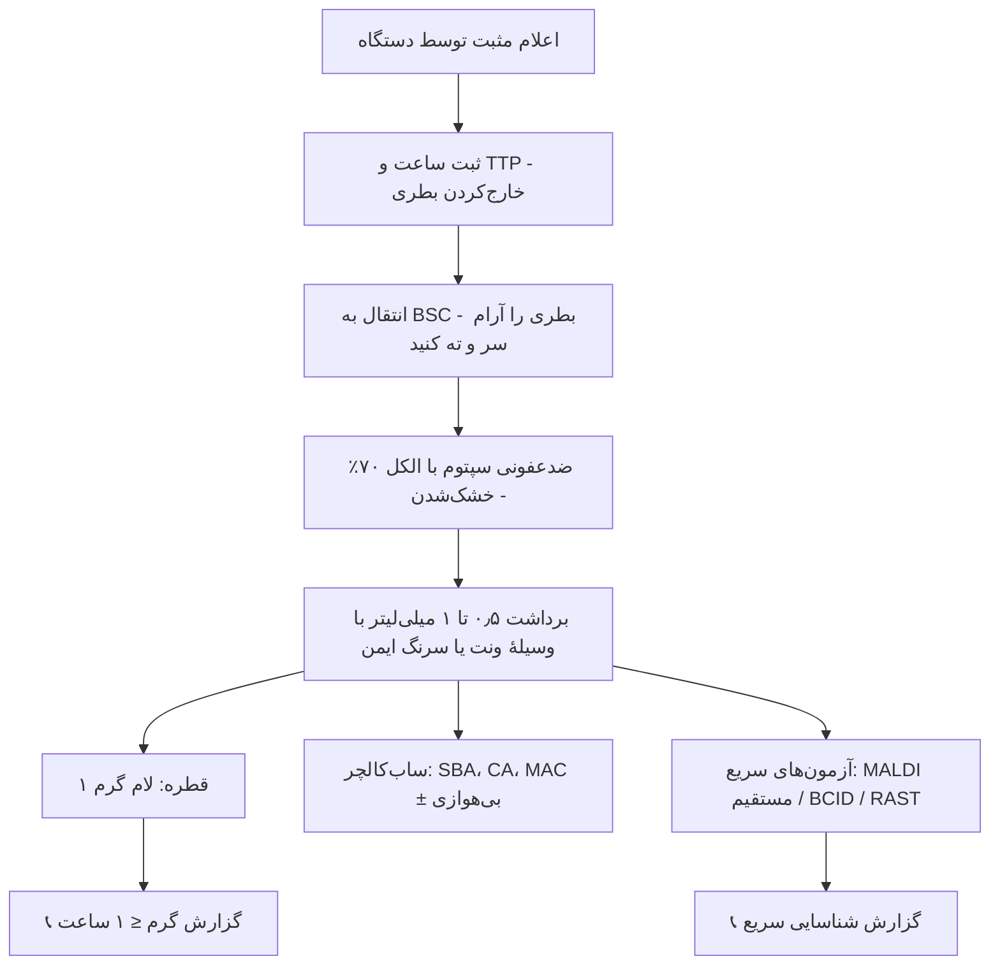

# پروتکل ۳: بررسی مستقیم بطری کشت خون مثبت

## ۱. هدف
ارائهٔ **اولین اطلاعات قابل‌اقدام** (گرم و مورفولوژی) ظرف **کمتر از ۱ ساعت** از اعلام مثبت‌شدن بطری. این اطلاعات تصمیم درمان تجربی را تغییر می‌دهد (مثلاً افزودن ونکومایسین برای کوکسی گرم مثبت خوشه‌ای).

> 🔬 گسترش خون محیطی (PBS) برای ارزیابی هماتولوژیک و انگل‌های خونی (مالاریا، بابزیا) خارج از دامنهٔ این ماژول باکتریایی است.

## ۲. پردازش بطری مثبت (در BSC کلاس II) ☣️

> ⚠️ **فشار مثبت بطری:** گاز تولیدی (به‌ویژه گرم منفی‌ها و کلستریدیوم‌ها) می‌تواند هنگام برداشت با سرنگ باعث **پاشیدن** شود. از **وسیلهٔ ونت/تخلیهٔ ایمن** (Venting/subculture unit) یا سرنگ با سوزن ایمن استفاده کنید. ⛔ هرگز سوزن را درپوش‌گذاری مجدد نکنید.

## ۳. رنگ‌آمیزی گرم

### ۳-۱) روش
1. یک قطره کوچک (حدود ۱۰ µL) را روی لام تمیز به قطر حدود ۱٫۵ cm پخش کنید (نازک).
2. خشک‌شدن در هوا (یا گرم‌کن لام ۶۰ °C).
3. **فیکس با متانول ۹۵–۱۰۰٪ به مدت ۱ تا ۲ دقیقه** (ارجح در خون: پروتئین‌ها و RBCها بهتر فیکس می‌شوند، زمینه تمیزتر است و ارگانیسم کمتر شسته می‌شود).
4. رنگ‌آمیزی استاندارد گرم. رنگ‌بری با الکل–استون **کوتاه** (چند ثانیه) یا الکل ۹۵٪ (۱۰–۳۰ ثانیه).
5. بررسی با روغن ۱۰۰۰×، حداقل ۲۰–۵۰ میدان. اگر بطری مثبت است ولی ارگانیسمی دیده نمی‌شود، کل لام را ببینید.

### ۳-۲) تفسیر و اقدام

| مورفولوژی | ارگانیسم‌های محتمل | آزمون سریع/ساب‌کالچر بعدی |
|---|---|---|
| **کوکسی گرم مثبت خوشه‌ای** | *S. aureus*، CoNS، *S. lugdunensis* (*Micrococcus*: تتراد) | BCID (*mecA*/*mecC*، MREJ) یا PBP2a؛ کوآگولاز لوله از براث ⚠️ (تفسیر با احتیاط) |
| **کوکسی گرم مثبت جفت یا زنجیره** | استرپتوکوک‌ها، *S. pneumoniae*، *Enterococcus* | حلالیت در صفرا از براث (پنوموکوک)؛ BCID (*vanA/B*)؛ آنتی‌ژن پنوموکوک |
| کوکسی گرم مثبت زنجیرهٔ بلند/«نوع رشته‌ای» در براث | استرپتوکوک‌های ویریدانس، **NVS** (*Abiotrophia*/*Granulicatella*) | ساب‌کالچر روی CA + خط *S. aureus* (اقماری) یا محیط حاوی پیریدوکسال |
| **باسیل گرم مثبت درشت، اسپوردار، گاه جعبه‌ای** | *Bacillus* (اغلب آلودگی)، *Clostridium* (*C. perfringens*: بدون اسپور، مستطیلی؛ *C. septicum*) | ساب‌کالچر بی‌هوازی؛ ☣️ *B. anthracis* را در نظر داشته باشید (غیرهمولیتیک، غیرمتحرک، کلنی «سر مدوزا») |
| **باسیل کوتاه گرم مثبت** | *Listeria*، *Corynebacterium* | کاتالاز، حرکت؛ ***Listeria* را هرگز «دیفتروئید» گزارش نکنید** |
| باسیل گرم مثبت شاخه‌دار | *Nocardia* (اسیدفست ضعیف)، *Actinomyces* | اسیدفست اصلاح‌شده |
| **باسیل گرم منفی** | Enterobacterales، *Pseudomonas*، *Acinetobacter*، *Stenotrophomonas* | BCID (ژن‌های ESBL/کارباپنماز)؛ RAST |
| باسیل گرم منفی کم‌رنگ، دوکی‌شکل/پلئومورف در بطری بی‌هوازی | *Bacteroides*، *Fusobacterium* | ساب‌کالچر بی‌هوازی |
| **کوکوباسیل گرم منفی بسیار ریز، کم‌رنگ، شبیه «شن»** | ☣️ ***Brucella*** (یا *Haemophilus*، *Acinetobacter*، HACEK) | **فوراً به BSC محدود کنید**؛ اطلاع به مسئول؛ ساب‌کالچر فقط در BSC؛ تست اوره‌آز سریع |
| باسیل گرم منفی خمیده، بال مرغ دریایی | *Campylobacter* (*C. fetus*)، *Helicobacter* (*H. cinaedi*) | ساب‌کالچر میکروآئروفیل |
| **دیپلوکوک گرم منفی** | *N. meningitidis* ☣️ (*Moraxella*، *Acinetobacter* کوکوباسیلی) | BSC؛ ساب‌کالچر CA |
| مخمر | کاندیدا (خارج از دامنه) | گزارش بحرانی 📞 |
| چند مورفولوژی | عفونت چندمیکروبی (منشأ شکمی، زخم) یا آلودگی | ساب‌کالچر کامل شامل بی‌هوازی |

### ۳-۳) دام‌های تفسیر گرم ⚠️
- *Acinetobacter* ممکن است **گرم مثبت** (رنگ‌بری ناکافی) یا کوکوئید دیده شود.
- *Bacillus* و *Clostridium* در کشت قدیمی ممکن است **گرم منفی یا متغیر** دیده شوند.
- پنوموکوک **اتولیزشده** ممکن است گرم منفی یا گرم متغیر دیده شود.
- مخمرها گرم مثبت درشت‌اند و گاه با کوکسی خوشه‌ای اشتباه می‌شوند (اندازه را مقایسه کنید).
- *Streptococcus* در براث ممکن است **کوکوباسیلی** (به‌ویژه NVS) دیده شود.

## ۴. بطری مثبت، گرم منفی («بدون ارگانیسم»)

| علت احتمالی | اقدام |
|---|---|
| تعداد کم ارگانیسم | **آکریدین اورنج** (حساس‌تر) + ساب‌کالچر کور روی SBA، CA و بی‌هوازی |
| ارگانیسم‌های ضعیف‌رنگ (*Brucella*، *Campylobacter*، *Legionella*، *Mycoplasma hominis*) | آکریدین اورنج؛ ساب‌کالچر CA + بی‌هوازی؛ انکوباسیون طولانی‌تر پلیت‌ها (۷۲ ساعت) |
| **مثبت کاذب دستگاه** (WBC بسیار بالا، حجم بیش از حد خون، گرم‌کردن پیش از بارگذاری) | ساب‌کالچر؛ بطری را دوباره در دستگاه بارگذاری کنید (طبق IFU به‌عنوان بطری جدید) تا پایان ۵ روز |
| ارگانیسم مرده (بیمار تحت درمان) | ساب‌کالچر؛ مولکولی (BCID) ممکن است DNA را نشان دهد |

> گزارش: «بطری کشت خون علامت مثبت داده است. در رنگ‌آمیزی گرم ارگانیسمی دیده نشد. کشت ادامه دارد.» (معمولاً بدون تماس تلفنی، مگر سیاست محلی)

## ۵. آکریدین اورنج
- رنگ فلورسنت DNA/RNA؛ باکتری‌ها **نارنجی** روی زمینهٔ سبز/زرد.
- حساس‌تر از گرم (حدود ۱۰⁴ CFU/mL در برابر ۱۰⁵). **واکنش گرم را نشان نمی‌دهد**.
- برای بطری‌های مثبت با گرم منفی، و غربالگری *Brucella* و *Campylobacter*.

## ۶. آزمون‌های سریع مستقیم از براث (فنوتیپی)

| آزمون | ارگانیسم | نکته |
|---|---|---|
| کوآگولاز لوله از براث | کوکسی خوشه‌ای | حساسیت متوسط؛ مثبت با ارزش است، منفی رد نمی‌کند. با روش‌های مولکولی جایگزین شده |
| PBP2a ایمونوکروماتوگرافی (از رسوب یا کلنی کوتاه‌مدت) | *S. aureus* | پیش‌بینی MRSA |
| حلالیت در صفرا (۰٫۵ mL براث + ۰٫۵ mL دئوکسی‌کولات ۱۰٪) | کوکسی جفتی گرم مثبت | شفاف‌شدن ← پنوموکوک |
| آنتی‌ژن پنوموکوک (ICT) روی براث | | |
| اکسیداز/اسپات ایندول روی رشد ۴–۶ ساعته | گرم منفی | |

## ۷. گزارش گرم
- 📞 **مقدار بحرانی:** هر گرم مثبت از بطری کشت خون (**اولین بطری مثبت هر بیمار در هر اپیزود**)
- محتوای گزارش:
  - بطری (هوازی/بی‌هوازی، ست، محل)
  - **TTP** (ساعت)
  - مورفولوژی
  - ⚠️ «شناسایی و آنتی‌بیوگرام در جریان است»
- نمونه: «کشت خون (ست ۱، هوازی، ورید محیطی) پس از ۱۴ ساعت مثبت شد. **کوکسی گرم مثبت خوشه‌ای**. شناسایی و آنتی‌بیوگرام در جریان است.»
- جزئیات فرایند بحرانی: [07_Reporting.md](07_Reporting.md)
