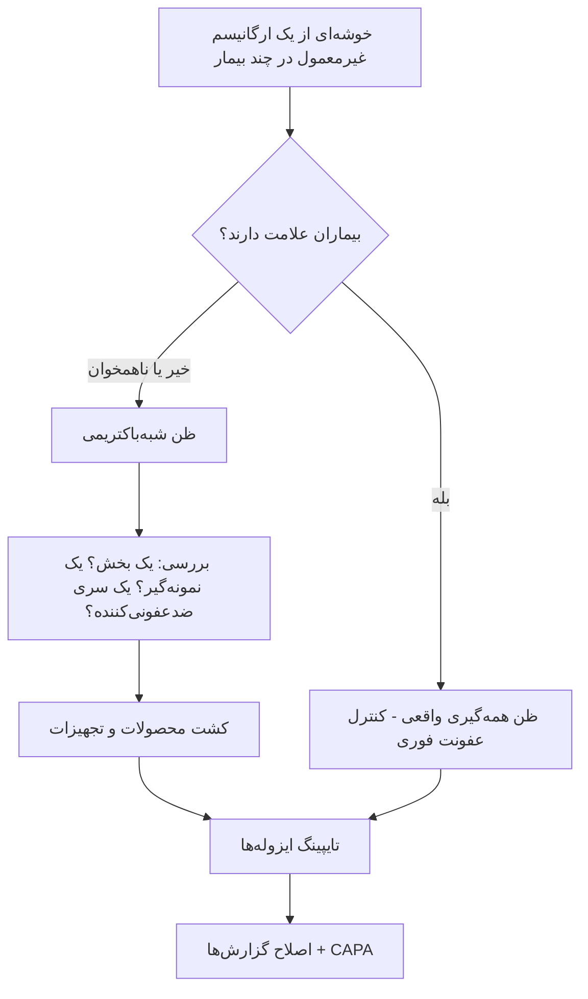

# پروتکل ۹: خطاهای رایج و عیب‌یابی در کشت خون

## ۱. خطاهای پیش‌آزمایشی

| خطا | پیامد | پیشگیری/اصلاح |
|---|---|---|
| **حجم کم خون** | منفی کاذب (هر mL کمتر ≈ ۳٪ بازده کمتر) | پایش وزن بطری، بازخورد بخش‌ها، خطوط مدرج روی بطری |
| **حجم بیش از حد** | مثبت کاذب دستگاه، کاهش خنثی‌سازی آنتی‌بیوتیک | آموزش؛ رعایت حداکثر IFU |
| **تک‌ست** | تفسیر CoNS غیرممکن؛ حساسیت پایین | سیاست «حداقل ۲ ست» در LIS (هشدار هنگام درخواست) |
| ضدعفونی ناکافی یا لمس محل پس از ضدعفونی | **آلودگی** | کیت آماده، ممیزی مشاهده‌ای |
| کلرهگزیدین خشک‌نشده / پوویدون آیوداین با زمان ناکافی | آلودگی | تأکید بر ۳۰ ثانیه (CHG) یا ۲ دقیقه (PVP-I) |
| عدم ضدعفونی سپتوم بطری | آلودگی | آموزش (سپتوم زیر درپوش استریل نیست) |
| نمونه از لاین/آنژیوکت تازه | آلودگی ۲ تا ۳ برابر | ونی‌پانکچر محیطی؛ کاتتر فقط برای CRBSI |
| نمونهٔ کاتتر بدون ست محیطی هم‌زمان | CRBSI قابل تفسیر نیست | آموزش؛ درخواست جفت در LIS |
| حجم نابرابر بطری‌های کاتتر و محیطی | DTP نامعتبر | |
| ثبت‌نکردن ساعت/محل | DTP و TTP غیرقابل‌تفسیر | فیلد اجباری |
| نمونه‌گیری پس از آنتی‌بیوتیک | منفی کاذب | نمونه پیش از دوز؛ بطری رزین‌دار |
| **پیش‌انکوباسیون بطری** در انکوباتور یا کنار بخاری | منفی کاذب در دستگاه پایش مداوم | ممنوعیت مکتوب |
| یخچال | آسیب ارگانیسم‌های حساس | |
| تأخیر بارگذاری | تأخیر TTP، منفی کاذب | پوشش ۲۴ ساعته؛ ساب‌کالچر کور در تأخیرهای طولانی |
| بارکد پوشیده با برچسب | خطای خوانش دستگاه | آموزش |

## ۲. خطاهای آزمایشی

| خطا | پیامد | اصلاح |
|---|---|---|
| تأخیر در برداشتن بطری مثبت (شب/تعطیل) | تأخیر درمان؛ اتولیز پنوموکوک | هشدار صوتی/پیامکی دستگاه؛ پوشش شیفت |
| **رنگ‌بری بیش از حد/ناکافی** | گزارش غلط گرم | QC روزانه؛ مقایسه با رنگ زمینه |
| گزارش *Listeria* یا *Corynebacterium* بیماری‌زا به‌عنوان «دیفتروئید آلوده» | درمان نشدن | شناسایی کامل در ≥ ۲ ست یا بیمار پرخطر |
| کوکسی زنجیره‌ای در گرم ولی **بدون رشد روی SBA** | از دست رفتن **NVS** (*Abiotrophia*/*Granulicatella*، اندوکاردیت) | CA + خط *S. aureus* یا محیط پیریدوکسال‌دار |
| گرم منفی ریز، کار روی میز باز | ☣️ مواجهه با بروسلا | قانون «کوکوباسیل ریز = BSC» |
| استفاده از سیستم شناسایی خودکار برای بروسلای مشکوک | شناسایی اشتباه (*Ochrobactrum*، *Psychrobacter*، *Moraxella*) + آئروسل | اوره‌آز سریع، اکسیداز؛ ارسال به مرجع |
| ساب‌کالچر نکردن بطری بی‌هوازی روی آگار بی‌هوازی | از دست رفتن *Bacteroides*/*Clostridium* | چک‌لیست ساب‌کالچر |
| کشت مخلوط نادیده‌گرفته‌شده | آنتی‌بیوگرام روی مخلوط ← نتیجهٔ غلط | خلوص کلنی؛ گرم کلنی |
| RAST/BCID روی کشت چندمیکروبی | نتیجهٔ غلط یا نسبت‌دادن ژن مقاومت به ارگانیسم اشتباه | گرم یکدست شرط RAST |
| **دیسک ونکومایسین برای *S. aureus*/CoNS** | نامعتبر (VISA را تشخیص نمی‌دهد) | MIC (BMD، گرادیان، خودکار تأییدشده) |
| دیسک کولیستین | نامعتبر | BMD |
| تفسیر پنوموکوک خون بیمار مننژیتی با نقاط برش غیرمننژیت | گزارش «حساس» غلط | انتخاب تشخیص بالینی در LIS |

## ۳. خطاهای پس‌آزمایشی

| خطا | پیامد | اصلاح |
|---|---|---|
| تأخیر یا عدم تماس گرم مثبت | تأخیر در درمان مؤثر | پایش TAT؛ سلسله‌مراتب |
| گزارش بدون TTP و بطری/ست | از دست رفتن اطلاعات تفسیری | قالب گزارش |
| گزارش آنتی‌بیوگرام برای CoNS تک‌ست | درمان غیرضروری (ونکومایسین) | سیاست مکتوب |
| گزارش همهٔ داروها (بدون Cascade) | استفادهٔ بی‌رویه از داروهای وسیع‌الطیف | گزارش انتخابی |
| سفالوسپورین «حساس» برای MRSA یا *Listeria* | درمان شکست می‌خورد | قوانین تخصصی LIS |
| گزارش سفتریاکسون «S» برای *Enterobacter* بدون تذکر AmpC | شکست درمان | جملهٔ تفسیری |
| عدم اطلاع به بهداشت (بروسلا/تیفوئید) | پیگیری اپیدمیولوژیک ناقص | چک‌لیست بیماری‌های واجب‌الگزارش |

## ۴. عیب‌یابی سیستم کشت خون

### ۴-۱) «مثبت کاذب دستگاه» زیاد
- WBC بالا (لوسمی) یا حجم خون بسیار زیاد ← متابولیسم سلولی تولید CO₂ می‌کند
- بطری‌های آسیب‌دیده یا سنسور معیوب
- ⇐ ساب‌کالچر همه؛ بررسی حجم؛ گزارش به سازنده در صورت خوشه

### ۴-۲) منفی کاذب (کشت منفی ولی پاتوژن در نمونهٔ دیگر/روش دیگر)
- پیش‌انکوباسیون، تأخیر، حجم کم، آنتی‌بیوتیک، ارگانیسم‌های مهارشده با SPS (*N. meningitidis*، *Gardnerella*، *Peptostreptococcus anaerobius*)، ارگانیسم‌های بسیار کندرشد
- ⇐ ساب‌کالچر انتهایی کور در موارد ظن بالا؛ PCR

### ۴-۳) شبه‌همه‌گیری (Pseudo-bacteremia)
- خوشه‌ای از یک ارگانیسم غیرمعمول (مثلاً *Burkholderia cepacia*، *Serratia*، *Bacillus*، *Ralstonia*، *Pseudomonas* محیطی) در بیماران متعدد بدون علامت
- منابع: **ضدعفونی‌کنندهٔ آلوده** (کلرهگزیدین آبی رقیق‌شده، بنزالکونیوم)، تجهیزات نمونه‌گیری، آب، دستگاه پردازش، سرنگ‌های بازمصرف
- ⇐ اطلاع به کنترل عفونت؛ تایپینگ مولکولی؛ کشت منابع محیطی

