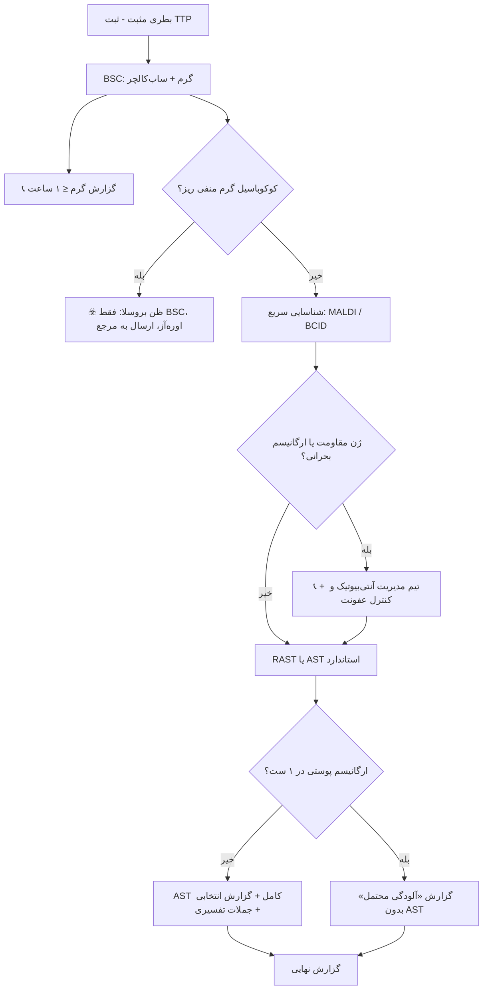

# جداول مقایسه‌ای استاندارد — کشت خون

## جدول ۱: تعداد ست و حجم بر اساس سناریو

| سناریو | ست‌ها | حجم کل (بزرگسال) | نکتهٔ کلیدی |
|---|---|---|---|
| سپسیس | ۲ | ۴۰ mL | پیش از آنتی‌بیوتیک، بدون تأخیر درمان |
| اندوکاردیت | ۳ | ۶۰ mL | فاصلهٔ زمانی در بیمار پایدار |
| CRBSI | ۱ کاتتر + ۱ محیطی | ۲ × ۲۰ mL | هم‌زمان، حجم برابر |
| نوتروپنی | ۲ (هر لومن + محیطی) | ۴۰ mL+ | |
| کودک ۱۵ kg | ۲ | ۲۰ mL | جدول وزنی |
| نوزاد ۳ kg | ۱ | ۱–۴ mL | حداقل ۱ mL |
| پیگیری *S. aureus* | ۱–۲ | | هر ۲۴–۴۸ ساعت |

## جدول ۲: ضدعفونی‌کننده‌ها

| ماده | زمان لازم | مزیت | عیب |
|---|---|---|---|
| CHG ۲٪ / IPA ۷۰٪ | ۳۰ ثانیه اسکراب + ۳۰ ثانیه خشک | سریع، اثر باقی‌مانده | احتیاط در نارس‌ها |
| تنتور ید | ۳۰ ثانیه | سریع | تحریک پوست؛ نیاز به پاک‌کردن |
| پوویدون آیوداین ۱۰٪ | ≥ ۱٫۵–۲ دقیقه | در دسترس | زمان طولانی ← آلودگی بیشتر در عمل |
| الکل ۷۰٪ تنها | — | — | برای پوست کافی نیست؛ برای **سپتوم** مناسب |

## جدول ۳: ارگانیسم‌ها — آلودگی یا واقعی؟

| ارگانیسم | ۱ ست از ۲ | ۲ از ۲ | در کاتتر/ایمپلنت |
|---|---|---|---|
| *S. aureus* | **واقعی** | واقعی | واقعی |
| CoNS | آلودگی محتمل | واقعی محتمل | جدی بگیرید |
| *S. lugdunensis* | **واقعی (مثل *S. aureus*)** | واقعی | واقعی |
| *Micrococcus* | آلودگی | معمولاً آلودگی | به‌ندرت واقعی |
| *Corynebacterium* | آلودگی | واقعی محتمل (*jeikeium*/*striatum*) | جدی بگیرید |
| *Bacillus* (غیر *anthracis*) | آلودگی | ممکن است واقعی (نوتروپنی/تزریقی) | جدی بگیرید |
| *C. acnes* | آلودگی | ممکن است واقعی | دریچه/شانت |
| ویریدانس | بینابینی | واقعی (اندوکاردیت/نوتروپنی) | |
| Enterobacterales، *Pseudomonas* | **واقعی** | واقعی | واقعی |
| *Brucella*، *Salmonella*، *Listeria* | **واقعی** | واقعی | واقعی |

## جدول ۴: روش‌های شناسایی و آنتی‌بیوگرام سریع

| روش | زمان | گستره | مقاومت | هزینه | محدودیت اصلی |
|---|---|---|---|---|---|
| گرم | کمتر از ۱ ساعت | همه | ❌ | خیلی کم | فقط مورفولوژی |
| MALDI مستقیم از براث | حدود ۱ ساعت | وسیع | ❌ | کم (با دستگاه) | چندمیکروبی، استرپتوکوک‌ها، بروسلا |
| MALDI از کشت ۴–۶ ساعته | ۴–۶ ساعت | وسیع | ❌ | کم | |
| BCID2 | حدود ۱ ساعت | ۴۳ هدف | ✅ ژن‌ها | زیاد | فقط اهداف پنل؛ ژن منفی ≠ حساس |
| EUCAST RAST | ۴–۸ ساعت | ۸ گونه | ✅ فنوتیپ | کم | فقط تک‌میکروبی؛ ATU |
| دیسک مستقیم CLSI | ۸–۱۸ ساعت | Enterobacterales، *P. aeruginosa* | ✅ | کم | داروهای محدود |
| روش استاندارد | ۲۴–۴۸ ساعت | همه | ✅ | کم | کند |

## جدول ۵: تفسیر ژن‌های مقاومت (BCID) ← انتخاب دارو

| ژن | معنی | داروی محتمل مؤثر | داروی بی‌اثر |
|---|---|---|---|
| *mecA/C* + *S. aureus* | MRSA | ونکومایسین، داپتومایسین | همهٔ بتالاکتام‌ها (جز سفتارولین) |
| *vanA/B* | VRE | لینزولید، داپتومایسین | ونکومایسین |
| CTX-M | ESBL | کارباپنم | سفالوسپورین نسل ۳، (پیپ–تازو در باکتریمی) |
| KPC | کارباپنماز کلاس A | سفتازیدیم–اویباکتام، مروپنم–واباباکتام، ایمی‌پنم–رلباکتام | کارباپنم‌ها |
| OXA-48-like | کارباپنماز کلاس D | سفتازیدیم–اویباکتام | کارباپنم‌ها (اغلب)، مروپنم–واباباکتام، ایمی‌پنم–رلباکتام |
| NDM/VIM/IMP | متالوبتالاکتاماز | سفتازیدیم–اویباکتام **+ آزترئونام**، سفیدروکول، (آزترئونام–اویباکتام) | همهٔ بتالاکتام‌ها جز آزترئونام (که اغلب با ESBL هم‌زمان خنثی می‌شود) |

## جدول ۶: مقایسهٔ CLSI و EUCAST (نکات کشت خون)

| موضوع | CLSI | EUCAST |
|---|---|---|
| «I» | بینابینی | حساس با دوز بالا |
| آنتی‌بیوگرام سریع | دیسک مستقیم (Enterobacterales، *P. aeruginosa*) | RAST (۸ گونه، ۴–۸ ساعت) |
| آمینوگلیکوزید در باکتریمی | نقاط برش معمول (کاهش‌یافته از ۲۰۲۳) | در پرانتز (فقط ترکیبی) |
| *P. aeruginosa* و بتالاکتام‌ها | S/I/R معمول | جمعیت وحشی اغلب «I» |
| کولیستین | فقط I/R | S/R |
| سفپیم Enterobacterales | SDD | I |

## فلوچارت جامع: از بطری مثبت تا گزارش نهایی

