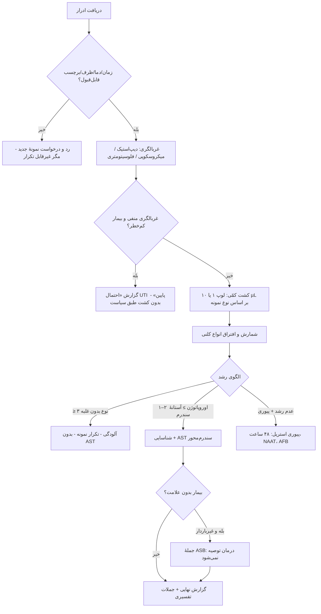

# جداول مقایسه‌ای استاندارد — میکروب‌شناسی ادرار

## جدول ۱: انواع نمونه

| نمونه | آلودگی | لوپ | آستانهٔ کلیدی | پذیرش |
|---|---|---|---|---|
| MSU | متوسط | ۱ µL | بر اساس سندرم (۱۰³–۱۰⁵) | ✅ |
| کاتتر یک‌بار مصرف | کم | ۱۰ µL | ≥ ۱۰³ (کودک: ≥ ۵۰٬۰۰۰ + پیوری) | ✅ |
| پورت کاتتر دائم | — | ۱۰ µL | CAUTI ≥ ۱۰³ | ✅ |
| SPA | حداقل | ۱۰ µL | هر رشد | ✅ |
| کیسهٔ کودک | بسیار زیاد | ۱ µL | منفی معنادار؛ مثبت نیازمند تأیید | ⚠️ فقط غربالگری |
| کیسهٔ کاتتر | — | — | — | ⛔ |
| نوک کاتتر Foley | — | — | — | ⛔ |
| ادرار ۲۴ ساعته | — | — | — | ⛔ |
| ادرار اول جریان | — | — | فقط NAAT | ⛔ برای کشت |

## جدول ۲: دیپ‌استیک و میکروسکوپی

| الگو | دیپ‌استیک | میکروسکوپی | تفسیر | اقدام |
|---|---|---|---|---|
| UTI محتمل | LE+، نیتریت+ | WBC ≥ ۱۰، باکتری فراوان | التهاب + باکتریوری | کشت + AST |
| UTI با نیتریت منفی | LE+، نیتریت– | WBC ↑، باکتری | انتروکوک، *S. saprophyticus*، ادرار رقیق | کشت |
| پیوری استریل | LE+، نیتریت– | WBC ↑، باکتری – | علل غیرروتین | کشت ۴۸ ساعت، NAAT، AFB |
| ASB | LE–، نیتریت+ | WBC طبیعی | باکتریوری بدون التهاب | فقط در بارداری/پیش از جراحی |
| آلودگی | متغیر | سلول سنگفرشی فراوان، باکتری مخلوط | فلور | تکرار نمونه، بدون AST |
| هماچوری غیرعفونی | خون+++، LE– | RBC فراوان | سنگ، تومور، GN | ارجاع؛ کشت روتین لازم نیست |

## جدول ۳: محاسبهٔ CFU/mL

| کلنی | لوپ ۱ µL | لوپ ۱۰ µL |
|---|---|---|
| ۱ | ۱۰³ | ۱۰² |
| ۱۰ | ۱۰⁴ | ۱۰³ |
| ۵۰ | ۵ × ۱۰⁴ | ۵ × ۱۰³ |
| ۱۰۰ | ۱۰⁵ | ۱۰⁴ |
| > ۳۰۰ | > ۱۰⁵ | > ۱۰⁴ |

## جدول ۴: آستانه‌های تفسیر

| سندرم/بیمار | نمونه | CFU/mL |
|---|---|---|
| سیستیت در زن | MSU | ≥ ۱۰³ |
| پیلونفریت | MSU | ≥ ۱۰⁴ |
| UTI مرد | MSU | ≥ ۱۰³ |
| ASB زن | MSU × ۲ | ≥ ۱۰⁵ |
| ASB مرد | MSU | ≥ ۱۰⁵ |
| CAUTI | کاتتر | ≥ ۱۰³ |
| کودک ۲–۲۴ ماه | کاتتر/SPA | ≥ ۵۰٬۰۰۰ + پیوری |
| SPA | SPA | هر رشد |
| GBS در بارداری | MSU | ≥ ۱۰⁴ (یا هر شمارش) |

## جدول ۵: شناسایی سریع اوروپاتوژن‌ها

| ارگانیسم | گرم | لاکتوز | ایندول | اکسیداز | کاتالاز | آزمون کلیدی |
|---|---|---|---|---|---|---|
| *E. coli* | GNB | + | **+** | – | + | اسپات ایندول |
| *K. pneumoniae* | GNB | + | – | – | + | موکوئید، غیرمتحرک |
| *P. mirabilis* | GNB | – | – | – | + | swarming، اوره‌آز سریع |
| *P. aeruginosa* | GNB | – | – | **+** | + | رنگدانه، بو |
| *Enterococcus* | GPC | — | — | — | **–** | PYR + |
| *S. saprophyticus* | GPC | — | — | — | + | **نووبیوسین R** |
| *S. aureus* | GPC | — | — | — | + | کوآگولاز + |
| GBS | GPC | — | — | — | – | CAMP + |
| *A. urinae* | GPC (تتراد) | — | — | — | **–** | LAP +، PYR – |

## جدول ۶: داروهای ادراری — کجا گزارش شوند؟

| دارو | سیستیت | پیلونفریت | پروستاتیت | باکتریمی | مقاومت ذاتی مهم |
|---|---|---|---|---|---|
| نیتروفورانتوئین | ✅ | ❌ | ❌ | ❌ | *Proteus*، *Morganella*، *Providencia*، *P. aeruginosa* |
| فسفومایسین خوراکی | ✅ (*E. coli*) | ❌ | ❌ | ❌ | *S. saprophyticus*، *Acinetobacter* |
| TMP-SMX | ✅ | ✅ | ✅ | ✅ | *P. aeruginosa*، *Enterococcus* |
| فلوروکینولون | ⚠️ (نه خط اول) | ✅ | ✅ | ✅ | |
| سفالوسپورین خوراکی (جانشین سفازولین) | ✅ | ⚠️ | ❌ | ❌ | *Enterococcus*، AmpC |
| آمینوگلیکوزید | — | ✅ | ⚠️ | ⚠️ (ترکیبی) | |
| کارباپنم | ردیف ۲ | ✅ (ESBL) | ✅ | ✅ | *S. maltophilia* |

## فلوچارت جامع: نمونهٔ ادرار

