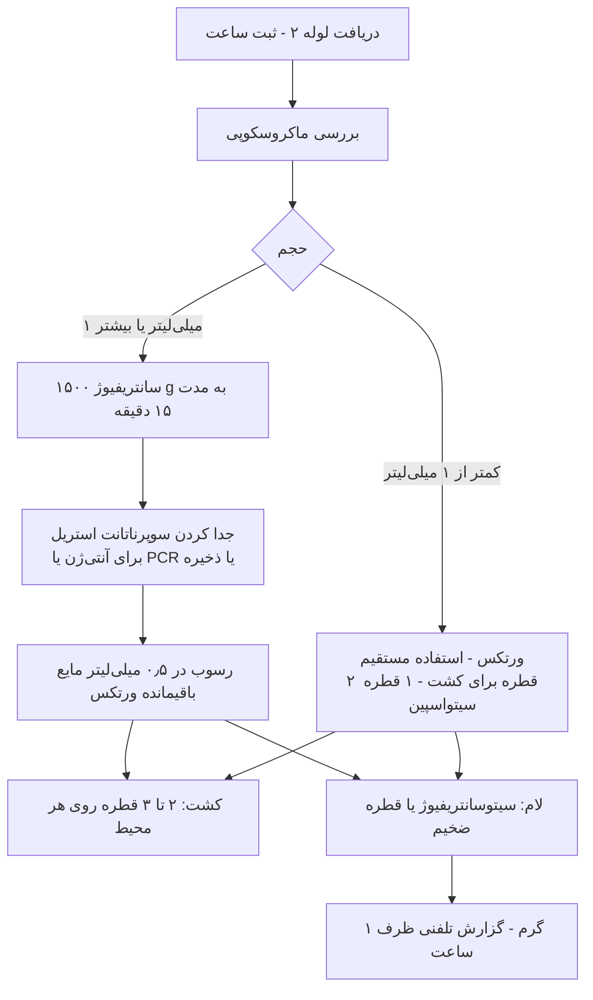

# پروتکل ۳: بررسی مستقیم CSF

## ۱. هدف
ارائهٔ **سریع‌ترین شواهد میکروبیولوژیک** (ظرف کمتر از ۱ ساعت) برای هدایت درمان، از طریق:
- ظاهر نمونه
- رنگ‌آمیزی گرم
- شمارش سلولی
- آنتی‌ژن‌های سریع

## ۲. ترتیب کار در زیر کابینت ایمنی زیستی (BSC)

> ⚠️ **کشت قبل از لام:** اول محیط‌ها را تلقیح کنید، بعد لام تهیه کنید. این کار از آلوده‌شدن باقیماندهٔ نمونه با پیپت یا لام جلوگیری می‌کند.

## ۳. بررسی ماکروسکوپی

| ظاهر | تفسیر احتمالی |
|---|---|
| شفاف و بی‌رنگ | طبیعی؛ مننژیت ویروسی؛ اوایل مننژیت باکتریایی؛ لیستریا یا TB (با شمارش پایین) |
| کدر (Turbid) | معمولاً WBC بیش از حدود ۲۰۰/µL یا باکتری فراوان |
| چرکی | مننژیت باکتریایی شدید |
| خون‌آلود | LP تروماتیک یا SAH |
| زانتوکرومی (زرد پس از سانتریفیوژ) | SAH (بیش از حدود ۱۲ ساعت)، پروتئین بسیار بالا (بیش از ۱۵۰ mg/dL)، ایکتر |
| لخته یا تار عنکبوت (Pellicle) | پروتئین بالا؛ **کلاسیک در مننژیت سلی** ← لخته را برای AFB رنگ کنید |

> 🔬 **پیشرفته — تفکیک LP تروماتیک از SAH:** کاهش تدریجی RBC از لولهٔ ۱ به ۴ به نفع تروما است، ولی قطعی نیست. زانتوکرومی در سوپرناتانت به نفع SAH است (پس از چند ساعت تشکیل می‌شود). برای اصلاح WBC در LP تروماتیک: به‌ازای هر حدود ۷۰۰ تا ۱۰۰۰ RBC/µL، یک WBC کسر کنید (فقط تقریبی).

## ۴. سانتریفیوژ و تهیهٔ رسوب

| پارامتر | استاندارد |
|---|---|
| سرعت | **۱۵۰۰ × g** (نه بیشتر از حدود ۳۰۰۰ × g؛ سرعت بالا به سلول‌ها و مورفولوژی آسیب می‌زند) |
| زمان | ۱۵ دقیقه |
| سانتریفیوژ | **درپوش‌دار** (Sealed buckets/aerosol-tight) ☣️ |
| حجم باقیمانده | حدود ۰٫۵ mL سوپرناتانت برای سوسپانسیون مجدد رسوب نگه دارید |
| سوپرناتانت | در لولهٔ استریل جدا کنید (برای آنتی‌ژن، PCR یا ذخیره در ۷۰– °C) |

### سیتوسانتریفیوژ (Cytospin)
- مقدار: ۰٫۱ تا ۰٫۲ mL از رسوب یا CSF ورتکس‌شده
- تنظیم معمول: ۷۰۰ تا ۱۰۰۰ دور در دقیقه (حدود ۱۰۰–۱۵۰ × g) به مدت ۵ تا ۱۰ دقیقه (طبق دستگاه)
- **حساسیت گرم را تا حدود ۱۰۰ برابر** نسبت به لام از CSF سانتریفیوژنشده افزایش می‌دهد
- ناحیهٔ کوچک و متمرکز ← بررسی کامل در زمان کمتر

> ⚠️ اگر سیتوسانتریفیوژ ندارید: ۱ تا ۲ قطره از رسوب را روی لام **بدون پخش‌کردن** بگذارید (قطرهٔ ضخیم)، بگذارید خشک شود و قطره دوم را روی همان نقطه اضافه کنید.

## ۵. رنگ‌آمیزی گرم

### ۵-۱) روش
1. لام را در هوا خشک کنید. **فیکس با متانول** (۱ تا ۲ دقیقه) بر فیکس حرارتی ارجح است (مورفولوژی بهتر سلول و جداشدن کمتر).
2. رنگ‌آمیزی استاندارد گرم. رنگ‌بری را **کنترل‌شده** انجام دهید.
3. بررسی: ابتدا درشت‌نمایی ۱۰۰× برای یافتن نواحی سلولی، سپس روغن ۱۰۰۰×.
4. **حداقل ۱۰ دقیقه یا کل ناحیهٔ سیتواسپین** را بررسی کنید، پیش از گزارش «باکتری دیده نشد».

### ۵-۲) تفسیر مورفولوژی

| یافته | پاتوژن محتمل | نکته |
|---|---|---|
| دیپلوکوک گرم مثبت نیزه‌ای (لانست)، گاه با هالهٔ کپسول | *S. pneumoniae* | در اثر اتولیز یا آنتی‌بیوتیک ممکن است **گرم متغیر یا منفی** دیده شود |
| دیپلوکوک گرم منفی لوبیایی، داخل یا خارج PMN | *N. meningitidis* | |
| کوکوباسیل گرم منفی کوچک و پلئومورف | *H. influenzae* | کم‌رنگ؛ با سافرانین ضعیف به‌راحتی دیده نمی‌شود ← **کاربول فوشین ۰٫۱–۰٫۳٪ به‌جای سافرانین** |
| باسیل کوتاه گرم مثبت، گاه کوکوباسیل یا در زنجیرهٔ کوتاه | *L. monocytogenes* | ⚠️ با دیفتروئید، پنوموکوک یا استرپتوکوک اشتباه می‌شود؛ اغلب تعداد بسیار کم یا منفی |
| کوکسی گرم مثبت در زنجیره یا جفت | GBS (نوزاد)، سایر استرپتوکوک‌ها | |
| کوکسی گرم مثبت خوشه‌ای | *S. aureus* یا CoNS | شانت یا جراحی |
| باسیل گرم منفی متوسط | Enterobacterales، *Pseudomonas*، *Acinetobacter* | نوزاد، جراحی؛ *Acinetobacter* گاه کوکوباسیل و شبیه نایسریا |
| باسیل گرم مثبت پلئومورف (شانت) | *Cutibacterium acnes* یا دیفتروئید | |

### ۵-۳) عملکرد

| شرایط | حساسیت تقریبی گرم |
|---|---|
| بدون آنتی‌بیوتیک قبلی | ۶۰–۹۰٪ (اختصاصیت بیش از ۹۷٪) |
| پنوموکوک | حدود ۹۰٪ |
| مننگوکوک | حدود ۷۰–۹۰٪ |
| *L. monocytogenes* | **حدود ۳۰–۳۵٪** |
| پس از آنتی‌بیوتیک | حدود ۲۰–۵۰٪ کاهش |
| تعداد باکتری ≤ ۱۰³ CFU/mL | حدود ۲۵٪ |
| تعداد باکتری بیش از ۱۰⁵ CFU/mL | حدود ۹۵٪ |

> 🔬 **پیشرفته — مثبت کاذب گرم:** باکتری مرده در محلول‌های رنگ یا آب آلوده، لوله‌های غیراستریل، رسوب رنگ (شبیه کوکسی گرم مثبت)، و لام‌های مصرف‌شده می‌توانند باعث مثبت کاذب شوند. **وقتی گرم مثبت است ولی کشت و PCR منفی و سلول‌ها طبیعی‌اند**، ریشه‌یابی کنید (فایل [09_Troubleshooting.md](09_Troubleshooting.md)).

### ۵-۴) گزارش گرم
گزارش شامل این موارد است:
1. **سلول‌ها:** PMN و سلول تک‌هسته‌ای به‌صورت نیمه‌کمّی (نادر/کم/متوسط/فراوان)
2. **ارگانیسم:** مورفولوژی، بدون نام‌گذاری گونه
3. **فراوانی** ارگانیسم

نمونه: «PMN فراوان. دیپلوکوک‌های گرم منفی داخل‌سلولی متعدد دیده شد.»
- ⛔ ننویسید «نایسریا مننژیتیدیس». فقط مورفولوژی را گزارش کنید.
- **هر نتیجهٔ مثبت گرم در CSF، مقدار بحرانی است** 📞 (فایل [07_Reporting.md](07_Reporting.md)).

## ۶. شمارش سلولی (در هماتولوژی یا میکروب‌شناسی، طبق سازمان آزمایشگاه)
- **لام نئوبار** یا شمارشگر خودکار تأییدشده برای مایعات بدن. در شمارش‌های پایین، روش دستی معتبرتر است.
- افتراق در **لام سیتوسانتریفیوژ با رنگ رایت–گیمسا** (نه در لام گرم).
- بعد از ۱ ساعت، شمارش به‌علت لیز سلول **کاذباً پایین** می‌شود.

| گروه | WBC طبیعی (سلول در µL) |
|---|---|
| بزرگسال | ۰–۵ (لنفوسیت و مونوسیت) |
| نوزاد ترم | تا حدود ۱۵–۲۰ (گاه تا ۳۰ در نارس) |
| ۱ تا ۲ ماهه | تا حدود ۱۰ |

## ۷. رنگ‌آمیزی‌های تکمیلی

| رنگ | اندیکاسیون | نکته |
|---|---|---|
| **زیل–نلسون / کینیون** | ظن TB | حساسیت در CSF پایین (کمتر از ۲۰٪ در روش معمول)؛ با **حجم زیاد (≥ ۱۰ mL)** و بررسی طولانی (۳۰ دقیقه) و رنگ‌آمیزی لخته افزایش می‌یابد |
| آکریدین اورنج | گرم مشکوک یا منفی با سلول بالا | حساس‌تر از گرم برای باکتری‌های کم‌تعداد؛ نیاز به میکروسکوپ فلورسنت |
| مرکب چین (India ink) | کریپتوکوک (خارج از دامنه) | آنتی‌ژن کریپتوکوک (CrAg) بسیار حساس‌تر است |

## ۸. تست‌های آنتی‌ژنی سریع

| تست | جایگاه کنونی |
|---|---|
| **آگلوتیناسیون لاتکس باکتریایی** (پنوموکوک، مننگوکوک A/B/C/Y/W135، Hib، GBS، *E. coli* K1) | **برای استفادهٔ روتین توصیه نمی‌شود** (IDSA). حساسیت متغیر (۵۰–۱۰۰٪)، مثبت کاذب، و اثر کم بر درمان. فقط وقتی گرم منفی و بیمار آنتی‌بیوتیک گرفته و PCR در دسترس نیست، با احتیاط |
| **آنتی‌ژن ایمونوکروماتوگرافی پنوموکوک در CSF** (C-polysaccharide) | حساسیت حدود ۹۵–۱۰۰٪ و اختصاصیت بالا در CSF؛ مفید در مننژیت نیمه‌درمان. ⚠️ در ادرار کودکان به‌علت کلونیزاسیون نازوفارنکس اختصاصی نیست |

> ⚠️ نتیجهٔ آنتی‌ژن منفی، مننژیت باکتریایی را رد نمی‌کند. نتیجهٔ مثبت هم جایگزین کشت (برای آنتی‌بیوگرام) نیست.
