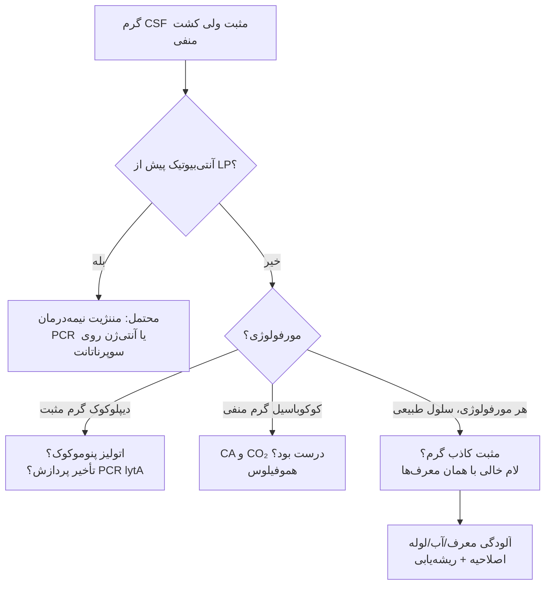

# پروتکل ۹: خطاهای رایج و عیب‌یابی در میکروب‌شناسی CSF

## ۱. خطاهای پیش‌آزمایشی

| خطا | پیامد | پیشگیری/اصلاح |
|---|---|---|
| CSF کشت در یخچال | منفی کاذب برای مننگوکوک و هموفیلوس | آموزش بخش‌ها؛ برچسب «یخچال ممنوع» روی ست LP؛ قید در گزارش |
| تأخیر در انتقال | اتولیز پنوموکوک؛ لیز سلول ← شمارش کاذب پایین | انتقال دستی فوری؛ پایش TAT |
| LP پس از آنتی‌بیوتیک بدون ثبت زمان | تفسیر غلط کشت منفی | فیلد اجباری «زمان آنتی‌بیوتیک» در درخواست |
| حجم کم برای AFB | منفی کاذب TB | درخواست صریح ≥ ۵–۱۰ mL؛ آموزش |
| ارسال لولهٔ ۱ (خون‌آلود) برای کشت | آلودگی پوستی | آموزش ترتیب لوله‌ها |
| نمونه از کیسهٔ درن EVD | آلودگی و رشد ثانویه | پروتکل نمونه‌گیری از پورت |
| ضدعفونی ناکافی / ماسک‌نزدن انجام‌دهنده | آلودگی؛ مننژیت ایاتروژنیک استرپتوکوک دهانی | پروتکل استاندارد LP |

## ۲. خطاهای آزمایشی

### ۲-۱) لام گرم
| خطا | پیامد | اصلاح |
|---|---|---|
| لام از CSF سانتریفیوژنشده یا لام نازک | منفی کاذب | سیتوسانتریفیوژ یا قطرهٔ ضخیم |
| **رنگ‌بری بیش از حد** | پنوموکوک گرم منفی دیده شود ← اشتباه با مننگوکوک | QC روزانه؛ زمان رنگ‌بری کنترل‌شده؛ مقایسه با رنگ‌پذیری PMN (هسته‌ها باید صورتی باشند، نه بنفش) |
| رنگ‌بری ناکافی | گرم منفی‌ها بنفش؛ رسوب کریستال ویوله شبیه کوکسی | فیلتر رنگ؛ بررسی سلول‌ها (هستهٔ بنفش = رنگ‌بری ناکافی) |
| سافرانین ضعیف | *H. influenzae* دیده نشود | کاربول فوشین به‌جای سافرانین |
| بررسی ناکافی (کمتر از ۱۰ دقیقه) | منفی کاذب | بررسی کل ناحیهٔ سیتواسپین |
| **معرف یا آب آلوده** | **مثبت کاذب** (باکتری‌های مرده) | QC لام خالی؛ آب استریل؛ تعویض معرف |
| اشتباه *Listeria* با دیفتروئید/پنوموکوک | تأخیر در پوشش آمپی‌سیلین | هرگز «دیفتروئید» در CSF را بدون شناسایی کامل رد نکنید؛ گزارش «باسیل گرم مثبت» |
| *Acinetobacter* کوکوباسیلی شبیه نایسریا | خطای تشخیص | در زمینهٔ پس از جراحی، اکسیداز روی کلنی |

### ۲-۲) کشت
| خطا | پیامد | اصلاح |
|---|---|---|
| حذف CA یا انکوباسیون بدون CO₂ | هموفیلوس و مننگوکوک رشد نکنند | پنل محیط ثابت؛ پایش CO₂ |
| دور ریختن پلیت‌ها پیش از ۷۲ ساعت | از دست رفتن ارگانیسم‌های کندرشد | سیاست مکتوب |
| انکوباسیون کوتاه نمونهٔ شانت | از دست رفتن *C. acnes* | ۱۰–۱۴ روز برای براث/بی‌هوازی |
| استفاده از براث در همهٔ CSFها | افزایش «آلودگی» و درمان غیرضروری | فقط با اندیکاسیون |
| اشتباه *Listeria* با GBS (هر دو بتا همولیز باریک) | گزارش غلط و درمان ناکافی | **کاتالاز** (لیستریا +)، حرکت، اسکولین |
| اشتباه *S. pneumoniae* با *S. mitis/oralis* در MALDI-TOF | گزارش غلط | حلالیت در صفرا |

### ۲-۳) آنتی‌بیوگرام
| خطا | پیامد | اصلاح |
|---|---|---|
| استفاده از **دیسک اکساسیلین به‌تنهایی** برای پنوموکوک CSF | گزارش ناکافی؛ عدم تعیین سطح مقاومت به سفتریاکسون | **MIC پنی‌سیلین و سفتریاکسون/سفوتاکسیم (و مروپنم)** |
| استفاده از نقاط برش **غیرمننژیت** برای CSF | گزارش «حساس» غلط | انتخاب صحیح نقطهٔ برش در LIS |
| دیسک دیفیوژن برای *Listeria* (در CLSI) | نتیجهٔ نامعتبر | MIC براث (CLSI M45) یا دیسک طبق EUCAST |
| گزارش سفالوسپورین برای لیستریا | درمان غلط | قانون LIS: سرکوب سفالوسپورین‌ها |
| گزارش داروهای خوراکی، ماکرولید، کلیندامایسین، تتراسایکلین، سفالوسپورین نسل ۱–۲ برای CSF | درمان نامناسب | قانون LIS: سرکوب برای منبع CSF |
| دیسک دیفیوژن کولیستین | نتیجهٔ نامعتبر | فقط براث میکرودایلوشن |

## ۳. خطاهای پس‌آزمایشی

| خطا | پیامد | اصلاح |
|---|---|---|
| تأخیر در اطلاع گرم مثبت | تأخیر درمان، افزایش مرگ | پروتکل 📞 و پایش TAT |
| اطلاع بدون بازخوانی | اشتباه شنیداری | Read-back الزامی |
| گزارش «نایسریا مننژیتیدیس» از روی گرم | خطا اگر پنوموکوک رنگ‌بری‌شده باشد | فقط مورفولوژی |
| عدم گزارش به بهداشت | پروفیلاکسی تماس‌ها انجام نشود | چک‌لیست گزارش بیماری واجب‌الگزارش |
| گزارش کشت منفی بدون قید آنتی‌بیوتیک قبلی | رد اشتباه مننژیت | جملهٔ استاندارد |

## ۴. الگوریتم ریشه‌یابی «گرم مثبت، کشت منفی»

