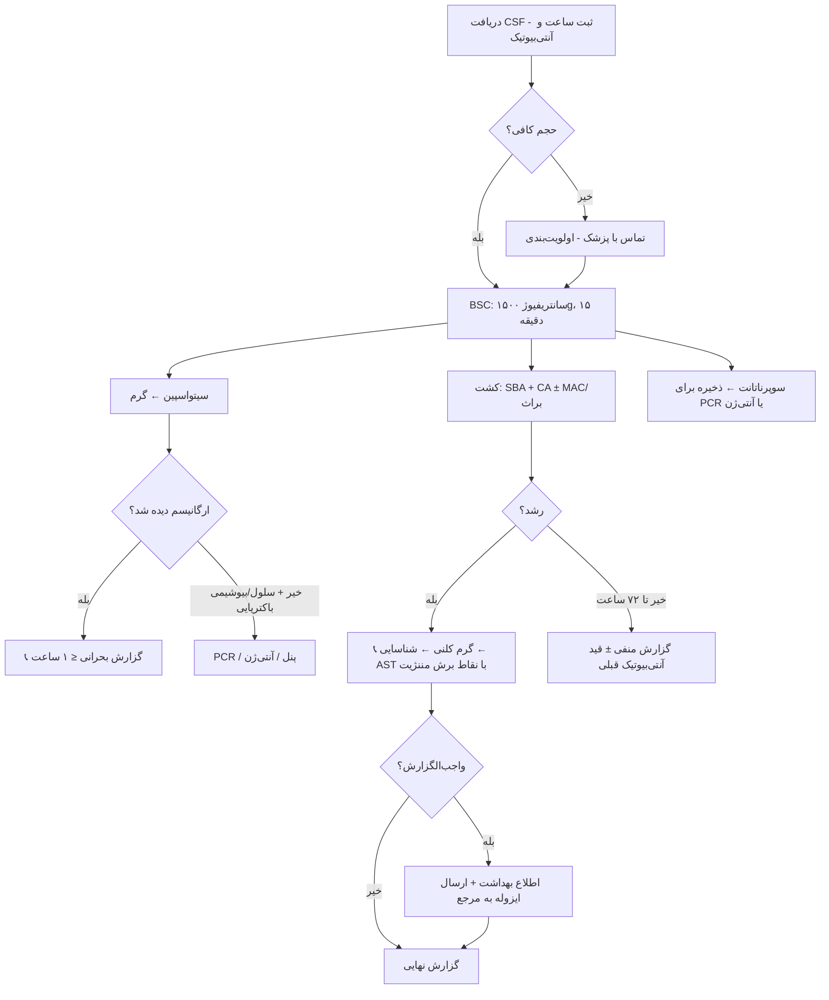

# جداول مقایسه‌ای استاندارد — CSF

## جدول ۱: الگوی CSF در انواع مننژیت

| پارامتر | طبیعی | باکتریایی | ویروسی | سلی | لیستریا (دام) | نیمه‌درمان |
|---|---|---|---|---|---|---|
| ظاهر | شفاف | کدر/چرکی | شفاف | شفاف/لختهٔ تار عنکبوتی | شفاف تا کدر | متغیر |
| WBC/µL | ۰–۵ | ۱۰۰۰–۵۰۰۰ | ۵۰–۱۰۰۰ | ۵۰–۵۰۰ | ۱۰۰–۱۰۰۰ | ↑ |
| سلول غالب | L | **N** | L | L | **مخلوط/L** | N یا L |
| گلوکز CSF/خون | ≥ ۰٫۶ | **≤ ۰٫۴** | طبیعی | پایین | اغلب طبیعی | ممکن است طبیعی شود |
| پروتئین mg/dL | ۱۵–۴۵ | ۱۰۰–۵۰۰ | کمتر از ۱۰۰ | **۱۰۰–۵۰۰+** | ↑ | ↑ |
| لاکتات mmol/L | کمتر از ۲ | **بیش از ۳٫۵–۴** | کمتر از ۳٫۵ | ↑ | ↑ | کاهش‌یافته |
| گرم | – | ۶۰–۹۰٪ + | – | – | **حدود ۳۰٪ +** | ↓↓ |
| کشت | – | ۷۰–۹۰٪ + | – | هفته‌ها | + | ↓↓↓ |
| بهترین تست تکمیلی | — | PCR | PCR انتروویروس/HSV | Xpert Ultra، کشت AFB | کشت خون | **PCR، آنتی‌ژن پنوموکوک** |

## جدول ۲: شناسایی سریع پاتوژن‌های اصلی

| ویژگی | *S. pneumoniae* | *N. meningitidis* | *H. influenzae* | *L. monocytogenes* | GBS | *E. coli* |
|---|---|---|---|---|---|---|
| گرم | GPDC نیزه‌ای | GNDC لوبیایی | GN کوکوباسیل | GPB کوتاه | GPC زنجیره | GNB |
| رشد روی SBA | ✅ α | ✅ | ❌ (فقط اقماری) | ✅ β باریک | ✅ β باریک | ✅ |
| رشد روی CA | ✅ | ✅ | ✅ | ✅ | ✅ | ✅ |
| کاتالاز | – | + | + | **+** | – | + |
| اکسیداز | — | **+** | + | – | — | – |
| آزمون کلیدی | اپتوچین S، صفرا + | گلوکز+/مالتوز+، GGT + | X+V | حرکت چرخشی، اسکولین +، CAMP + | CAMP +، هیپورات + | لاکتوز +، ایندول + |
| PCR هدف | *lytA* | *sodC*/*ctrA* | *hpd* | *hly* | *cfb* | K1: *neuC* |
| BSL | 2 | **2 + BSC؛ اقدامات 3** | 2 | 2 | 2 | 2 |
| واجب‌الگزارش | طبق دستورالعمل | **بله** | **بله (Hib)** | طبق دستورالعمل | — | — |

## جدول ۳: مقایسهٔ روش‌های تشخیصی

| روش | زمان | حساسیت | اختصاصیت | اثر آنتی‌بیوتیک قبلی | آنتی‌بیوگرام | هزینه |
|---|---|---|---|---|---|---|
| گرم (سیتواسپین) | کمتر از ۱ ساعت | ۶۰–۹۰٪ | بیش از ۹۷٪ | ↓ متوسط | ❌ | کم |
| کشت | ۱–۳ روز | ۷۰–۹۰٪ | ≈ ۱۰۰٪ | **↓↓↓ شدید** | ✅ | کم |
| لاتکس | ۱۵ دقیقه | ۵۰–۱۰۰٪ | متغیر | ↓ کم | ❌ | متوسط |
| آنتی‌ژن پنوموکوک (ICT) در CSF | ۱۵ دقیقه | حدود ۹۵٪ | بالا | ↓ کم | ❌ | متوسط |
| PCR اختصاصی | ۲–۴ ساعت | بیش از ۹۰٪ | بالا | ↓ کم | ❌ (به‌جز ژن‌های مقاومت) | متوسط |
| پنل سندرومیک ME | حدود ۱ ساعت | حدود ۹۰٪ (لیستریا کمتر) | بالا (با مثبت کاذب گزارش‌شده) | ↓ کم | ❌ | زیاد |
| 16S rRNA PCR | ۱–۳ روز | متوسط | متوسط (DNA زمینه) | ↓ کم | ❌ | زیاد |
| Xpert MTB/RIF Ultra | ۲ ساعت | حدود ۷۰–۹۰٪ (TB) | بالا | — | ریفامپین | متوسط |

## جدول ۴: محیط و انکوباسیون بر حسب نوع نمونه

| نمونه | SBA | CA | MAC | براث | بی‌هوازی | مدت |
|---|---|---|---|---|---|---|
| CSF کمری | ✅ | ✅ | ± | ❌ | ❌ | ۷۲ ساعت |
| شانت/EVD | ✅ | ✅ | ✅ | ✅ | ✅ | هوازی ۵ روز؛ براث/بی‌هوازی ۱۰–۱۴ روز |
| آبسهٔ مغزی | ✅ | ✅ | ✅ | ✅ | ✅ | ۵–۷ روز (+ *Nocardia* در صورت ظن) |
| AFB | — | — | — | MGIT | — | ۶–۸ هفته |

## جدول ۵: پاتوژن بر اساس سن و شرایط ← درمان تجربی ← پنل آنتی‌بیوگرام

| شرایط | پاتوژن‌ها | درمان تجربی | پنل کلیدی |
|---|---|---|---|
| نوزاد | GBS، *E. coli*، لیستریا | آمپی‌سیلین + سفوتاکسیم | آمپی‌سیلین، سفوتاکسیم، جنتامایسین، مروپنم، ESBL |
| ۱ ماه–۵۰ سال | پنوموکوک، مننگوکوک، (Hib) | سفتریاکسون + ونکومایسین | MIC پنی‌سیلین/سفتریاکسون، بتالاکتاماز |
| بیش از ۵۰ سال / نقص ایمنی | پنوموکوک، لیستریا، GNB | + آمپی‌سیلین | + آمپی‌سیلین، TMP-SMX |
| پس از جراحی/شانت | استافیلوکوک، GNB MDR، *C. acnes* | ونکومایسین + سفپیم/مروپنم | سفوکسیتین، MIC ونکومایسین، کارباپنماز، کولیستین BMD |

## فلوچارت جامع: از دریافت CSF تا گزارش

