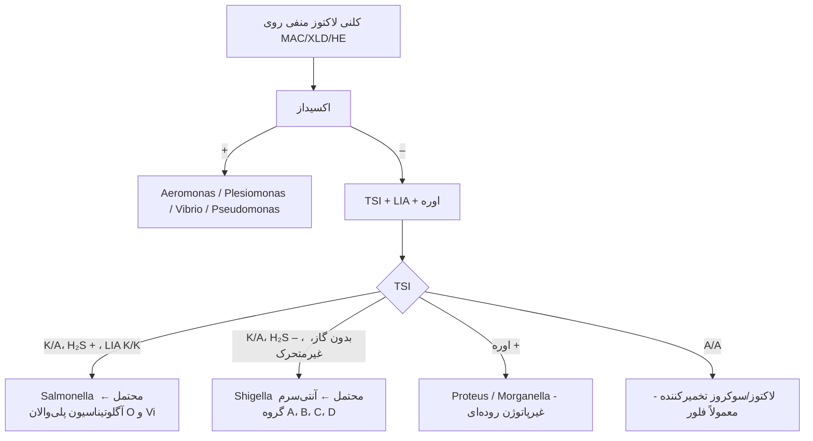

# پروتکل ۴: کشت و شناسایی پاتوژن‌های روده‌ای

## ۱. پنل محیط‌ها

### ۱-۱) پایه (همهٔ کشت‌های مدفوع)

| هدف | محیط | انکوباسیون | ظاهر مثبت |
|---|---|---|---|
| *Salmonella*/*Shigella* — افتراقی کم‌انتخابی | **MAC** | ۳۵ °C، هوا، ۱۸–۲۴ ساعت | کلنی‌های **لاکتوز منفی** (بی‌رنگ) |
| *Salmonella*/*Shigella* — انتخابی متوسط | **XLD** یا **HE** | ۳۵ °C، هوا، ۱۸–۲۴ ساعت | XLD: *Salmonella* قرمز با مرکز سیاه (H₂S)؛ *Shigella* قرمز بدون مرکز سیاه. HE: *Salmonella* سبز–آبی با مرکز سیاه؛ *Shigella* سبز |
| (اختیاری) *Salmonella* — بسیار انتخابی | SS، **Brilliant green**، کروموژنیک *Salmonella* | | ⚠️ SS برخی *Shigella* (به‌ویژه *S. dysenteriae*) را مهار می‌کند |
| غنی‌سازی *Salmonella* | **سلنیت F** یا **Rappaport-Vassiliadis**؛ GN براث (*Shigella* و *Salmonella*) | ۳۵–۴۲ °C، ۱۲–۱۸ ساعت (GN: ۶–۸ ساعت) ← ساب‌کالچر روی XLD/HE | برای حاملین و تعداد کم |
| ***Campylobacter*** | **CCDA** (بدون خون، ذغال‌دار) یا Campy-BAP (Skirrow، Butzler) | **۴۲ °C**، **میکروآئروفیل** (۵٪ O₂، ۱۰٪ CO₂، ۸۵٪ N₂)، **۴۸–۷۲ ساعت** | کلنی‌های خاکستری، مرطوب، **پخش‌شونده در مسیر خط**، گاه براق |
| **STEC O157** | **SMAC** (سوربیتول مک‌کانکی) یا CT-SMAC، یا کروموژنیک STEC | ۳۵ °C، ۱۸–۲۴ ساعت | O157: **سوربیتول منفی** (بی‌رنگ)؛ سایر *E. coli* صورتی |
| + **شیگاتوکسین** (EIA/PCR روی براث) | GN/MAC براث شبانه | | برای STEC غیر O157 (حدود نیمی از موارد STEC) |

> 🔬 **توصیهٔ CDC:** همهٔ کشت‌های مدفوع اسهال جامعه‌اکتساب باید **هم‌زمان برای O157 (SMAC) و شیگاتوکسین** بررسی شوند.

### ۱-۲) اختصاصی (بر اساس درخواست یا بالین)

| هدف | محیط | انکوباسیون | نکته |
|---|---|---|---|
| ***Vibrio*** | **TCBS** + غنی‌سازی **آب پپتونهٔ قلیایی (APW، pH ۸٫۴)** ۶–۸ ساعت | ۳۵ °C | *V. cholerae*: کلنی **زرد** (سوکروز +)؛ *V. parahaemolyticus*: **سبز** (سوکروز –)؛ ⚠️ اکسیداز را **از TCBS نخوانید** (کاذب منفی) ← از SBA |
| ***Yersinia*** | **CIN** (Cefsulodin–Irgasan–Novobiocin) | **۲۵–۳۰ °C**، ۴۸ ساعت | «**چشم گاو**» (مرکز قرمز، حاشیهٔ شفاف)؛ (*Aeromonas* هم روی CIN رشد می‌کند ← اکسیداز +) |
| غنی‌سازی سرد *Yersinia* | PBS در ۴ °C تا ۳ هفته | | پژوهشی/شیوع |
| ***Aeromonas*/*Plesiomonas*** | **SBA با آمپی‌سیلین** (*Aeromonas*)، CIN | ۳۵ °C | **اکسیداز +** (از SBA)؛ *Aeromonas* اغلب بتا همولیتیک |
| *S. aureus*، *B. cereus*، *C. perfringens* (مسمومیت غذایی) | کشت کمّی + توکسین | آزمایشگاه مرجع | |

### ۱-۳) *C. difficile* (کشت توکسیژنیک)
- **CCFA** یا کروموژنیک *C. difficile*، **بی‌هوازی**، ۴۸ ساعت؛ پیش‌تیمار با **شوک الکلی/حرارتی** (انتخاب اسپورها)
- کلنی‌ها: بزرگ، زرد–خاکستری، لبهٔ نامنظم، **بوی پِهِن اسب (p-cresol)**، **فلورسانس سبز–زرد زیر UV**
- **کشت توکسیژنیک** (کلنی + تست توکسین) **مرجع پژوهشی** است. در عمل روتین برای تایپینگ (ریبوتیپ ۰۲۷) و آنتی‌بیوگرام در مراکز مرجع.

### ۱-۴) *H. pylori*
- بیوپسی را **هموژن** (له) کنید ← کشت روی:
  - محیط **غیرانتخابی** (کلمبیا یا بروسلا آگار + ۵–۱۰٪ خون اسب/گوسفند)
  - و **انتخابی** (Skirrow یا Dent با ونکومایسین، تری‌متوپریم، سفسولودین، آمفوتریسین)
- **میکروآئروفیل**، **۳۷ °C**، رطوبت بالا، **۳–۷ روز** (تا ۱۰–۱۴ روز)
- کلنی‌های **ریز، شفاف، قطره‌شبنمی**
- شناسایی: گرم منفی **خمیده/مارپیچی** (کوکوئید در کشت پیر)، **اکسیداز +، کاتالاز +، اوره‌آز بسیار قوی +**

## ۲. غربالگری کلنی‌های مشکوک (Enterobacterales روده‌ای)

### ۲-۱) *Salmonella*
| آزمون | نتیجه |
|---|---|
| TSI | **K/A**، **H₂S +** (اغلب)، گاز + (به‌جز *S.* Typhi: گاز –، H₂S ضعیف) |
| LIA | **K/K** (لیزین دکربوکسیلاز +)، H₂S + |
| اوره | – |
| ایندول | – |
| سیترات | + (به‌جز Typhi، Paratyphi A) |
| حرکت | + |
| سرولوژی | **پلی‌والان O** ← **گروه O** (B، C1، C2، D، E) ← H (فاز ۱ و ۲)؛ **Vi** (Typhi) |
| ⚠️ | سروتایپینگ کامل (Kauffmann–White–Le Minor) در آزمایشگاه مرجع؛ *S.* Typhi/Paratyphi با **BSC** |

### ۲-۲) *Shigella* ☣️
| آزمون | نتیجه |
|---|---|
| TSI | **K/A**، **H₂S –**، **گاز –** (اغلب) |
| LIA | **K/A** (لیزین –) |
| حرکت | **–** |
| اوره | – |
| سرولوژی | **A** = *S. dysenteriae*؛ **B** = *S. flexneri*؛ **C** = *S. boydii*؛ **D** = *S. sonnei* |
| ⚠️ | **EIEC** و *E. coli* غیرمتحرک لاکتوز منفی با *Shigella* اشتباه می‌شوند (و MALDI آن‌ها را از هم جدا **نمی‌کند**). سرولوژی + بیوشیمی (لیزین، استات، موکات، ONPG برای *S. sonnei* +) |
| ⚠️ | گاهی آگلوتیناسیون کاذب منفی (آنتی‌ژن K) ← **جوشاندن سوسپانسیون** ۱۵ دقیقه و تکرار |

### ۲-۳) *Campylobacter*
| آزمون | نتیجه |
|---|---|
| گرم | باسیل گرم منفی **خمیده، S، بال مرغ دریایی** |
| اکسیداز | **+** |
| کاتالاز | + |
| هیپورات | ***C. jejuni* +**؛ *C. coli* – |
| رشد در ۴۲ °C | + (*C. jejuni*/*coli*)؛ *C. fetus* در ۲۵ °C |
| MALDI | گونه |

### ۲-۴) STEC
- کلنی‌های **سوربیتول منفی** روی SMAC ← آگلوتیناسیون **O157** (لاتکس) ← تأیید *E. coli* (بیوشیمی) ← **H7**
- **شیگاتوکسین** روی ایزوله یا براث (EIA/PCR *stx1*/*stx2*، *eae*)
- ارسال **همهٔ** ایزوله‌ها/براث‌های Stx مثبت به آزمایشگاه مرجع (سروتایپ غیر O157، WGS برای شیوع)

### ۲-۵) *Vibrio*
- اکسیداز +، **حساسیت به ویبریواستات O/129** (۱۵۰ µg)، رشد در NaCl (*V. cholerae* بدون نمک هم رشد می‌کند؛ هالوفیل‌ها نیاز به NaCl دارند)، **String test +**
- *V. cholerae*: آنتی‌سرم **O1** (سروتایپ Ogawa/Inaba) و O139؛ تست توکسین (PCR *ctxA*)
- 📞 **وبا = بیماری فوری واجب‌الگزارش**

### ۲-۶) *Y. enterocolitica*
- اوره‌آز +، حرکت در ۲۵ °C + و در ۳۷ °C –، سوکروز +؛ بیوتایپ/سروتایپ (O:3، O:9، O:8) در مرجع

### ۲-۷) *Aeromonas* و *Plesiomonas*
- اکسیداز + (افتراق از Enterobacterales)، گرم منفی، بدون نیاز به NaCl؛ *Aeromonas*: معمولاً بتا همولیتیک، DNase +؛ *Plesiomonas*: غیرهمولیتیک، لیزین/اورنیتین/آرژینین +

## ۳. مدت نگهداری پلیت‌ها
- MAC، XLD/HE، SMAC، TCBS: **۴۸ ساعت**
- CCDA: **۷۲ ساعت**
- CIN: ۴۸ ساعت در ۲۵–۳۰ °C
- *H. pylori*: تا ۱۰–۱۴ روز
