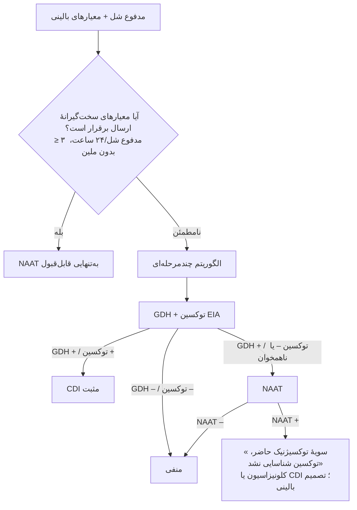

# پروتکل ۵: روش‌های مولکولی در نمونه‌های گوارشی

> جدا از روش‌های کلاسیک. **آزمون‌های تشخیصی مستقل از کشت (CIDT)** حساسیت و سرعت را افزایش داده‌اند. ولی **ایزوله** برای آنتی‌بیوگرام، سروتایپ و نظام مراقبت همچنان لازم است.

## ۱. پنل‌های سندرمیک گوارشی

### BioFire FilmArray GI Panel (نمونهٔ شاخص) — ۲۲ هدف

| باکتری‌ها | انگل‌ها | ویروس‌ها |
|---|---|---|
| *Campylobacter* (*jejuni*/*coli*/*upsaliensis*)، ***C. difficile* toxin A/B**، *Plesiomonas shigelloides*، *Salmonella*، *Vibrio* (*parahaemolyticus*، *vulnificus*، *cholerae*) + *V. cholerae*، *Y. enterocolitica*، **EAEC، EPEC، ETEC (lt/st)، STEC (stx1/stx2) + O157**، ***Shigella*/EIEC** | *Cryptosporidium*، *Cyclospora*، *E. histolytica*، *Giardia* | آدنو F40/41، آسترو، نورو GI/GII، روتا A، ساپو |

### مزایا
- حساسیت بالا؛ یافتن پاتوژن‌هایی که کشت روتین نمی‌یابد (ETEC، EAEC، EPEC، STEC غیر O157)؛ نتیجه در حدود ۱ ساعت.

### محدودیت‌ها و دام‌ها ⚠️

| محدودیت | پیامد |
|---|---|
| DNA ارگانیسم مرده یا دفع پس از بهبودی | مثبت بدون بیماری فعال |
| **چند پاتوژن هم‌زمان** (حدود ۲۰–۳۰٪) | کدام مسئول است؟ تفسیر با بالین |
| **EPEC** و **EAEC** در کودکان و افراد سالم کشورهای کم‌درآمد شایع است | ارزش بالینی نامشخص |
| ***C. difficile*** در پنل GI | **کلونیزاسیون** را از عفونت جدا نمی‌کند؛ کودکان کمتر از ۲ سال |
| *Shigella*/EIEC جدا نمی‌شوند | (هدف *ipaH*) |
| **بدون آنتی‌بیوگرام** | ⇒ **کشت بازتابی (Reflex culture)** برای *Salmonella*، *Shigella*، *Campylobacter*، *Vibrio*، STEC، *Yersinia* |
| اثر بر **نظام مراقبت** (عدم ایزوله برای سروتایپ/WGS) | ارسال نمونهٔ اولیه یا ایزوله به آزمایشگاه بهداشت |
| هزینه | مدیریت تشخیصی (فقط اسهال شدید، خونی، نقص ایمنی، مسافرت) |

## ۲. *Clostridioides difficile*: NAAT و الگوریتم‌ها

| روش | هدف | حساسیت | اختصاصیت برای **بیماری** | نکته |
|---|---|---|---|---|
| **NAAT** (PCR ژن *tcdB*، ± *tcdA*، *cdt*، حذف *tcdC*/ریبوتیپ ۰۲۷) | ژن توکسین | **بسیار بالا** | پایین‌تر (کلونیزاسیون با سویهٔ توکسیژنیک = مثبت) | |
| GDH (EIA) | آنتی‌ژن | بالا | پایین (سویه‌های غیرتوکسیژنیک) | |
| **توکسین EIA** | توکسین آزاد | متوسط | **بالا** | |

### الگوریتم‌های توصیه‌شده (IDSA/SHEA 2017/2021؛ ESCMID 2016)

> 🔬 **NAAT+/توکسین–:** این بیماران پیامد بهتری از توکسین+ها دارند و بسیاری کلونیزه‌اند. گزارش باید این تمایز را منعکس کند (فایل گزارش).

## ۳. شیگاتوکسین/STEC
- **PCR *stx1*، *stx2*** (± *eae*، *rfbE* O157، *hlyA*) روی براث غنی‌شده یا مستقیم مدفوع.
- **Stx2** و **eae+** با خطر HUS بالاتر.
- 🔬 **STEC/EAEC O104:H4** (شیوع آلمان ۲۰۱۱): ترکیب Stx2 با چسبندگی EAEC؛ *eae* منفی ← بر اهمیت آزمایش **Stx** به‌جای فقط O157 تأکید دارد.

## ۴. *Helicobacter pylori*
| روش | کاربرد |
|---|---|
| PCR روی بیوپسی (یا مدفوع) برای ***23S rRNA*** (جهش‌های **A2142G، A2143G، A2142C**) | **مقاومت به کلاریترومایسین** ← انتخاب رژیم (درمان مبتنی بر حساسیت) |
| PCR *gyrA* (کدون‌های ۸۷ و ۹۱) | مقاومت به لووفلوکساسین |
| ⚠️ | مقاومت به مترونیدازول با روش مولکولی قابل‌اعتماد نیست (ژن‌های *rdxA*/*frxA* متنوع) |

> مقاومت به کلاریترومایسین در ایران در مطالعات منتشرشده بالا (اغلب بیش از ۱۵–۲۰٪) گزارش شده است ← طبق Maastricht VI، در مقاومت بیش از ۱۵٪ رژیم سه‌دارویی کلاریترومایسین تجربی توصیه نمی‌شود.

## ۵. وبا
- PCR *ctxA*، *rfbO1*/*rfbO139*؛ RDT (غربالگری شیوع، تأیید با کشت/PCR)
- **WGS** در آزمایشگاه مرجع برای ردیابی شیوع

## ۶. غربالگری مولکولی کنترل عفونت
- PCR مستقیم سواب رکتال برای **کارباپنمازها** (KPC، NDM، OXA-48، VIM، IMP) و ***vanA/vanB***
- سریع (۱–۲ ساعت)؛ ⚠️ *vanB* در فلور بی‌هوازی روده (کلستریدیوم‌ها) ← مثبت کاذب VRE ← تأیید با کشت

## ۷. MALDI-TOF در پاتوژن‌های روده‌ای ⚠️
- ***Shigella* را از *E. coli* جدا نمی‌کند** ← سرولوژی/بیوشیمی
- *Salmonella* فقط تا حد جنس ← سروتایپینگ
- *Campylobacter*، *Vibrio*، *Aeromonas*، *Yersinia*: شناسایی مناسب
