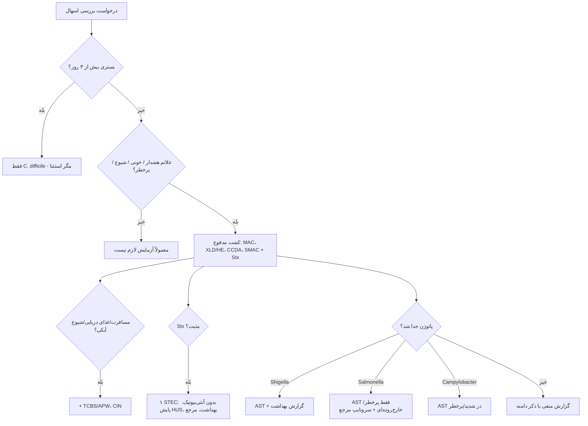

# جداول مقایسه‌ای استاندارد — نمونه‌های گوارشی

## جدول ۱: پاتوژن‌های روده‌ای — محیط و ظاهر

| ارگانیسم | محیط | دما/اتمسفر | ظاهر کلیدی |
|---|---|---|---|
| *Salmonella* | XLD / HE / SS + سلنیت | ۳۵ °C هوا | XLD قرمز + مرکز سیاه؛ HE سبز–آبی + سیاه |
| *Shigella* | XLD / HE (± GN) | ۳۵ °C هوا | XLD قرمز بدون سیاه؛ HE سبز |
| *Campylobacter* | CCDA | **۴۲ °C میکروآئروفیل ۴۸–۷۲ ساعت** | خاکستری، پخش‌شونده |
| STEC O157 | SMAC | ۳۵ °C | **سوربیتول منفی** (بی‌رنگ) |
| *V. cholerae* | TCBS + APW | ۳۵ °C | **زرد** |
| *V. parahaemolyticus* | TCBS | ۳۵ °C | **سبز** |
| *Y. enterocolitica* | CIN | **۲۵–۳۰ °C** | چشم گاو |
| *Aeromonas* | SBA + آمپی‌سیلین | ۳۵ °C | بتا همولیتیک، **اکسیداز +** |
| *C. difficile* | CCFA | بی‌هوازی | بوی پهن اسب، فلورسانس UV |
| *H. pylori* | خون‌دار ± انتخابی | ۳۷ °C میکروآئروفیل ۳–۷ روز | قطره‌شبنمی ریز |

## جدول ۲: بیوشیمی افتراقی Enterobacterales روده‌ای

| ویژگی | *Salmonella* | *S.* Typhi | *Shigella* | *E. coli* | STEC O157 | *Y. enterocolitica* |
|---|---|---|---|---|---|---|
| لاکتوز | – | – | – (*sonnei* دیررس) | + | + | – |
| H₂S (TSI) | + | ضعیف | – | – | – | – |
| گاز | + | **–** | – | + | + | – |
| لیزین | + | + | **–** | + | + | – |
| حرکت | + | + | **–** | + | + | ۲۵ °C + |
| اوره | – | – | – | – | – | **+** |
| سوربیتول | + | + | ± | + | **–** | + |

## جدول ۳: *C. difficile* — مقایسهٔ روش‌ها

| روش | هدف | حساسیت | اختصاصیت برای بیماری | زمان |
|---|---|---|---|---|
| GDH | آنتی‌ژن | بالا | پایین | کمتر از ۱ ساعت |
| توکسین EIA | توکسین | متوسط | **بالا** | کمتر از ۱ ساعت |
| NAAT | ژن | **بسیار بالا** | متوسط (کلونیزاسیون) | ۱–۲ ساعت |
| سنجش سیتوتوکسیسیتی سلولی (CCNA) | توکسین فعال | بالا | بالا | ۴۸ ساعت (مرجع) |
| کشت توکسیژنیک | ارگانیسم + توکسین | بسیار بالا | متوسط | ۳–۵ روز (مرجع) |

## جدول ۴: *H. pylori* — مقایسهٔ روش‌ها

| روش | تهاجمی | حساسیت | تأیید ریشه‌کنی | اثر PPI | AST |
|---|---|---|---|---|---|
| UBT | خیر | بیش از ۹۵٪ | ✅ | منفی کاذب | ❌ |
| آنتی‌ژن مدفوع (مونوکلونال) | خیر | حدود ۹۴٪ | ✅ | منفی کاذب | ❌ |
| سرولوژی | خیر | متوسط | ❌ | بی‌اثر | ❌ |
| RUT | بیوپسی | حدود ۹۰٪ | ✅ | منفی کاذب | ❌ |
| بافت‌شناسی | بیوپسی | بالا | ✅ | کاهش | ❌ |
| **کشت** | بیوپسی | ۶۰–۹۰٪ | ✅ | کاهش | ✅ **کامل** |
| PCR بیوپسی/مدفوع | بیوپسی/مدفوع | بالا | ✅ | | ✅ کلاریترومایسین (± لووفلوکساسین) |

## جدول ۵: مسمومیت غذایی

| ارگانیسم | دورهٔ نهفتگی | علامت غالب | غذای تیپیک | آزمایش |
|---|---|---|---|---|
| *S. aureus* | ۱–۶ ساعت | استفراغ | سالاد، شیرینی | انتروتوکسین در غذا |
| *B. cereus* (امتیک) | ۱–۶ ساعت | استفراغ | برنج | ≥ ۱۰⁵/g؛ سرولید |
| *B. cereus* (اسهالی) | ۸–۱۶ ساعت | اسهال | گوشت، سبزی | ≥ ۱۰⁵/g |
| *C. perfringens* | ۸–۱۶ ساعت | اسهال، کرامپ | گوشت/خورش حجیم | ≥ ۱۰⁶/g مدفوع؛ توکسین |
| *Salmonella* | ۶–۷۲ ساعت | اسهال، تب | مرغ، تخم‌مرغ | کشت |
| STEC | ۱–۸ روز (معمولاً ۳–۴) | اسهال خونی | همبرگر، سبزی | Stx + کشت |
| *C. botulinum* | ۱۲–۷۲ ساعت | فلج نزولی | کنسرو خانگی | ☣️ مرجع |

## جدول ۶: آنتی‌بیوگرام — داروی مناسب بر اساس ارگانیسم

| ارگانیسم | خط اول رایج | ⛔ گزارش نشود |
|---|---|---|
| *Shigella* | آزیترومایسین، سیپروفلوکساسین، سفتریاکسون | آمینوگلیکوزید، سفالوسپورین نسل ۱–۲ |
| *Salmonella* (پرخطر) | سفتریاکسون، سیپروفلوکساسین، آزیترومایسین | همان |
| *Campylobacter* | آزیترومایسین (اریترومایسین) | TMP-SMX، بتالاکتام |
| *V. cholerae* | داکسی‌سایکلین، آزیترومایسین | |
| STEC | ⛔ آنتی‌بیوتیک | — |
| *C. difficile* | فیداکسومایسین، ونکومایسین خوراکی | — |
| *H. pylori* | بر اساس AST/PCR | — |

## فلوچارت جامع: اسهال حاد

