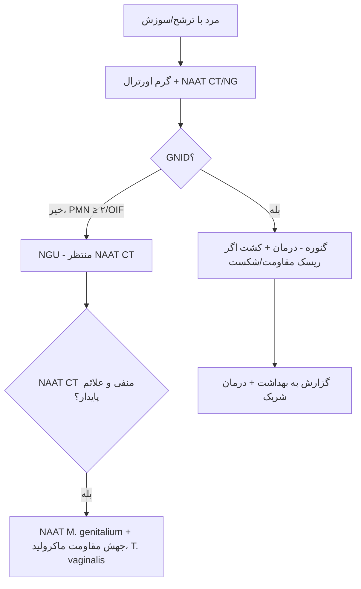

# جداول مقایسه‌ای استاندارد — نمونه‌های تناسلی

## جدول ۱: انتخاب نمونه بر اساس آزمایش

| آزمایش | زن | مرد | خارج‌تناسلی |
|---|---|---|---|
| NAAT CT/NG | سواب واژینال (خودگرفته OK) | ادرار اول جریان | حلق، رکتوم |
| کشت گنوکوک | اندوسرویکس | اورترا | حلق، رکتوم، مایع مفصل، خون |
| NAAT *M. genitalium* | سواب واژینال | ادرار اول جریان | رکتوم |
| BV | سواب واژینال (Nugent/Amsel) | — | — |
| GBS | واژینال–رکتال (۳۶–۳۷ هفته) | — | — |
| گرم | ⛔ (کم‌حساس) | **اورترا** | ⛔ |

## جدول ۲: مقایسهٔ روش‌های گنوکوک

| روش | حساسیت | اختصاصیت | AST | انتقال | زمان |
|---|---|---|---|---|---|
| گرم اورترال مرد علامت‌دار | حدود ۹۰–۹۵٪ | حدود ۹۵–۱۰۰٪ | ❌ | — | دقایق |
| گرم سرویکس | حدود ۵۰٪ | متوسط | ❌ | — | ⛔ |
| کشت | ۸۰–۹۵٪ (با انتقال بهینه)؛ کمتر در عمل | ≈ ۱۰۰٪ | ✅ | **حساس** | ۲۴–۷۲ ساعت |
| NAAT | بیش از ۹۵٪ | بیش از ۹۹٪ (حلق: متغیر) | ❌ | مقاوم | ساعت‌ها |

## جدول ۳: *Neisseria* و شبه‌نایسریاها

| ارگانیسم | گلوکز | مالتوز | لاکتوز | سوکروز | رشد روی TM | رشد روی SBA ۲۲ °C |
|---|---|---|---|---|---|---|
| *N. gonorrhoeae* | + | – | – | – | + | – |
| *N. meningitidis* | + | + | – | – | + | – |
| *N. lactamica* | + | + | + | – | + | ± |
| *M. catarrhalis* | – | – | – | – | ± | + |
| *Kingella denitrificans* | + | – | – | – | + | (کاتالاز –) |

## جدول ۴: واژینیت/واژینوز

| ویژگی | طبیعی | BV | تریکومونیاز | کاندیدیاز |
|---|---|---|---|---|
| ترشح | سفید، شفاف | نازک، خاکستری، همگن | زرد–سبز، کف‌آلود | پنیری |
| pH | ≤ ۴٫۵ | **بیش از ۴٫۵** | **بیش از ۴٫۵** | ≤ ۴٫۵ |
| Whiff | – | **+** | ± | – |
| لام | لاکتوباسیل | **Clue cells**، کاهش لاکتوباسیل | تریکوموناس متحرک، PMN | مخمر/هیف کاذب |
| PMN | کم | **کم** | **زیاد** | متغیر |
| آزمایش استاندارد | — | Nugent/Amsel/مولکولی | NAAT | لام KOH، (کشت در عود) |

## جدول ۵: زخم‌های تناسلی

| ویژگی | سیفلیس | شانکروئید | HSV | LGV | دونووانوز |
|---|---|---|---|---|---|
| درد | **بدون درد** | **دردناک** | دردناک | گذرا/بی‌درد | بدون درد |
| ظاهر | سخت، تمیز | نرم، چرکی، نامنظم | وزیکول‌های متعدد ← زخم | کوچک، گذرا | قرمز گوشتی، خونریزی‌دهنده |
| لنفادنوپاتی | سفت، بدون درد | دردناک، چرکی (بوبو) | دردناک | **شدید، دردناک (نشانهٔ شیار)** | کاذب (pseudobubo) |
| آزمایش | سرولوژی، دارک‌فیلد/PCR | PCR/کشت ویژه | PCR | NAAT + ژنوتایپ L | بافت (اجسام دونووان) |

## جدول ۶: GBS و آلرژی پنی‌سیلین

| وضعیت | پروفیلاکسی | آزمایشگاه |
|---|---|---|
| بدون آلرژی | پنی‌سیلین G/آمپی‌سیلین | فقط شناسایی |
| آلرژی کم‌خطر | سفازولین | فقط شناسایی |
| آلرژی پرخطر، کلیندامایسین S و D-test – | کلیندامایسین | **AST کلیندامایسین + D-test** |
| آلرژی پرخطر، کلیندامایسین R یا D-test + | ونکومایسین | همان |

## فلوچارت: اورتریت مرد

