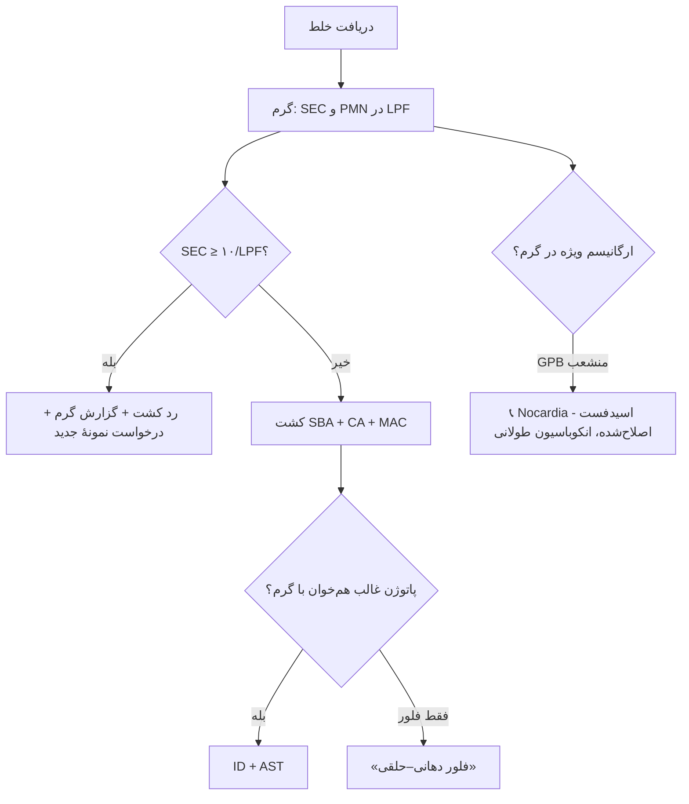

# جداول مقایسه‌ای استاندارد — نمونه‌های تنفسی

## جدول ۱: انواع نمونه و آستانه‌ها

| نمونه | کیفیت/آلودگی | روش کشت | آستانه | بی‌هوازی |
|---|---|---|---|---|
| خلط | غربالگری SEC | نیمه‌کمّی | پاتوژن غالب | ⛔ |
| ETA | (SEC/باکتری) | نیمه‌کمّی/کمّی | ≥ ۱۰⁵–۱۰⁶ | ⛔ |
| BAL | — | کمّی | ≥ ۱۰⁴ | ⛔ |
| PSB | — | کمّی | ≥ ۱۰³ | ✅ |
| آسپیرهٔ ریه/سینوس | — | کیفی | هر رشد | ✅ |
| سواب حلق | — | GAS | — | (*F. necrophorum*) |
| سواب NP | — | سیاه‌سرفه/دیفتری | — | ⛔ |

## جدول ۲: شناسایی پاتوژن‌های اصلی

| ارگانیسم | گرم | محیط | آزمون کلیدی |
|---|---|---|---|
| *S. pneumoniae* | GPDC نیزه‌ای | SBA (α) | اپتوچین، صفرا |
| *H. influenzae* | GN کوکوباسیل | CA | X+V |
| *M. catarrhalis* | GNDC | SBA/CA | DNase، بوتیرات، «ژتون هاکی» |
| GAS | GPC زنجیره | SBA (β) | PYR +، لانسفیلد A |
| *S. aureus* | GPC خوشه | SBA | کوآگولاز |
| *K. pneumoniae* | GNB کپسول‌دار | MAC (موکوئید) | String test |
| *P. aeruginosa* | GNB | MAC | اکسیداز + |
| *Legionella* | GN ضعیف‌رنگ | **BCYE** | نیاز به L-سیستئین |
| *B. pertussis* | GN کوکوباسیل ریز | **Regan–Lowe** (۷–۱۲ روز) | قطرهٔ جیوه |
| *C. diphtheriae* | GPB پلئومورف | **Tinsdale** (سیاه + هاله) | Elek/PCR *tox* |
| *Nocardia* | GPB منشعب | SBA/BCYE (۵–۷ روز+) | اسیدفست اصلاح‌شده + |
| BCC | GNB | **BCSA** | MALDI + مرجع |

## جدول ۳: سیاه‌سرفه — روش بر اساس زمان سرفه

| هفته از شروع سرفه | کشت | PCR | سرولوژی |
|---|---|---|---|
| ۰–۲ | ✅ | ✅ | ❌ |
| ۲–۴ | ⚠️ (کم) | ✅ | ⚠️ |
| بیش از ۴ | ❌ | ⚠️ | ✅ |

## جدول ۴: آزمون‌های سریع

| آزمون | نمونه | ارزش اصلی | دام اصلی |
|---|---|---|---|
| RADT GAS | حلق | مثبت قطعی | منفی کودک ← کشت |
| NAAT GAS | حلق | حساس | حامل |
| آنتی‌ژن ادراری پنوموکوک | ادرار | بزرگسالان | کودکان (کلونیزاسیون) |
| آنتی‌ژن ادراری *Legionella* | ادرار | SG1 | سایر سروگروه‌ها |
| Xpert MTB/RIF Ultra | خلط | TB + RIF | ارگانیسم مرده (درمان قبلی) |
| پنل پنومونی | BAL/ETA | منفی‌ها (MRSA/PA) | bin ≠ CFU |

## جدول ۵: داروهای نامناسب در پنومونی

| دارو | دلیل |
|---|---|
| داپتومایسین | غیرفعال با سورفکتانت |
| تیگسایکلین | سطح سرمی پایین، مرگ بیشتر در HAP/VAP |
| آمینوگلیکوزید تنها | نفوذ ضعیف به ریه |
| نیتروفورانتوئین/فسفومایسین خوراکی | سیستمیک نیستند |
| ماکرولید برای پنوموکوک با مقاومت سطح بالا | شکست |

## فلوچارت: خلط برای کشت

