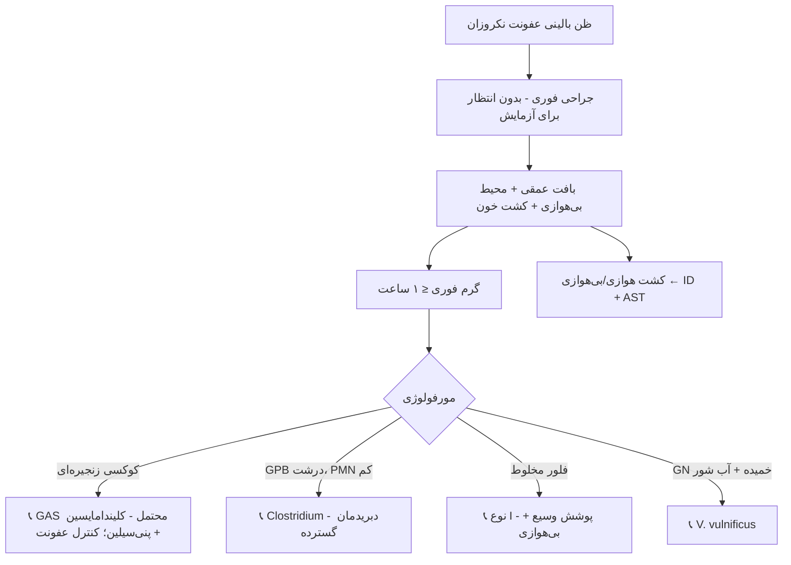

# جداول مقایسه‌ای استاندارد — پوست و بافت نرم

## جدول ۱: سندرم ← نمونه ← کشت

| سندرم | نمونهٔ بهینه | کشت | آزمایش اضافی |
|---|---|---|---|
| آبسه | آسپیرهٔ چرک | هوازی ± بی‌هوازی | — |
| زرد زخم | سواب زیر کراست | هوازی | — |
| سلولیت | (معمولاً هیچ) | — | کشت خون در موارد خاص |
| فاشئیت نکروزان | **بافت عمقی (جراحی)** | هوازی + **بی‌هوازی** | **گرم فوری**، کشت خون |
| گازگرفتگی عفونی | آسپیره/بافت | هوازی + CA + بی‌هوازی | — |
| تماس با آب | بافت/آسپیره | + TCBS، AFB ۳۰ °C | کشت خون |
| ضایعهٔ مزمن | بیوپسی | + AFB، قارچ، *Nocardia* | پاتولوژی |
| سیاه‌زخم | مایع وزیکول/زیر اسکار | SBA (مرجع) | کشت خون، PCR مرجع |

## جدول ۲: ارگانیسم‌های گازگرفتگی

| ارگانیسم | منبع | رشد | آزمون کلیدی | نکتهٔ AST |
|---|---|---|---|---|
| *P. multocida* | گربه > سگ | SBA، CA؛ ⛔ MAC | اکسیداز +، ایندول + | پنی‌سیلین S؛ ⛔ سفالکسین/کلیندامایسین |
| *C. canimorsus* | سگ | CA، CO₂ کند | اکسیداز +، کاتالاز + | آموکسی‌کلاو |
| *E. corrodens* | انسان | CA، CO₂، فرورفتگی آگار | بوی کلر | ⛔ کلیندامایسین، مترونیدازول |
| بی‌هوازی‌های دهانی | همه | بی‌هوازی | — | آموکسی‌کلاو |
| *S. aureus*/استرپتوکوک‌ها | همه | SBA | — | — |

## جدول ۳: *Bacillus anthracis* در برابر *B. cereus*

| ویژگی | *B. anthracis* | *B. cereus* |
|---|---|---|
| همولیز روی SBA | **–** | **+ (بتا)** |
| حرکت | **–** | **+** |
| کپسول (M'Fadyean) | **+** (در بافت/بیکربنات) | – |
| کلنی | سر مدوزا، **چسبنده (سفیدهٔ تخم‌مرغ)** | پهن، کدر |
| حساسیت به پنی‌سیلین | + (اغلب) | – (بتالاکتاماز) |
| فاژ گاما | حساس | مقاوم |
| اقدام | ☣️ **ارجاع** | گزارش با بالین |

## جدول ۴: *Clostridium* در عفونت‌های بافت نرم

| گونه | سرنخ بالینی | آزمایشگاه |
|---|---|---|
| *C. perfringens* | تروما، جراحی؛ گانگرن گازی | همولیز دوگانه، لسیتیناز +، بدون اسپور در بافت |
| *C. septicum* | **خودبه‌خودی**؛ بدخیمی کولون/خون، نوتروپنی | swarming، تحمل اکسیژن نسبی |
| *C. sordellii* | پس از زایمان/سقط، تزریق | لکوسیتوز شدید، بدون تب (ماژول ۰۵) |
| *C. novyi* | تزریق هروئین | |
| *C. tetani* | زخم آلوده (کزاز: تشخیص بالینی) | کشت کم‌ارزش |
| *C. botulinum* | بوتولیسم زخمی (تزریق) | ☣️ مرجع (توکسین) |

## جدول ۵: D-test و الگوهای ماکرولید–لینکوزامید

| اریترومایسین | کلیندامایسین | D-test | مکانیسم | گزارش کلیندامایسین |
|---|---|---|---|---|
| S | S | — | — | S |
| R | S | **+** | *erm* القایی (iMLSB) | **R** |
| R | S | – | پمپ *msrA* (استاف) / *mef* (استرپ) | S |
| R | R | — | *erm* ثابت (cMLSB) | R |

## فلوچارت: ظن عفونت نکروزان

