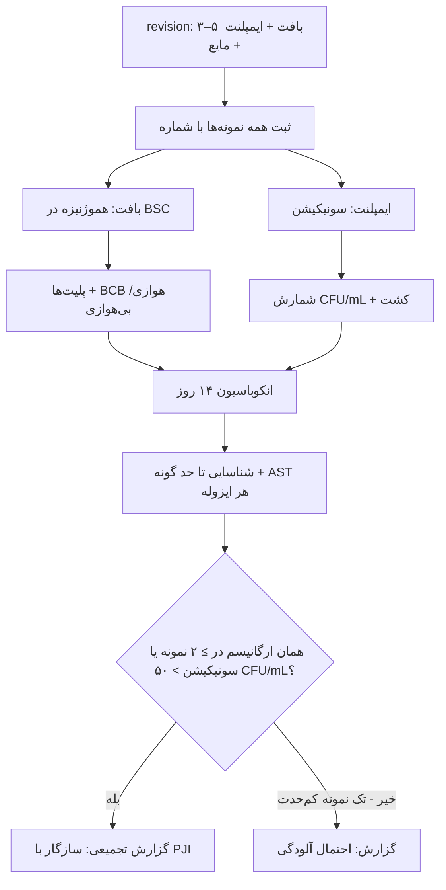

# جداول مقایسه‌ای استاندارد — زخم، بافت، استخوان، ایمپلنت

## جدول ۱: نمونهٔ بهینه بر اساس سندرم

| سندرم | بهینه | قابل‌قبول | ⛔ |
|---|---|---|---|
| SSI | بافت/آسپیرهٔ عمقی | سواب لِوین (ESwab) | سواب سطحی ترشح |
| پای دیابتی (بافت نرم) | بافت پس از دبریدمان (کورتاژ/بیوپسی) | آسپیره | سواب پیش از دبریدمان |
| پای دیابتی (استخوان) | **بیوپسی استخوان** | — | سواب سینوس/زخم |
| سوختگی | **بیوپسی کمّی** + بافت‌شناسی | — | سواب برای تشخیص عفونت مهاجم |
| استئومیلیت مهره‌ای | کشت خون + **بیوپسی CT-guided** | — | — |
| استئومیلیت کودک | کشت خون + آسپیره در BCB + PCR *Kingella* | — | — |
| **PJI** | **۳–۵ بافت (ابزار جدا)** + **سونیکیشن** + مایع مفصل (BCB) | — | **سواب** |

## جدول ۲: پردازش و انکوباسیون

| نمونه | پردازش | محیط‌ها | مدت |
|---|---|---|---|
| بافت عمومی | خردکردن/هموژنیزه | SBA، CA، MAC، بی‌هوازی، براث | هوازی ۵ روز؛ بی‌هوازی ۷ روز |
| **PJI بافت** | هموژنیزه | + **BCB هوازی/بی‌هوازی** | **۱۴ روز** (به‌ویژه شانه) |
| ایمپلنت | **سونیکیشن** (ورتکس–۵ دقیقه–ورتکس) | پلیت‌ها ± BCB | ۱۴ روز (بی‌هوازی) |
| سوختگی | وزن + هموژنیزه + رقت سریالی | SBA، MAC | ۴۸ ساعت |
| استخوان | خردکردن | مانند بافت + AFB/بروسلا | ۱۴ روز (+ ۶–۸ هفته AFB) |

## جدول ۳: آستانه‌ها و معیارها

| روش | آستانه/معیار |
|---|---|
| بافت PJI | **≥ ۲ نمونه با همان ارگانیسم** |
| سونیکیشن | **بیش از ۵۰ CFU/mL** (EBJIS) |
| بافت‌شناسی PJI | ≥ ۵ PMN/HPF (≥ ۵ میدان) |
| کمّی سوختگی | ≥ ۱۰⁵ CFU/g (+ بافت‌شناسی) |
| مایع سینوویال PJI مزمن | WBC بیش از ۳۰۰۰/µL، PMN بیش از ۸۰٪ (ماژول ۰۹) |

## جدول ۴: عوامل استئومیلیت بر اساس زمینه

| زمینه | عوامل |
|---|---|
| کودک هماتوژن | *S. aureus*، *K. kingae* (کمتر از ۴ سال)، GAS |
| سیکل‌سل | *Salmonella*، *S. aureus* |
| مهره‌ای بزرگسال | *S. aureus*، گرم منفی‌ها، *Brucella* (ایران)، TB |
| پای دیابتی | چندمیکروبی، *S. aureus* |
| پس از جراحی/ایمپلنت | CoNS، *C. acnes*، *S. aureus* |
| معتاد تزریقی | *S. aureus*، *P. aeruginosa* |
| زخم سوراخ‌شدگی کف پا (کفش ورزشی) | *P. aeruginosa* |

## جدول ۵: PJI بر اساس زمان

| نوع | زمان | ارگانیسم‌ها | AST کلیدی |
|---|---|---|---|
| زودرس | کمتر از ۳ ماه | *S. aureus*، گرم منفی | ریفامپین/فلوروکینولون (DAIR) |
| تأخیری | ۳–۲۴ ماه | CoNS، *C. acnes* | CoNS: پنل کامل + ریفامپین |
| دیررس هماتوژن | بیش از ۲۴ ماه | *S. aureus*، استرپتوکوک، گرم منفی | — |

## فلوچارت: پردازش نمونه‌های PJI

