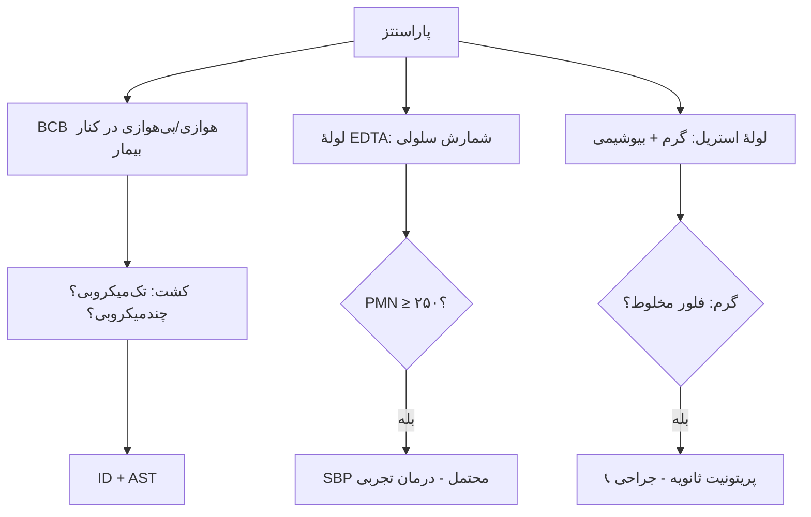

# جداول مقایسه‌ای استاندارد — مایعات استریل، چشم، گوش، مغز استخوان

## جدول ۱: مایعات استریل — آستانه‌ها و عوامل

| مایع | آستانهٔ سلولی/بیوشیمی | عوامل غالب | نکتهٔ کشت |
|---|---|---|---|
| آسیت (SBP) | PMN ≥ ۲۵۰/µL | *E. coli*، *Klebsiella*، استرپتوکوک (تک‌میکروبی) | **BCB** |
| آسیت (ثانویه) | PMN ≥ ۲۵۰ + Runyon | چندمیکروبی + بی‌هوازی | بی‌هوازی |
| PD | WBC بیش از ۱۰۰ + PMN بیش از ۵۰٪ | CoNS، *S. aureus*، گرم منفی | **BCB** |
| مفصل | WBC بیش از ۵۰٬۰۰۰، PMN بیش از ۹۰٪ | *S. aureus*، استرپتوکوک، گنوکوک، *Kingella* | BCB (کودک)؛ کریستال |
| پلور | چرک، pH کمتر از ۷٫۲، گلوکز کمتر از ۶۰ | *S. anginosus*، پنوموکوک، *S. aureus*، بی‌هوازی | بی‌هوازی؛ ADA (TB) |
| پریکارد | چرکی/لنفوسیتی | *S. aureus*، TB | AFB/Xpert/ADA |

## جدول ۲: آسیت — طبقه‌بندی

| PMN | کشت | تشخیص |
|---|---|---|
| ≥ ۲۵۰ | تک‌میکروبی + | SBP |
| ≥ ۲۵۰ | – | آسیت نوتروسیتیک کشت‌منفی |
| کمتر از ۲۵۰ | تک‌میکروبی + | باکتریآسیت غیرنوتروسیتیک |
| ≥ ۲۵۰ | چندمیکروبی | پریتونیت ثانویه |
| کمتر از ۲۵۰ | چندمیکروبی | سوراخ‌شدن روده با سوزن |

## جدول ۳: مایع مفصل

| دسته | WBC/µL | PMN |
|---|---|---|
| طبیعی | کمتر از ۲۰۰ | کمتر از ۲۵٪ |
| غیرالتهابی | ۲۰۰–۲٬۰۰۰ | کمتر از ۲۵٪ |
| التهابی | ۲٬۰۰۰–۵۰٬۰۰۰ | بیش از ۵۰٪ |
| سپتیک | بیش از ۵۰٬۰۰۰ | بیش از ۷۵–۹۰٪ |
| PJI مزمن | بیش از ۳٬۰۰۰ | بیش از ۸۰٪ |

## جدول ۴: کریستال‌ها

| کریستال | شکل | دوشکستی | بیماری |
|---|---|---|---|
| اورات | سوزنی | منفی قوی | نقرس |
| CPPD | میله‌ای/لوزی | مثبت ضعیف | کاذب‌نقرس |

## جدول ۵: چشم

| سندرم | نمونه | کشت | فوریت |
|---|---|---|---|
| کونژنکتیویت | سواب ملتحمه | SBA، CA | معمولاً نه |
| افتالمی نوزادی | سواب ملتحمه | MTM/CA + NAAT CT | 📞 |
| کراتیت | **خراش قرنیه** | **تلقیح مستقیم «C»** | اورژانس |
| اندوفتالمیت | **ویتره/زلالیه** | پلیت‌ها + BCB اطفال + PCR | 📞 فوری |

## جدول ۶: گوش

| سندرم | نمونهٔ صحیح | عوامل |
|---|---|---|
| اوتیت میانی حاد | تمپانوسنتز | پنوموکوک، هموفیلوس، موراکسلا |
| اوتیت خارجی | سواب کانال (در مقاوم) | *P. aeruginosa*، *S. aureus* |
| اوتیت خارجی بدخیم | **بیوپسی** | *P. aeruginosa* |

## جدول ۷: کشت مغز استخوان

| ارگانیسم | حساسیت کشت خون | حساسیت کشت مغز استخوان |
|---|---|---|
| *S.* Typhi | حدود ۴۰–۸۰٪ | **حدود ۸۰–۹۵٪** |
| *Brucella* | حدود ۴۰–۷۰٪ | **حدود ۸۰–۹۰٪** |

## فلوچارت: مایع آسیت

