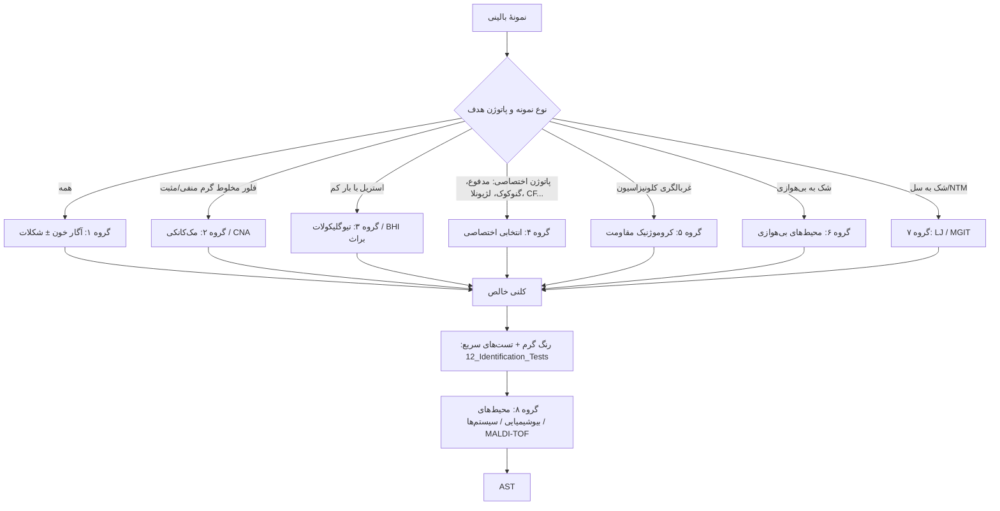

# کتابخانهٔ محیط‌های کشت

## معرفی
هر محیط کشت در این پوشه **فقط یک بار** شرح داده می‌شود. ماژول‌های نمونه (۰۱ تا ۰۹)، ماژول‌های خانواده‌ها (۱۳ تا ۲۴) و بخش [AST](../AST/README.md) به این‌جا ارجاع می‌دهند. ترتیب گروه‌ها همان **ترتیب کاربرد در گردش کار آزمایشگاه** است: از کشت اولیه تا شناسایی.

## ساختار هر محیط
۱. **اساس و ترکیب کلیدی** (چرا کار می‌کند)
۲. **کاربرد** (کدام نمونه/کدام ارگانیسم)
۳. **انکوباسیون**
۴. **تفسیر** (ظاهر کلنی‌ها)
۵. **QC** (سویهٔ مثبت/منفی و نتیجهٔ مورد انتظار)
۶. **محدودیت‌ها و دام‌ها**

## نقشهٔ پوشه

| فایل | گروه | محیط‌ها |
|---|---|---|
| [01_Basic_Enriched.md](01_Basic_Enriched.md) | ۱. پایه و غنی (کشت اولیه) | آگار خون، آگار شکلات، نوترینت آگار، TSA، BHI آگار |
| [02_Primary_Selective_Differential.md](02_Primary_Selective_Differential.md) | ۲. انتخابی/افتراقی اولیه | مک‌کانکی، EMB، CNA، PEA، CLED، کروموژنیک ادرار |
| [03_Enrichment_Broths.md](03_Enrichment_Broths.md) | ۳. براث‌های غنی‌سازی | تیوگلیکولات، BHI براث، سلنیت F، GN براث، آب پپتونه قلیایی، LIM/تاد–هیویت |
| [04_Pathogen_Specific_Selective.md](04_Pathogen_Specific_Selective.md) | ۴. انتخابی اختصاصی پاتوژن | SS، XLD، HE، بریلیانت گرین، DCA، SMAC، TCBS، CIN، کمپیلوباکتر، تایر–مارتین، BCYE، BCSA، سترامید، ریگان–لو، تلوریت/تینزدیل، لوفلر، مانیتول نمک |
| [05_Resistance_Screening.md](05_Resistance_Screening.md) | ۵. غربالگری مقاومت | کروموژنیک MRSA، VRE، ESBL، CRE/CPE |
| [06_Anaerobic.md](06_Anaerobic.md) | ۶. بی‌هوازی | بروسلا/CDC خون‌دار، BBE، KVLB، PEA بی‌هوازی، CCFA، زردهٔ تخم‌مرغ، RCM |
| [07_Mycobacterial.md](07_Mycobacterial.md) | ۷. مایکوباکتری | LJ، 7H10/7H11، MGIT |
| [08_Biochemical_Tube_Media.md](08_Biochemical_Tube_Media.md) | ۸. محیط‌های بیوشیمیایی لوله‌ای | TSI/KIA، LIA، SIM/MIO، سیترات، اوره، MR-VP، OF، دکربوکسیلازها، فنیل‌آلانین، مالونات، نیترات، بایل اسکولین، NaCl ۶٫۵٪، قندهای CTA |

## گردش کار کلی: کدام محیط، چه زمانی؟

## اصطلاحات پایه

| اصطلاح | تعریف | مثال |
|---|---|---|
| **پایه (Basal)** | حداقل مواد مغذی برای ارگانیسم‌های غیرسخت‌گیر | نوترینت آگار، TSA |
| **غنی (Enriched)** | افزودن خون، سرم، فاکتورهای رشد برای ارگانیسم‌های سخت‌گیر | آگار خون، شکلات |
| **انتخابی (Selective)** | مهار گروهی از ارگانیسم‌ها با رنگ، نمک صفراوی، آنتی‌بیوتیک، pH | CNA، تایر–مارتین |
| **افتراقی (Differential)** | نشان‌دادن یک ویژگی بیوشیمیایی با تغییر رنگ/ظاهر | آگار خون (همولیز)، مک‌کانکی (لاکتوز) |
| **غنی‌سازی (Enrichment broth)** | براثی که پاتوژن هدف را نسبت به فلور افزایش می‌دهد | سلنیت F، APW |
| **کروموژنیک** | سوبسترای کروموژن که با آنزیم اختصاصی رنگ آزاد می‌کند | محیط‌های ادرار، MRSA |

## اصول کیفیت محیط‌ها (خلاصه؛ جزئیات در ماژول ۱۰ QC)
- **CLSI M22** (QC محیط‌های تجاری): بسیاری از محیط‌های رایج تجاری از QC کاربر **معاف**‌اند (به شرط گواهی سازنده). محیط‌های **ساخت آزمایشگاه** و محیط‌های غیرمعاف (مثلاً شکلات، تایر–مارتین، کمپیلوباکتر، محیط‌های بی‌هوازی پیش‌احیاشده) **QC در هر بچ** لازم دارند.
- بررسی ظاهری هر بچ: رنگ، شفافیت، ضخامت (حدود ۴ mm)، ترک، حباب، آلودگی، دهیدراته شدن، **رطوبت سطح**.
- **کنترل استریلیتی:** ۱–۵٪ پلیت‌ها یا نمونهٔ معرف، ۴۸ ساعت انکوباسیون بدون تلقیح.
- نگهداری: ۲–۸°C، دور از نور (به‌ویژه محیط‌های حاوی رنگ، آنتی‌بیوتیک، کروموژن)؛ پلیت‌ها وارونه؛ هم‌دمای اتاق پیش از استفاده.

## منابع
- CLSI **M22-A3**: Quality Control for Commercially Prepared Microbiological Culture Media.
- Leber AL (ed). *Clinical Microbiology Procedures Handbook.* 5th ed. ASM Press.
- Carroll KC, Pfaller MA (eds). *Manual of Clinical Microbiology.* 13th ed. ASM Press; 2023.
- Tille PM. *Bailey & Scott's Diagnostic Microbiology.* 15th ed. Elsevier.
- Procop GW, et al. *Koneman's Color Atlas and Textbook of Diagnostic Microbiology.* 7th ed.
- ISO **11133**: Preparation, production, storage and performance testing of culture media.

> ⚠️ شمارهٔ سویه‌های QC بر اساس CLSI M22 و دستورالعمل‌های رایج سازندگان آمده است. **همیشه** با IFU سازندهٔ محیط مورد استفاده تطبیق دهید.
