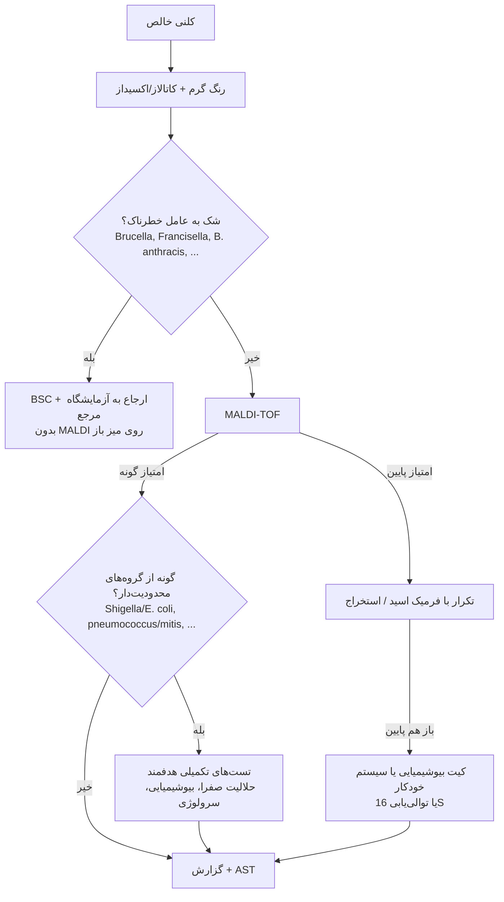

# سیستم‌های شناسایی: کیت‌های دستی، خودکار و MALDI-TOF

> مبنا: CLSI **M58** (Methods for the Identification of Cultured Microorganisms Using MALDI-TOF MS)، دستورالعمل سازندگان، Manual of Clinical Microbiology (ASM).

---

## ۵.۱ کیت‌های بیوشیمیایی دستی (Miniaturized)
| کیت | تعداد آزمون | گروه هدف | خوانش |
|---|---|---|---|
| **API 20E** | ۲۰ | Enterobacterales و گرم منفی‌های دیگر | ۱۸–۲۴ ساعت؛ **پروفایل عددی ۷ رقمی** ← پایگاه داده (apiweb) |
| **API 20NE** | ۲۰ | **غیرتخمیری‌ها** | ۲۴–۴۸ ساعت |
| **API Staph**، **API 20 Strep**، **API Coryne**، **API NH** (*Neisseria*/*Haemophilus*)، **API 20A**/**Rapid ID 32A** (بی‌هوازی‌ها)، **API Campy** | | | |
| **RapID** (Remel): ONE، NF Plus، NH، ANA II، STR | آنزیم‌های از پیش ساخته‌شده | | **۴ ساعت** (بدون نیاز به رشد) |
| **Crystal** (BD) | | | |

**منطق پروفایل عددی:** آزمون‌ها در گروه‌های سه‌تایی با وزن **۱، ۲، ۴**؛ جمع وزن‌های مثبت هر گروه = یک رقم.
**تفسیر احتمال:** «عالی/خیلی خوب/خوب» (مثلاً %id ≥ ۹۹٫۹، T ≥ ۰٫۷۵) ← قابل‌قبول؛ «قابل‌قبول پایین/غیرقابل‌قبول» ← **تست‌های تکمیلی** پیشنهادی پایگاه داده.

---

## ۵.۲ سیستم‌های خودکار شناسایی
| سیستم | اصول | کارت/پنل‌ها |
|---|---|---|
| **Vitek 2** | **فلورسانس و کدورت** در کارت‌های میکروچاهکی | GN، GP، **NH**، **ANC** (بی‌هوازی و کورینه)، YST |
| **BD Phoenix** | **کروموژن/فلوروژن** و شناساگرهای pH | ID/AST ترکیبی |
| **MicroScan** | پانل‌های خشک/سریع | |

- معمولاً **همراه AST** (← [AST/01_Phenotypic_Methods/07_Automated_Systems.md](../AST/01_Phenotypic_Methods/07_Automated_Systems.md)).
- **محدودیت:** سخت‌رشدها، بی‌هوازی‌ها، گونه‌های جدید یا نادر، و **گونه‌های نزدیک** (*Burkholderia*، *Achromobacter*، استرپ‌های ویریدانس).

---

## ۵.۳ MALDI-TOF MS

### اصول
1. کلنی روی **صفحهٔ هدف (target)** + **ماتریکس** (معمولاً **α-سیانو-۴-هیدروکسی‌سینامیک اسید، HCCA**).
2. **لیزر** ← یونیزه شدن پروتئین‌ها (بیشتر **ریبوزومی**، **۲–۲۰ kDa**).
3. **زمان پرواز (Time-of-Flight)** تا آشکارساز ← نسبت **m/z** ← **طیف (اثر انگشت پروتئینی)**.
4. مقایسه با **پایگاه دادهٔ طیف‌های مرجع** ← امتیاز/درصد اطمینان.

### آماده‌سازی نمونه
| روش | کاربرد |
|---|---|
| **انتقال مستقیم (Direct transfer)** | اکثر گرم منفی‌ها |
| **انتقال مستقیم گسترش‌یافته (eDT)**: + **۱ µL فرمیک اسید ۷۰٪** روی لکه پیش از ماتریکس | **گرم مثبت‌ها، مخمرها**، ارگانیسم‌های امتیاز پایین |
| **استخراج کامل** (اتانول/فرمیک اسید/استونیتریل) | *Nocardia*، مایکوباکتری‌ها، کپک‌ها، موارد دشوار |
| **مستقیم از کشت خون مثبت** (Sepsityper، لیز + سانتریفیوژ) | شناسایی سریع (≈ ۳۰ دقیقه) ← ماژول [01_Blood_Culture](../01_Blood_Culture/README.md) |
| **مایکوباکتری‌ها** | **غیرفعال‌سازی** (حرارت ۹۵°C یا اتانول ۷۰٪) پیش از استخراج؛ دانه‌های سیلیکا برای شکستن دیواره |

### تفسیر امتیاز (نمونه)
| سیستم | امتیاز | تفسیر |
|---|---|---|
| **Bruker Biotyper** | **≥ ۲٫۰۰** | شناسایی **گونه** (در نسخه‌های جدیدتر برای بسیاری از گونه‌ها ≥ ۱٫۸۰ پذیرفته است؛ طبق IFU) |
| | ۱٫۷۰–۱٫۹۹ | **جنس** (یا گونه با احتیاط) |
| | کمتر از ۱٫۷۰ | **بدون شناسایی قابل‌اعتماد** ← تکرار با فرمیک اسید/استخراج |
| **Vitek MS** | **۶۰–۹۹٫۹٪** (یک گزینه) | شناسایی |
| | چند گزینه («split») | **شناسایی کم‌تمایز** ← تست‌های تکمیلی |

### محدودیت‌های مهم (باید حفظ شوند)
| مشکل | توضیح | راه‌حل |
|---|---|---|
| ***E. coli* در برابر *Shigella*** | **جدا نمی‌کند** (طیف تقریباً یکسان) | بیوشیمیایی (لیزین، استات، ایندول/گاز) + سرولوژی |
| ***S. pneumoniae* در برابر *S. mitis/oralis*، *S. pseudopneumoniae*** | شناسایی نادرست پنوموکوک (به‌ویژه در پایگاه‌های قدیمی) | **حلالیت صفرا**، اپتوچین |
| **گروه *B. cereus*** (*B. anthracis*، *B. cereus*، *B. thuringiensis*) | *B. anthracis* در پایگاه **IVD** نیست؛ ممکن است *B. cereus* گزارش شود | ⚠️ ایمنی؛ تحرک، همولیز، الگوریتم Sentinel |
| ***Brucella*** | در پایگاه IVD نیست ← ممکن است **«*Ochrobactrum*»** گزارش شود | ⚠️ **خطر عفونت آزمایشگاهی** (آئروسل از لکه‌گذاری روی میز باز) |
| ***Francisella*، *Burkholderia mallei/pseudomallei*، *Y. pestis*** | در پایگاه IVD نیستند یا اشتباه می‌شوند (*B. thailandensis*) | پایگاه **RUO/امنیتی**؛ آزمایشگاه مرجع |
| ***Salmonella*** | فقط **جنس**؛ سروتیپ نمی‌دهد | سرولوژی |
| ***E. cloacae* complex**، ***K. pneumoniae* در برابر *K. variicola*/*K. quasipneumoniae***، ***Citrobacter freundii* complex** | تمایز گونه‌ها محدود | گزارش در سطح complex |
| ***Burkholderia cepacia* complex**، ***Achromobacter***، ***Aeromonas*** | گونه‌ها جدا نمی‌شوند | گزارش در سطح گروه؛ توالی‌یابی (*recA*) |
| **کشت مخلوط** | طیف مخلوط ← امتیاز پایین یا شناسایی نادرست | **کلنی خالص** |
| **سویه‌های موکوئید**، **SCV**، کلنی‌های بسیار کوچک | امتیاز پایین | فرمیک اسید، استخراج |

### ایمنی زیستی
- لکه‌گذاری کلنی‌های ناشناختهٔ مشکوک (کوکوباسیل گرم منفی کندرشد، رشد فقط پس از ۴۸ ساعت) ← **در BSC** و **پس از غیرفعال‌سازی** (فرمیک اسید/اتانول).
- قانون: **«MALDI-TOF ابزار rule-out عوامل بیوتروریسم نیست.»**

---

## ۵.۴ الگوریتم کلی شناسایی در آزمایشگاه نوین

