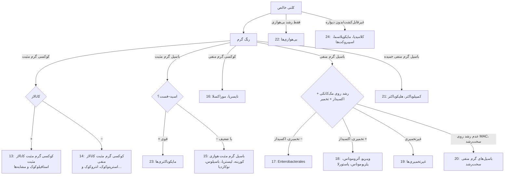

# کتابخانهٔ تست‌های شناسایی

## معرفی
هر تست شناسایی در این پوشه **فقط یک بار** شرح داده می‌شود. محیط‌های بیوشیمیایی لوله‌ای (TSI، LIA، SIM، سیترات، اوره، MR-VP، OF، دکربوکسیلازها، بایل اسکولین، NaCl ۶٫۵٪، قندهای CTA) چون **محیط** هستند در [11_Culture_Media/08_Biochemical_Tube_Media.md](../11_Culture_Media/08_Biochemical_Tube_Media.md) آمده‌اند و این‌جا تکرار نمی‌شوند. ماژول‌های خانواده‌ها (۱۳ تا ۲۴) **جدول‌ها و فلوچارت‌ها** را می‌سازند و برای جزئیات هر تست به این‌جا ارجاع می‌دهند.

## ساختار هر تست
اساس (واکنش) · روش · تفسیر (مثبت/منفی با مثال) · QC (سویهٔ مثبت و منفی) · دام‌ها و محدودیت‌ها

## نقشهٔ پوشه

| فایل | محتوا |
|---|---|
| [01_Microscopy_Stains.md](01_Microscopy_Stains.md) | رنگ گرم (خطاها، ارگانیسم‌های گمراه‌کننده، مورفولوژی‌ها)، اسید–فست (ZN، کینیون، اورامین، اصلاح‌شده)، سایر رنگ‌ها و روش‌ها |
| [02_Spot_Rapid_Tests.md](02_Spot_Rapid_Tests.md) | کاتالاز، اکسیداز، کوآگولاز (لام/لوله/لاتکس)، PYR، LAP، ایندول اسپات، حلالیت صفرا، هیپورات، بوتیرات استراز، سوپراکسول، DNase، ONPG، اوره‌آز سریع، نخ، ایندوکسیل استات |
| [03_Disk_and_Growth_Tests.md](03_Disk_and_Growth_Tests.md) | اپتوچین، باسیتراسین، نووبیوسین، دیسک‌های ویژهٔ بی‌هوازی، X/V و پورفیرین، اقمار، CAMP و CAMP معکوس، ناگلر، هوازی‌تحملی، تحرک، دما و نمک، اسپور، ایمنی زیستی |
| [04_Antigen_Serology.md](04_Antigen_Serology.md) | لانسفیلد، سروتایپینگ *Salmonella*/*Shigella*/O157/*V. cholerae*/مننگوکوک/Hib، آنتی‌ژن‌های مستقیم (GAS، ادراری، *C. difficile*، *H. pylori*، MPT64) |
| [05_Identification_Systems.md](05_Identification_Systems.md) | API/RapID، Vitek 2/Phoenix/MicroScan، **MALDI-TOF** (اصول، امتیاز، محدودیت‌ها، ایمنی)، الگوریتم کلی |
| [06_Molecular_ID.md](06_Molecular_ID.md) | 16S rRNA (CLSI MM18)، ژن‌های دیگر، پنل‌های سندرمی، WGS و mNGS |

## مسیر اولیهٔ شناسایی (از کلنی تا خانواده)

## منابع
- Leber AL (ed). *Clinical Microbiology Procedures Handbook.* 5th ed. ASM Press.
- Carroll KC, Pfaller MA (eds). *Manual of Clinical Microbiology.* 13th ed. ASM Press; 2023.
- Tille PM. *Bailey & Scott's Diagnostic Microbiology.* 15th ed.
- Procop GW, et al. *Koneman's Color Atlas and Textbook of Diagnostic Microbiology.* 7th ed.
- CLSI **M58** (MALDI-TOF identification)؛ CLSI **MM18** (sequencing-based identification)؛ CLSI **M35** (Abbreviated identification of bacteria and yeast).
- ASM. *Sentinel Level Clinical Laboratory Guidelines* (agents of bioterrorism).
