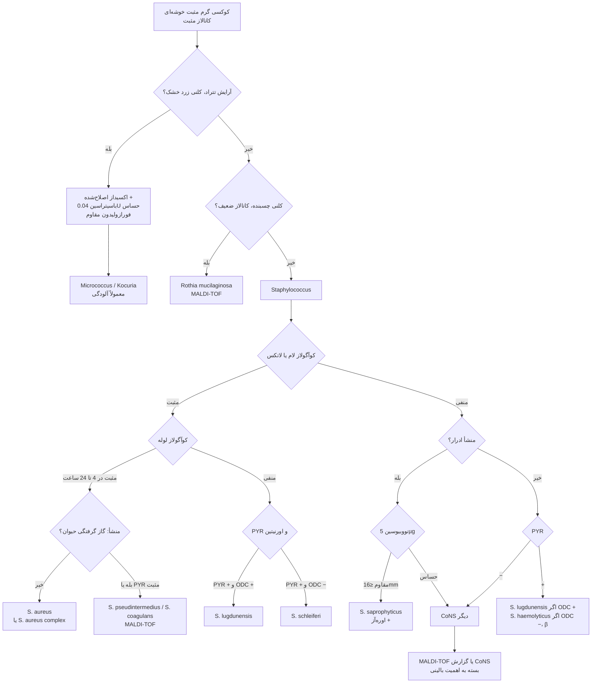
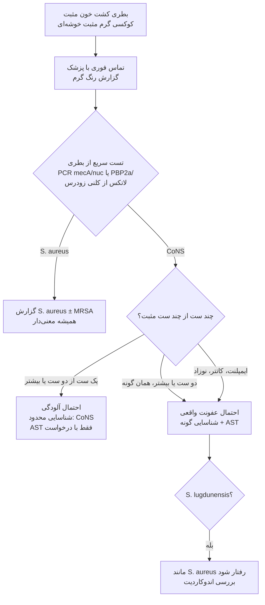

# فلوچارت‌های تشخیصی: کوکسی‌های گرم مثبت کاتالاز مثبت

## فلوچارت ۱: از رنگ گرم تا گونه

### منطق شاخه‌ها
1. **کاتالاز مثبت** ← استاف و مشابه‌ها (و ابتدا مطمئن شوید کاتالاز از آگار خون **مثبت کاذب** نیست).
2. **تتراد + زرد + اکسیداز اصلاح‌شده مثبت** ← *Micrococcus*. اگر کلنی چسبنده و کاتالاز ضعیف ← *Rothia*.
3. **کوآگولاز لام منفی** همیشه به **لوله** نمی‌رود، ولی **لام مثبت** ممکن است *S. lugdunensis*/*S. schleiferi* باشد ← **تأیید با لوله**.
4. **ادرار + نووبیوسین R** ← *S. saprophyticus* (*S. cohnii*/*S. xylosus* نادرند).
5. **PYR + ODC** دو تست ارزان برای پیدا کردن ***S. lugdunensis*** در میان CoNS.

---

## فلوچارت ۲: کشت خون با کوکسی گرم مثبت خوشه‌ای (تصمیم بالینی)

> قواعد تصمیم بالینی برای CoNS در خون (تعداد ست، زمان تا مثبت شدن، وجود وسیله) ← ماژول [01_Blood_Culture](../01_Blood_Culture/README.md).
