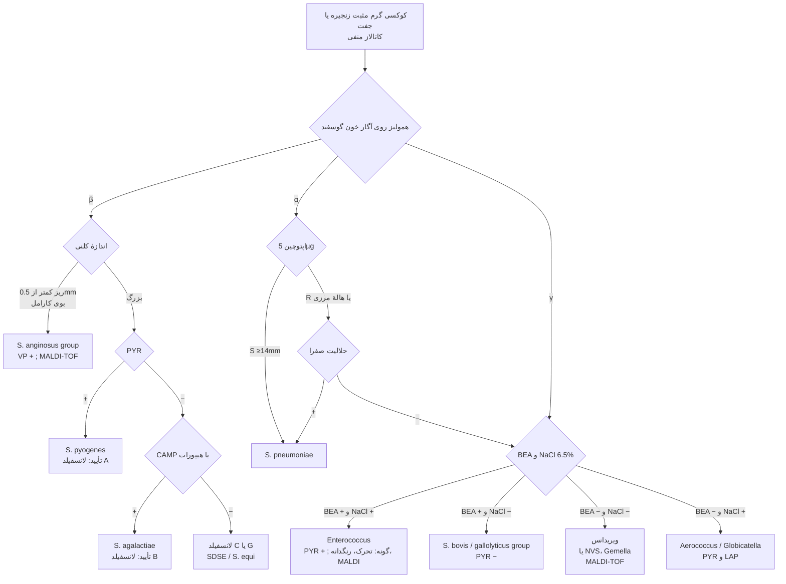
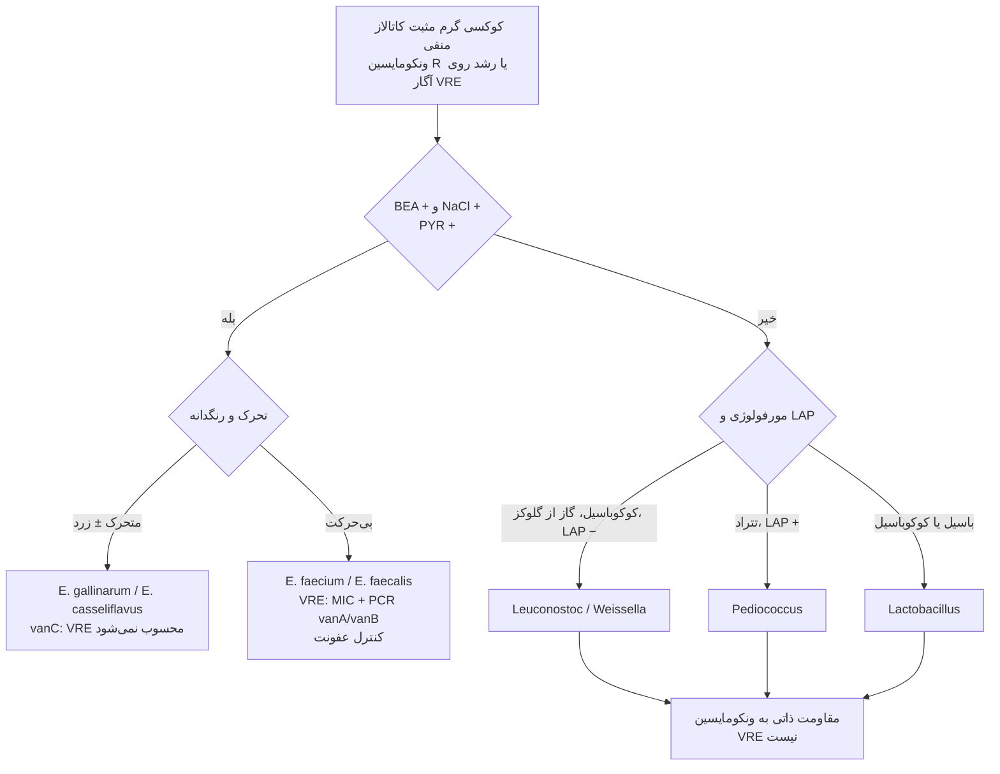
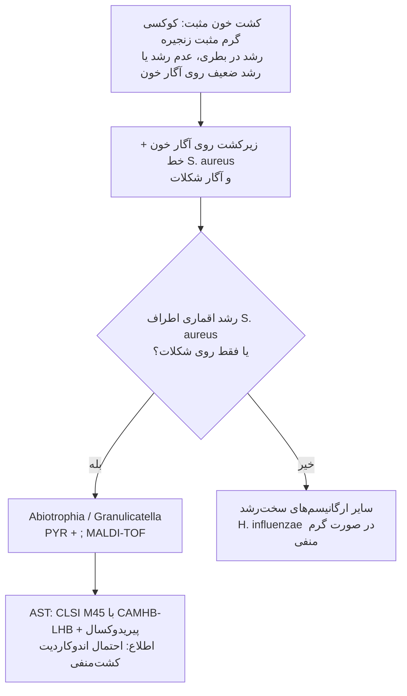

# فلوچارت‌های تشخیصی: کوکسی‌های گرم مثبت کاتالاز منفی

## فلوچارت ۱: بر اساس همولیز

### منطق شاخه‌ها
1. **همولیز** اولین شاخه است، ولی کافی نیست: GBS غیرهمولیتیک، انتروکوک β‌همولیتیک، پنوموکوک گاه γ در محیط بی‌هوازی.
2. در β: **اندازهٔ کلنی** پیش از لانسفیلد؛ کلنی ریز با آنتی‌ژن A = *S. anginosus* group، **نه GAS**.
3. در α: **اپتوچین** غربالگری؛ هالهٔ مرزی (به‌ویژه در CO₂) ← **حلالیت صفرا** (قطعی‌تر).
4. **BEA + NaCl ۶٫۵٪ + PYR** سه تست ارزان برای جدا کردن انتروکوک از *S. bovis* (ارتباط با سرطان کولون).

---

## فلوچارت ۲: کوکسی گرم مثبت کاتالاز منفی **مقاوم به ونکومایسین**

---

## فلوچارت ۳: اقمار و استرپتوکوک‌های نیازمند تغذیه (NVS)

