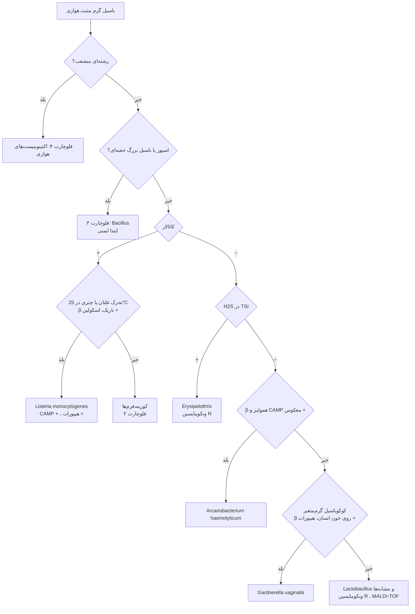
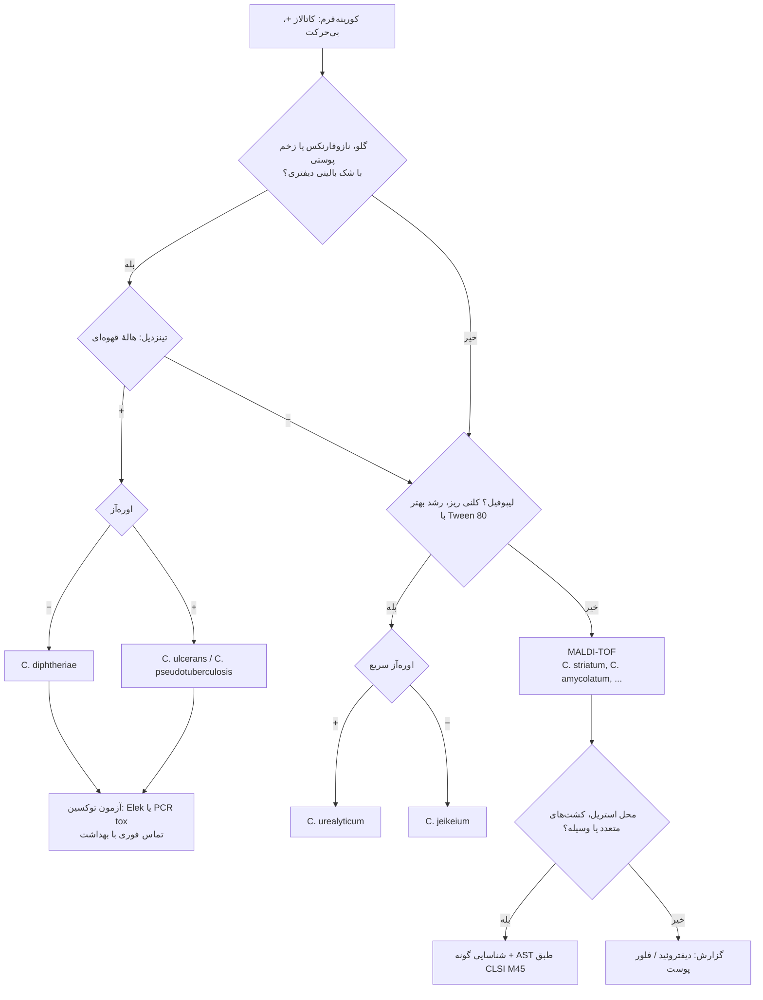
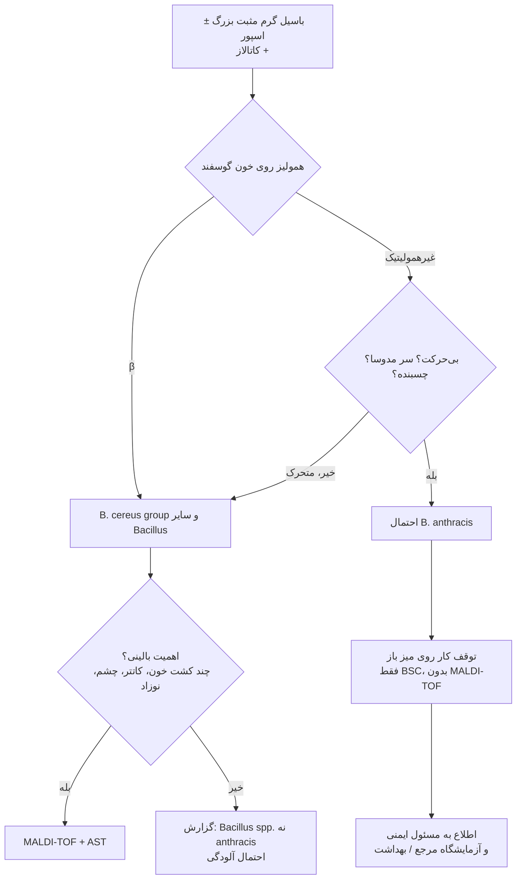
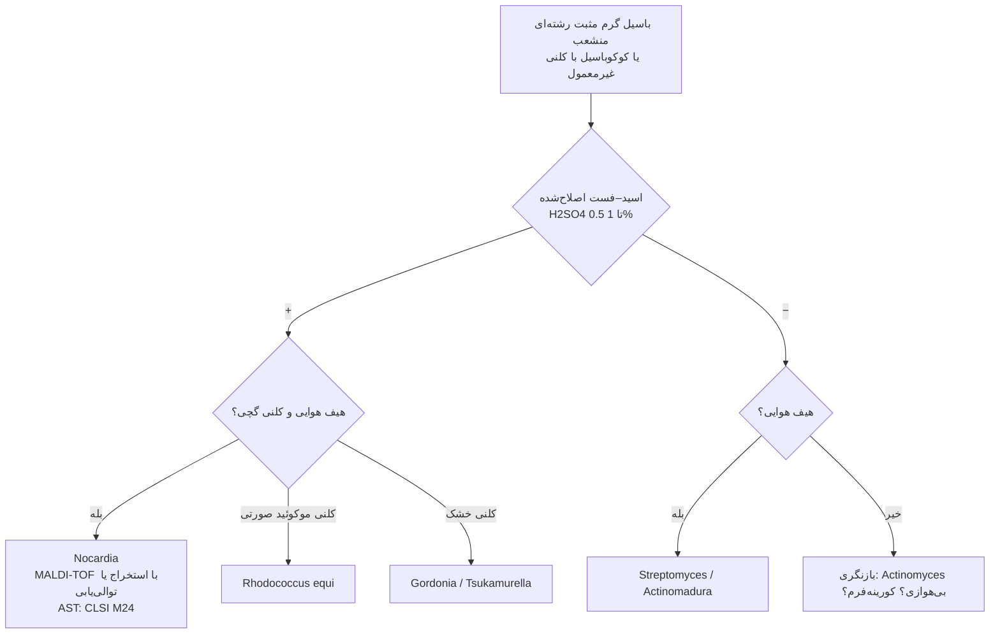

# فلوچارت‌های تشخیصی: باسیل‌های گرم مثبت هوازی

## فلوچارت ۱: فلوچارت اصلی

### منطق شاخه‌ها
1. **کاتالاز** بزرگ‌ترین تقسیم‌کننده است.
2. *Listeria* کوتاه و گاه کوکوئید است ← با استرپتوکوک (کاتالاز −) یا دیفتروئید اشتباه می‌شود؛ **تحرک ۲۵°C** و **اسکولین** کلیدند.
3. **H₂S در TSI** در باسیل گرم مثبت کاتالاز منفی ← تقریباً همیشه ***Erysipelothrix***.

---

## فلوچارت ۲: کورینه‌فرم‌ها

---

## فلوچارت ۳: *Bacillus* و پروتکل Sentinel

---

## فلوچارت ۴: اکتینومیست‌های هوازی

