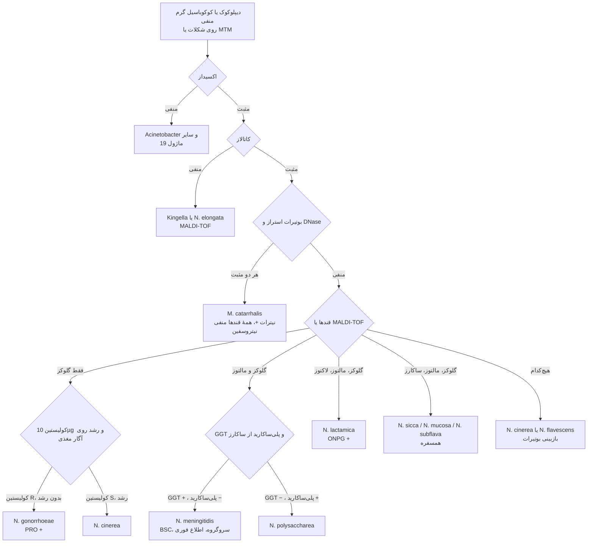
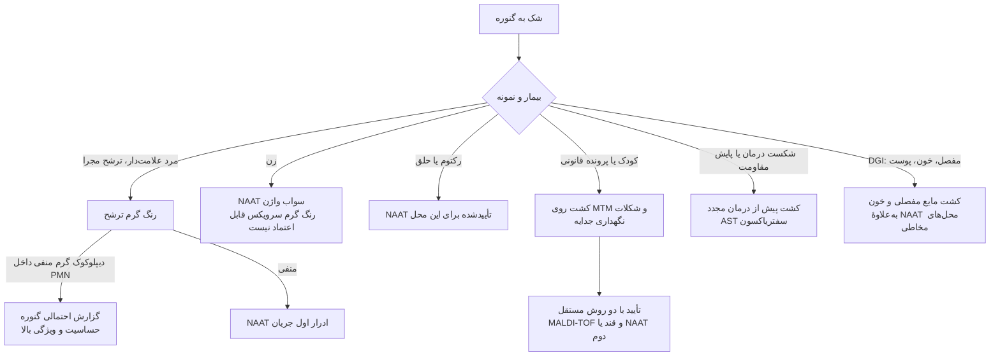
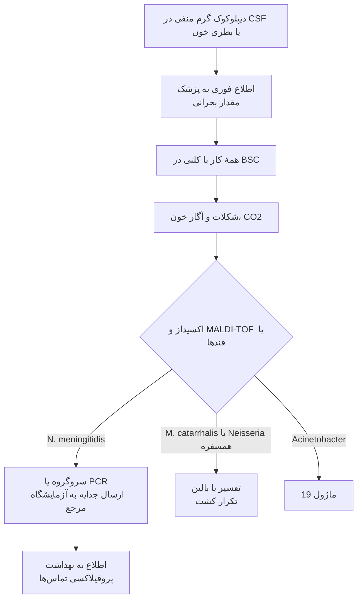

# فلوچارت‌های تشخیصی: کوکسی‌های گرم منفی

## فلوچارت ۱: از دیپلوکوک گرم منفی تا گونه

### منطق شاخه‌ها
- **اکسیداز و کاتالاز اول:** دو شبیه مهم (*Acinetobacter* اکسیداز −؛ *Kingella* کاتالاز −) در همین دو گام حذف می‌شوند.
- **بوتیرات + DNase** سریع‌ترین راه شناسایی *M. catarrhalis* است (۵ دقیقه).
- **«فقط گلوکز» کافی نیست:** همیشه **کولیستین** و **رشد روی آگار مغذی** (یا MALDI-TOF) را اضافه کنید تا *N. cinerea* حذف شود.
- **مننگوکوک:** GGT تنها آنزیم اختصاصی است؛ *N. polysaccharea* روی محیط انتخابی رشد می‌کند و الگوی قندی یکسان دارد.

## فلوچارت ۲: تشخیص گنوکوک بر اساس نوع نمونه

## فلوچارت ۳: دیپلوکوک گرم منفی در CSF یا خون

