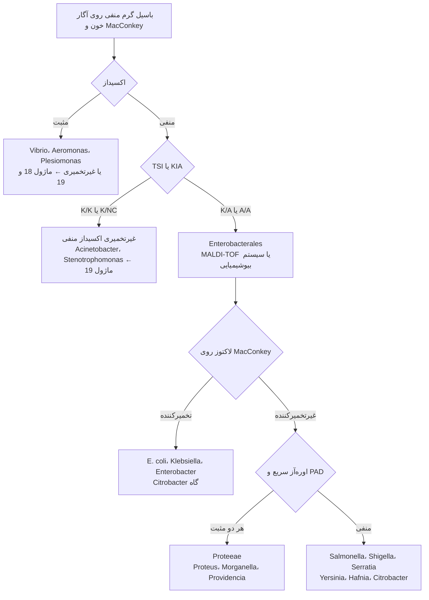
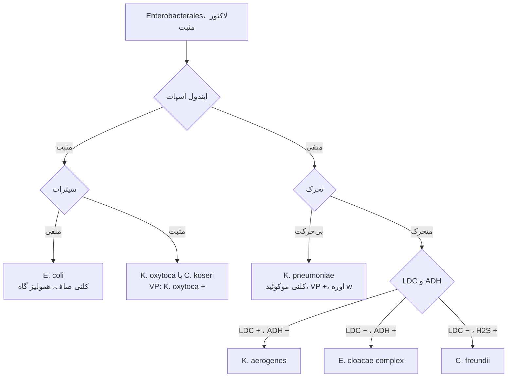
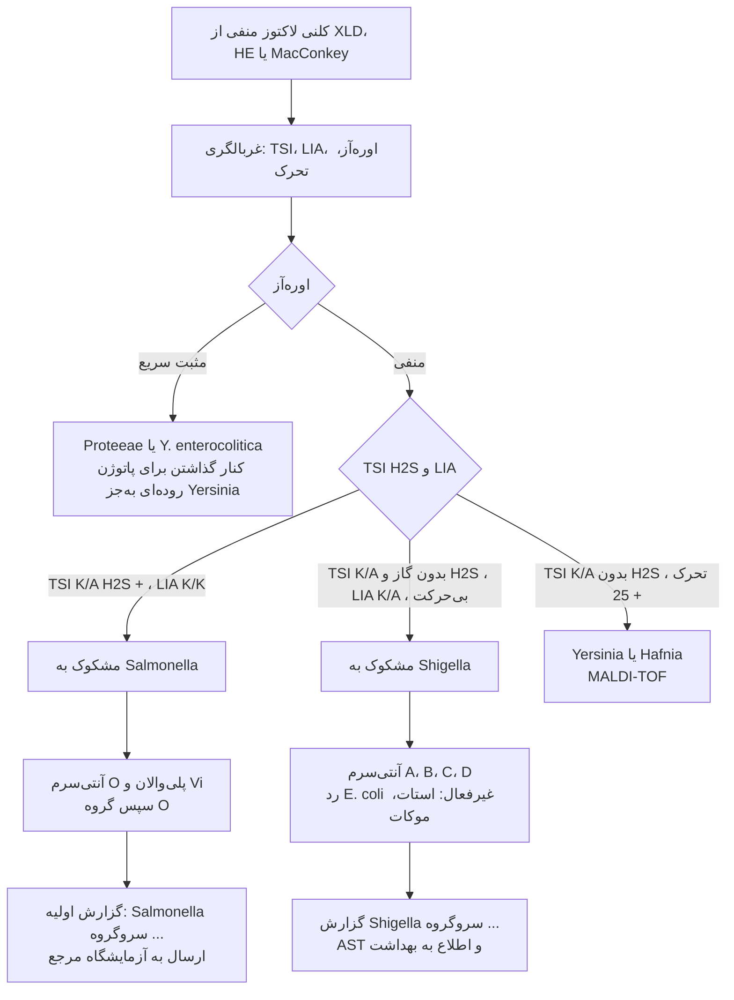
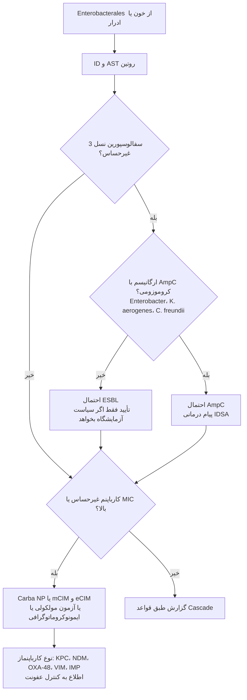

# فلوچارت‌های تشخیصی: Enterobacterales

## فلوچارت ۱: از باسیل گرم منفی تا گروه

## فلوچارت ۲: تخمیرکنندگان لاکتوز

## فلوچارت ۳: غیرتخمیرکنندگان لاکتوز و پاتوژن‌های روده‌ای

### منطق شاخه‌ها
- **اوره‌آز اول** در مدفوع: *Proteus* (کلنی H₂S + روی XLD/HE) شایع‌ترین «شبه‌*Salmonella*» است؛ اوره‌آز سریع آن را حذف می‌کند.
- **LIA:** *Salmonella* لیزین + (K/K) و *Proteus* دآمیناز + (R/A) است.
- **MALDI-TOF** *Salmonella* را تا جنس شناسایی می‌کند ولی **سروتیپ نمی‌دهد**؛ *Shigella* را از *E. coli* **جدا نمی‌کند**.
- سرولوژی **روی کلنی از محیط غیرانتخابی** (آگار خون یا TSI شیب) انجام شود.

## فلوچارت ۴: کشت خون یا ادرار با Enterobacterales ← مسیر AST

> جزئیات: [ESBL](../AST/02_Beta_Lactamases/03_ESBL.md) · [AmpC](../AST/02_Beta_Lactamases/04_AmpC.md) · [کارباپنمازها](../AST/02_Beta_Lactamases/05_Carbapenemases.md) · [انتخاب و گزارش](../AST/00_Principles/03_Selection_and_Reporting.md).
