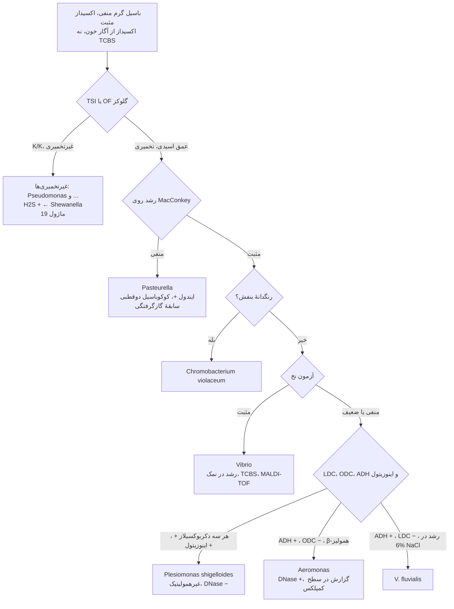
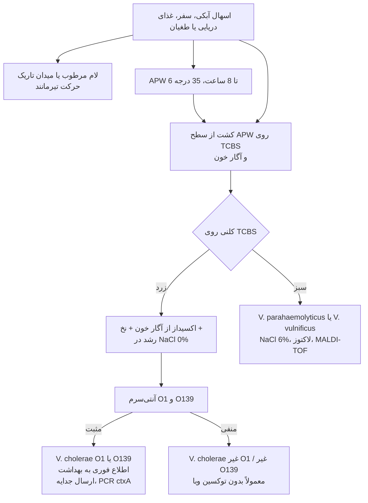
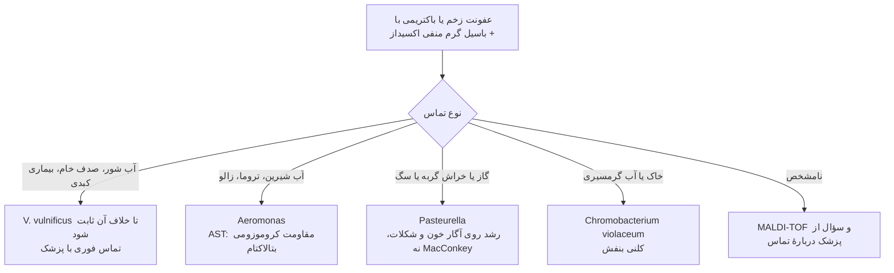

# فلوچارت‌های تشخیصی: باسیل‌های گرم منفی اکسیداز مثبت تخمیرکننده

## فلوچارت ۱: از باسیل گرم منفی اکسیداز مثبت تا جنس

### منطق شاخه‌ها
- **اکسیداز را از TCBS یا MacConkey نگیرید:** اسید و رنگ محیط ← **منفی کاذب** ← *Vibrio* یا *Aeromonas* «Enterobacterales» شناسایی می‌شود. همیشه از **آگار خون**.
- **MacConkey منفی** در یک باسیل اکسیداز + تخمیری با سابقهٔ گازگرفتگی ← تقریباً همیشه *Pasteurella*.
- **آزمون نخ** سریع‌ترین راه جدا کردن *Vibrio* از *Aeromonas* است؛ تأیید نهایی با رشد در نمک و MALDI-TOF.

## فلوچارت ۲: شک به *Vibrio* در مدفوع

### منطق شاخه‌ها
- **APW** کوتاه (۶–۸ ساعت) است؛ بیشتر از آن فلور روده رشد می‌کند. کشت از **لایهٔ سطحی** (*Vibrio* هوازی و متحرک است).
- **پانل‌های مولکولی مدفوع** *Vibrio* را بدون کشت شناسایی می‌کنند ولی برای **سروگروه، توکسین، اپیدمیولوژی و AST** کشت لازم است.

## فلوچارت ۳: زخم یا خون با سابقهٔ تماس

