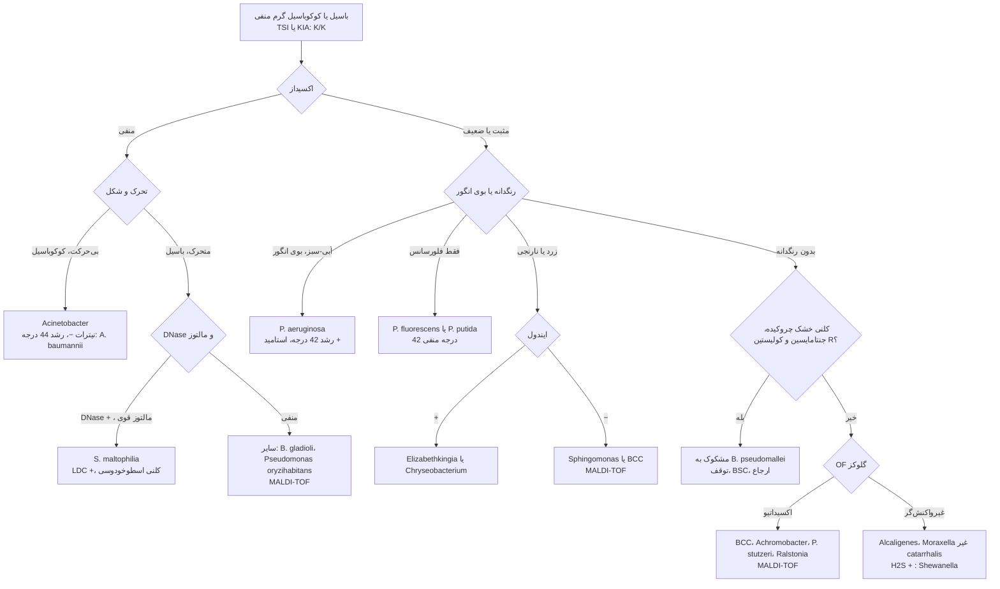
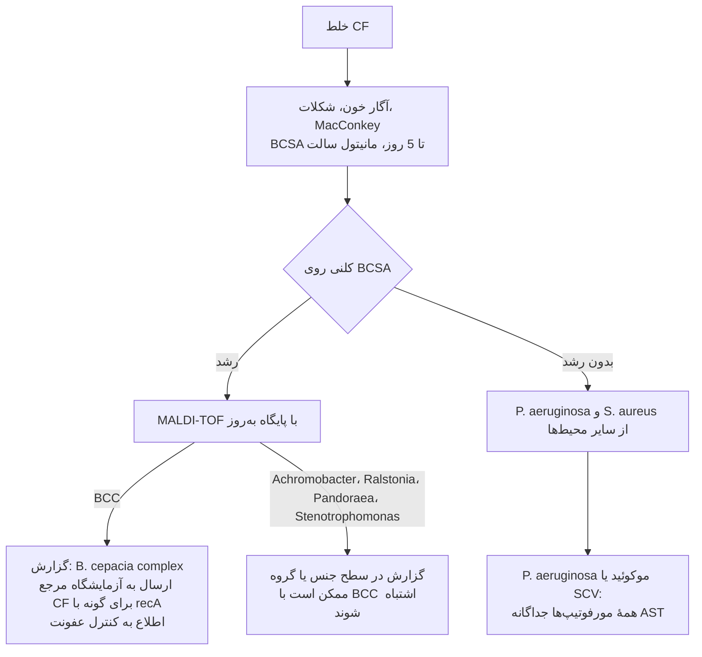
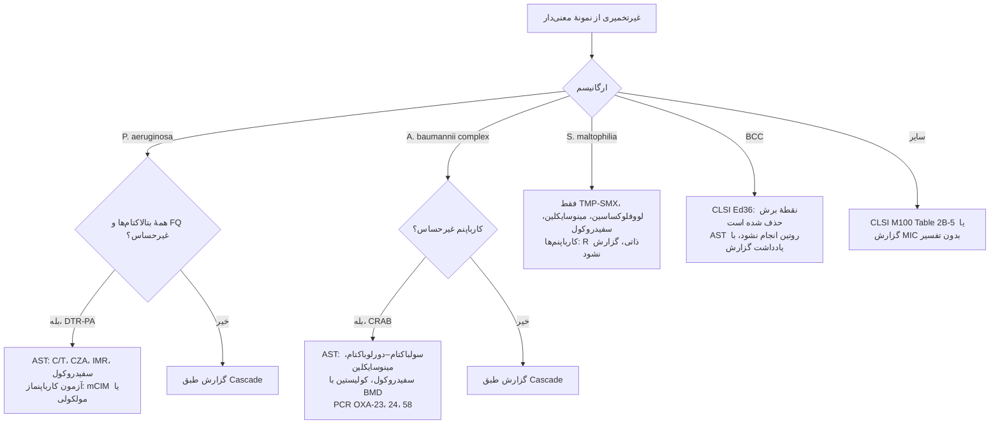

# فلوچارت‌های تشخیصی: باسیل‌های گرم منفی غیرتخمیری

## فلوچارت ۱: از K/K تا جنس

### منطق شاخه‌ها
- **K/K** باید پیش از هر چیز تأیید شود؛ اکسیداز + و K/A یعنی تخمیرکننده ← [18](../18_Oxidase_Positive_Fermenters/README.md).
- ***Acinetobacter*** تنها غیرتخمیری شایع **اکسیداز منفی و بی‌حرکت** است؛ کوکوباسیل‌های آن در رنگ گرم ممکن است **دیپلوکوک** یا حتی **گرم مثبت** دیده شوند.
- **B. pseudomallei** را قبل از استفاده از سیستم خودکار یا MALDI-TOF در نظر بگیرید (سابقهٔ سفر یا زندگی در مناطق آندمیک، دیابت).

## فلوچارت ۲: خلط بیمار فیبروز کیستیک (CF)

## فلوچارت ۳: مسیر AST

