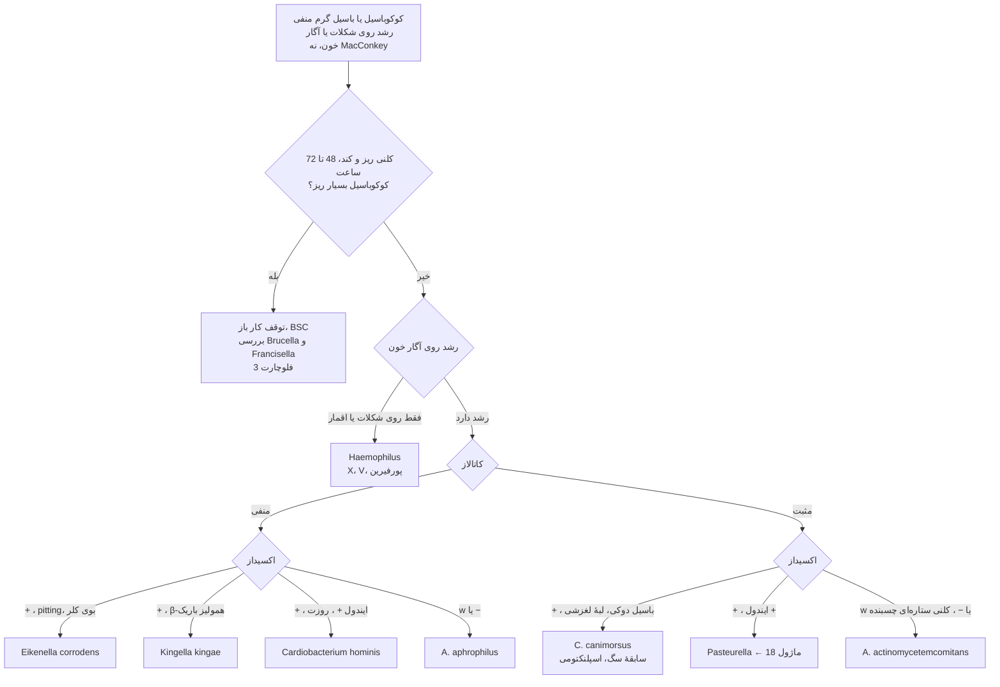
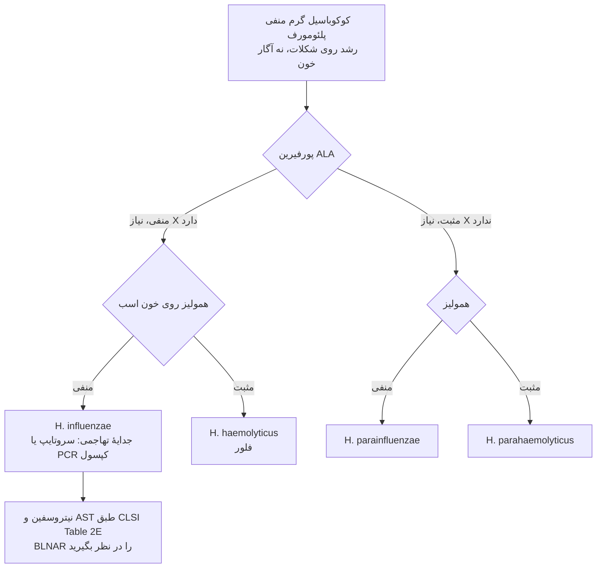
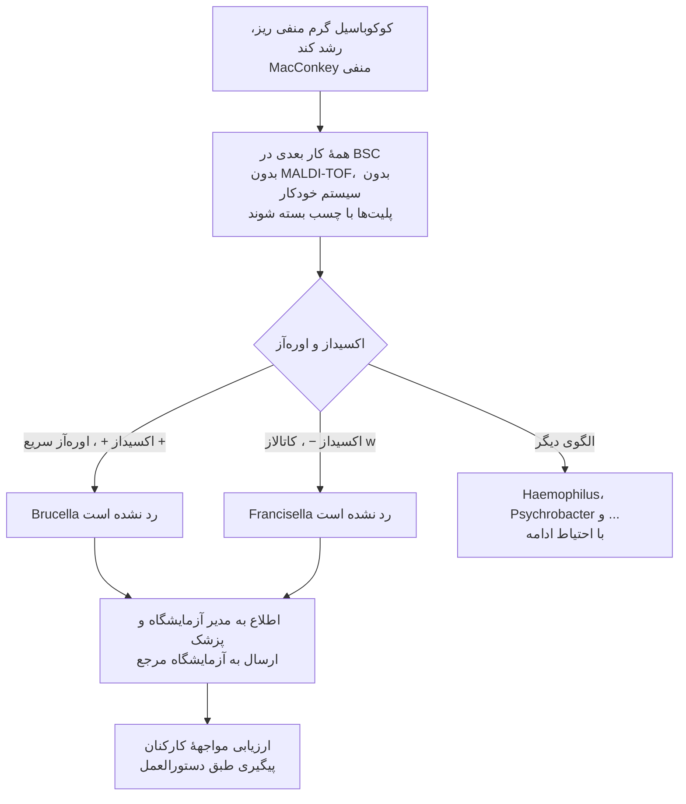

# فلوچارت‌های تشخیصی: گرم منفی‌های سخت‌رشد

## فلوچارت ۱: کوکوباسیل گرم منفی که روی MacConkey رشد نمی‌کند

### منطق شاخه‌ها
- **ایمنی اول:** پیش از هر آزمون، الگوی «کوکوباسیل ریز + رشد کند + MacConkey منفی» را بسنجید.
- **کاتالاز** HACEK را دو نیم می‌کند: *Cardiobacterium*، *Eikenella*، *Kingella*، *A. aphrophilus* منفی؛ *A. actinomycetemcomitans* مثبت.
- **MALDI-TOF** برای HACEK و *Capnocytophaga* معمولاً خوب است؛ برای *Brucella*/*Francisella* استفاده نشود.

## فلوچارت ۲: *Haemophilus*

## فلوچارت ۳: شک به *Brucella* یا *Francisella* ☣️

