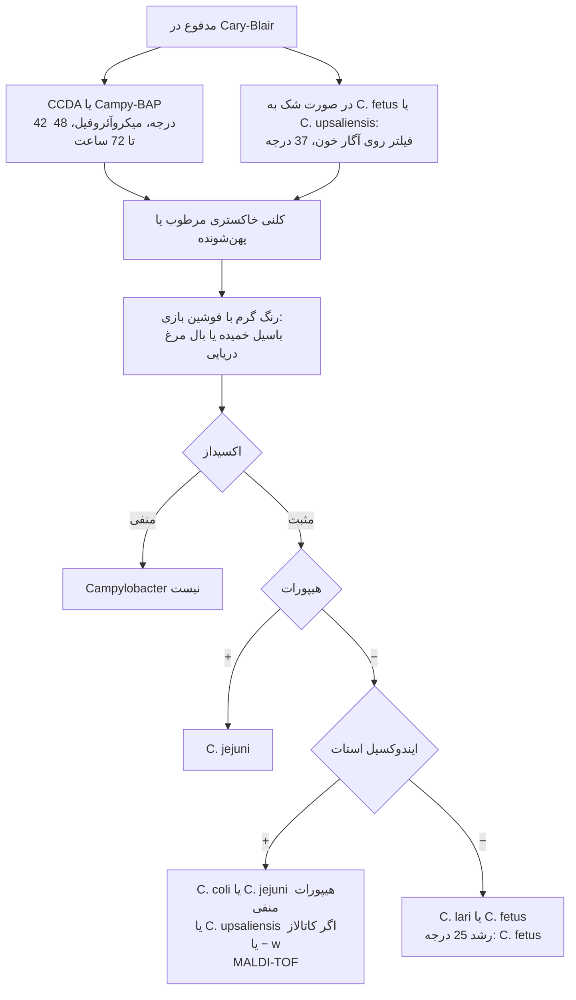
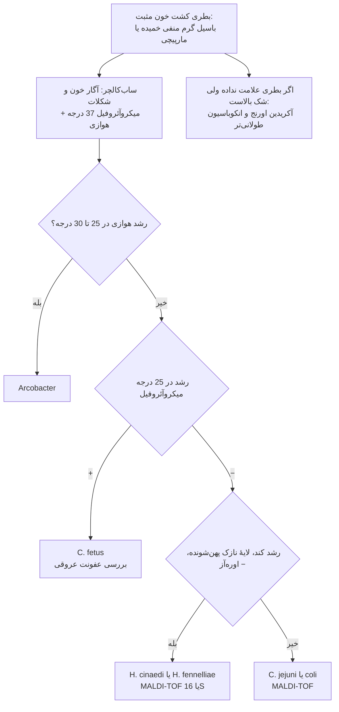
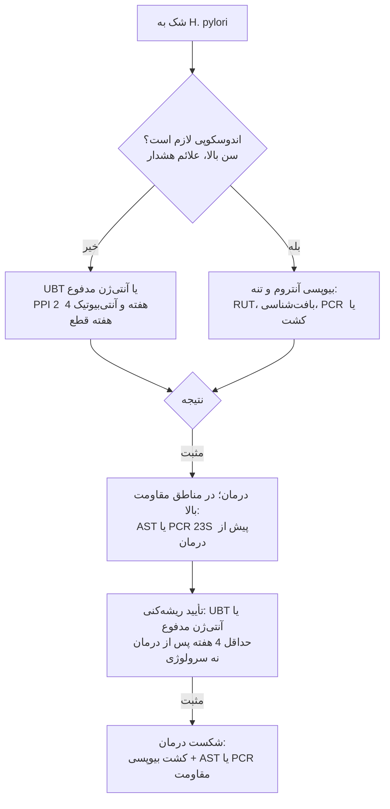

# فلوچارت‌های تشخیصی: باسیل‌های گرم منفی خمیده

## فلوچارت ۱: *Campylobacter* در مدفوع

### منطق شاخه‌ها
- **۴۲°C + آنتی‌بیوتیک‌ها** فلور را مهار می‌کنند ولی *C. fetus* و *C. upsaliensis* را هم از دست می‌دهند.
- **MALDI-TOF** برای *Campylobacter* تا گونه خوب است و هیپورات/ایندوکسیل را جایگزین می‌کند.

## فلوچارت ۲: باسیل خمیده در کشت خون

## فلوچارت ۳: انتخاب آزمون *H. pylori*

