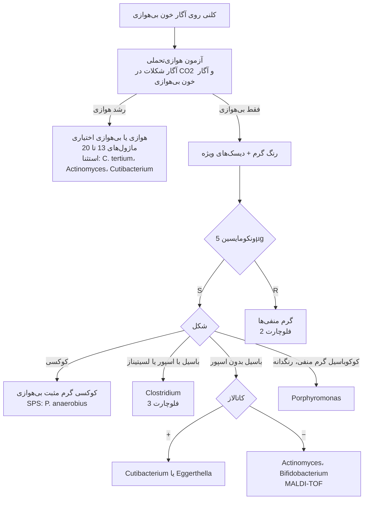
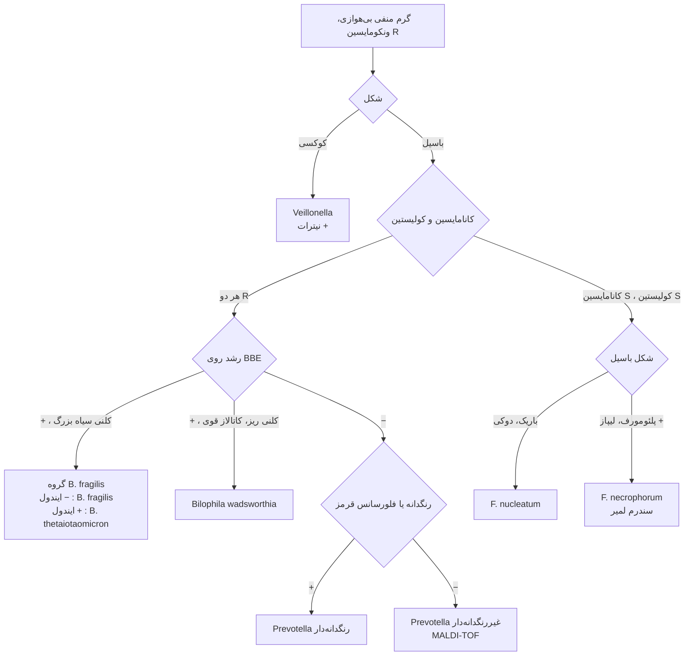
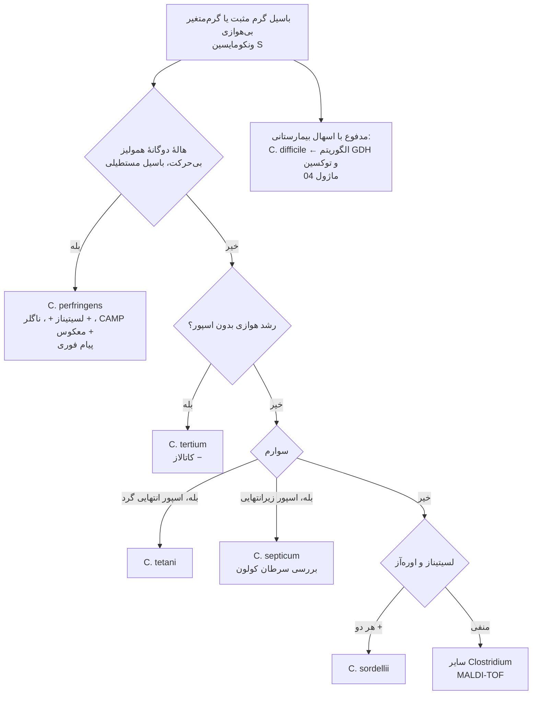

# فلوچارت‌های تشخیصی: باکتری‌های بی‌هوازی

## فلوچارت ۱: از پلیت بی‌هوازی تا گروه

## فلوچارت ۲: گرم منفی‌های بی‌هوازی

## فلوچارت ۳: *Clostridium*

> اسپور را با **رنگ‌آمیزی اسپور** یا **شوک الکلی/حرارتی** نشان دهید؛ *C. perfringens*، *C. ramosum* و *C. clostridioforme* به‌ندرت اسپور نشان می‌دهند.
