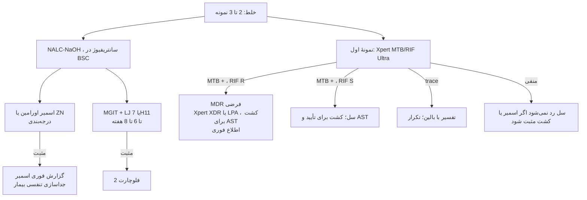
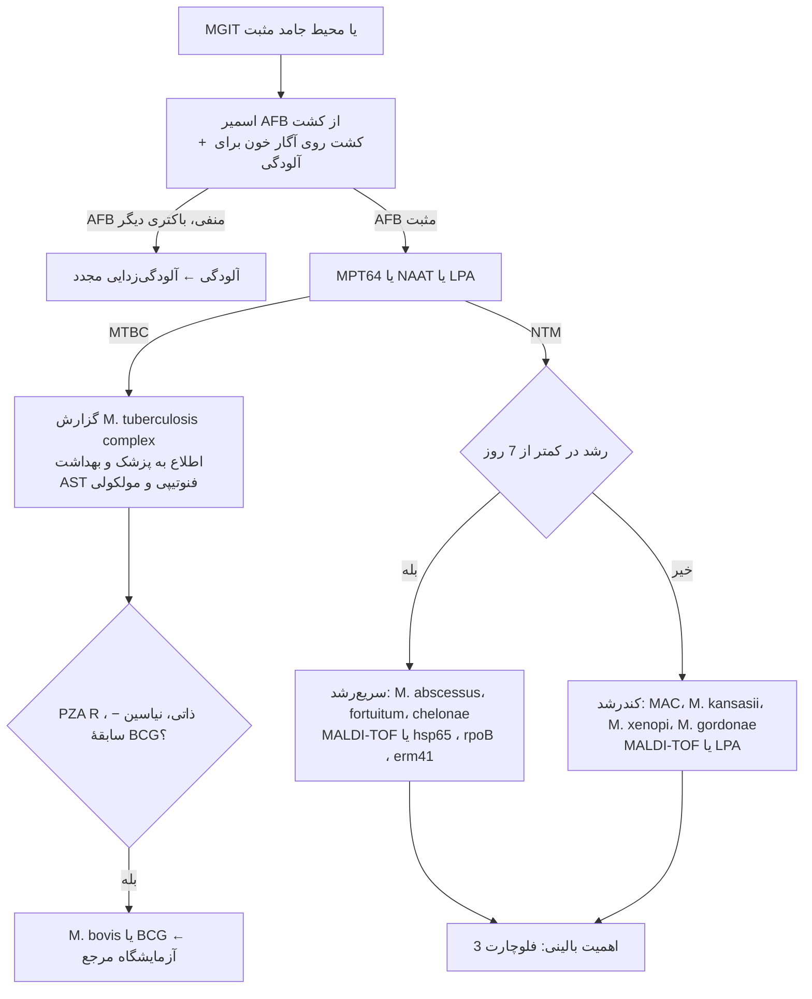
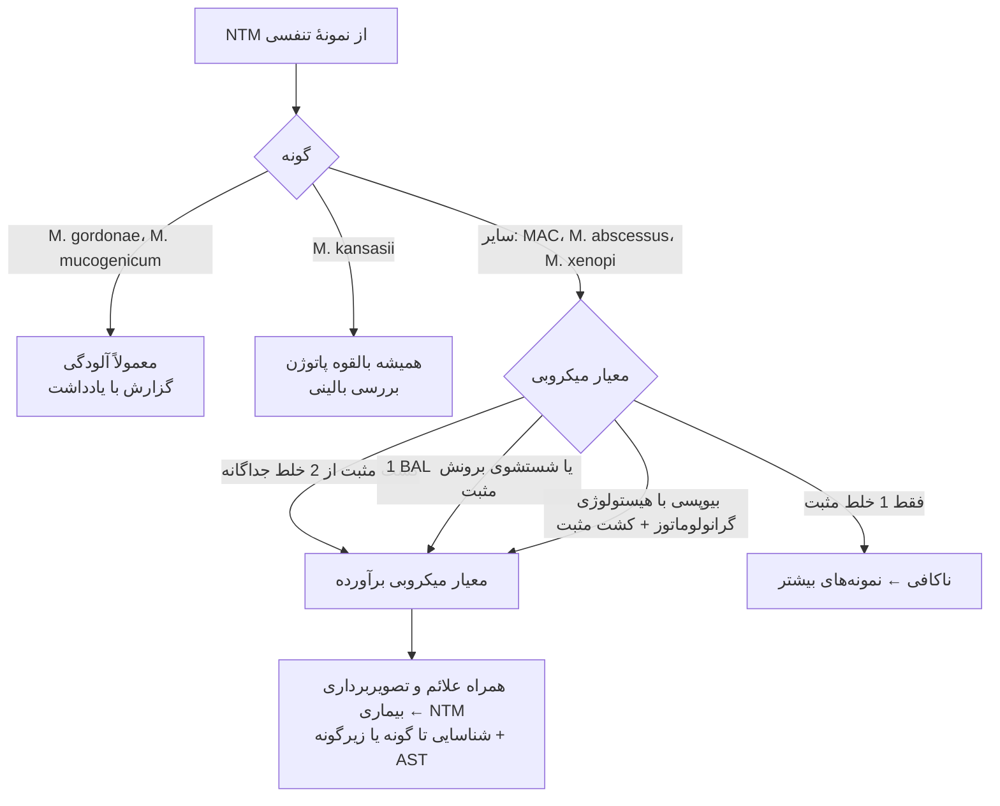

# فلوچارت‌های تشخیصی: مایکوباکتری‌ها

## فلوچارت ۱: از نمونه تا گزارش (شک به سل ریوی)

## فلوچارت ۲: کشت مثبت مایکوباکتری ← شناسایی

## فلوچارت ۳: اهمیت NTM در نمونهٔ تنفسی (معیارهای ATS/ERS/ESCMID/IDSA)

