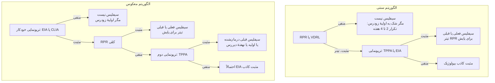
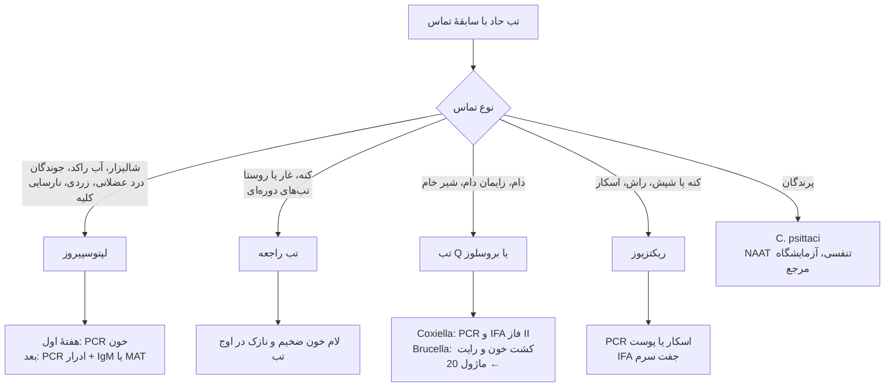
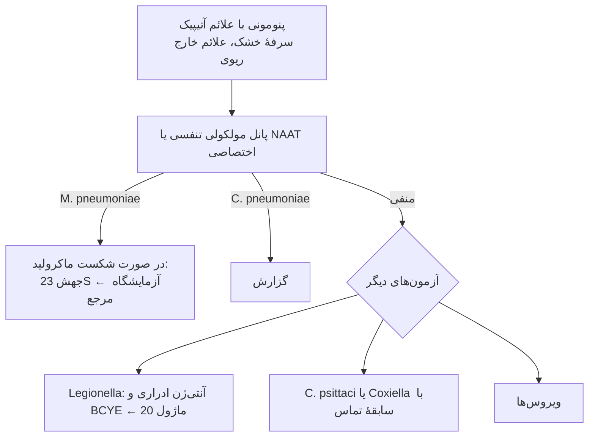

# فلوچارت‌های تشخیصی: باکتری‌های غیرقابل‌کشت یا دشوارکشت

## فلوچارت ۱: سرولوژی سیفلیس — الگوریتم سنتی و معکوس

### منطق
- **الگوریتم سنتی** ارزان است ولی سیفلیس **اولیهٔ زودرس** و **نهفتهٔ دیررس** (RPR منفی) را از دست می‌دهد.
- **الگوریتم معکوس** برای آزمایشگاه‌های پرحجم (خودکار) مناسب است و حساس‌تر است ولی **ناهمخوانی EIA+/RPR−** ایجاد می‌کند که باید با **ترپونمایی دوم** حل شود.

## فلوچارت ۲: تب با سابقهٔ تماس — انتخاب آزمون

## فلوچارت ۳: پنومونی آتیپیک

