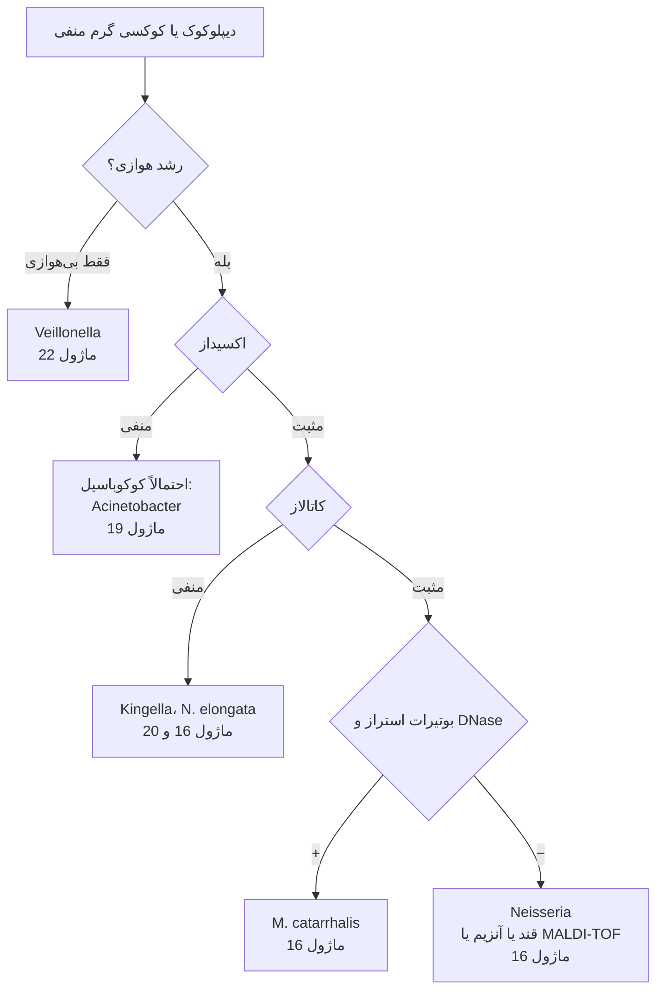

# الگوریتم اصلی: کوکسی‌ها و دیپلوکوک‌های گرم منفی

> **مسیریاب** از رنگ گرم تا ماژول خانواده. ⚠️ دیپلوکوک گرم منفی در **CSF یا خون** ← مقدار بحرانی؛ **همهٔ کار با کلنی در BSC** (*N. meningitidis*) ← [ماژول ۱۶](../../16_Gram_Negative_Cocci/README.md).

## نقاط تصمیم کلیدی
| گام | نکته | ارجاع |
|---|---|---|
| **رنگ گرم** | *Acinetobacter* (کوکوباسیل جفتی، گاه مقاوم به رنگ‌بری) و *Moraxella* شبیه دیپلوکوک دیده می‌شوند | [12/01](../../12_Identification_Tests/01_Microscopy_Stains.md) |
| **اکسیداز** | *Neisseria*/*Moraxella* + ؛ *Acinetobacter* − | [12/02 بخش ۲.۲](../../12_Identification_Tests/02_Spot_Rapid_Tests.md) |
| **کاتالاز** | *Kingella* (روی MTM رشد می‌کند، PRO +) را از گنوکوک جدا می‌کند | [ماژول ۱۶](../../16_Gram_Negative_Cocci/03_Pitfalls_and_Reporting.md) |
| **رنگ گرم ترشح مجرا** | فقط در **مرد علامت‌دار** برای گنوره معتبر است | [ماژول ۱۶](../../16_Gram_Negative_Cocci/02_Flowcharts.md) |

## ماژول‌های مقصد
- [16_Gram_Negative_Cocci](../../16_Gram_Negative_Cocci/README.md) · [19_Non_Fermenters](../../19_Non_Fermenters/README.md) · [20_Fastidious_GNB](../../20_Fastidious_GNB/README.md) · [22_Anaerobes](../../22_Anaerobes/README.md)
- آنتی‌بیوگرام: [گنوکوک و مننگوکوک](../../AST/05_Fastidious_Anaerobes/README.md)
