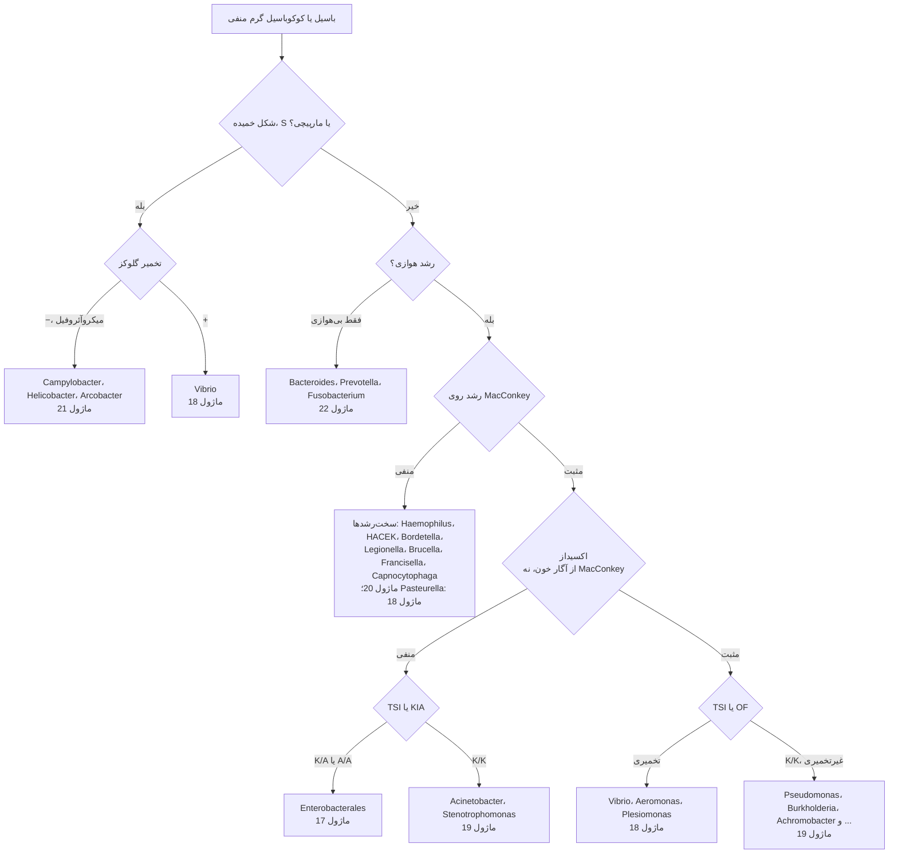

# الگوریتم اصلی: باسیل‌ها و کوکوباسیل‌های گرم منفی

> **مسیریاب** از رنگ گرم تا ماژول خانواده. ⚠️ **ایمنی اول:** کوکوباسیل **بسیار ریز** با رشد **کند** (۴۸–۷۲ ساعت) و **بدون رشد روی MacConkey** ← تا رد *Brucella*/*Francisella* **کار باز ممنوع** ← [ماژول ۲۰](../../20_Fastidious_GNB/02_Flowcharts.md). باسیل اکسیداز + با کلنی چروکیده و **جنتامایسین/کولیستین R** ← *B. pseudomallei* ← [ماژول ۱۹](../../19_Non_Fermenters/README.md).

## نقاط تصمیم کلیدی
| گام | نکته | ارجاع |
|---|---|---|
| **اکسیداز** | از **آگار خون**؛ از TCBS یا MacConkey ← **منفی کاذب** (*Vibrio*، *Aeromonas* به‌اشتباه Enterobacterales) | [ماژول ۱۸](../../18_Oxidase_Positive_Fermenters/03_Pitfalls_and_Reporting.md) |
| **TSI/KIA** | خوانش در **۱۸–۲۴ ساعت**؛ K/K = غیرتخمیری | [11/08 بخش ۸.۱](../../11_Culture_Media/08_Biochemical_Tube_Media.md) |
| **MacConkey منفی** | سخت‌رشد یا *Pasteurella*؛ هشدار ایمنی برای *Brucella* | [ماژول ۲۰](../../20_Fastidious_GNB/README.md) |
| ***Plesiomonas*** | تنها Enterobacterales **اکسیداز +** | [ماژول ۱۸](../../18_Oxidase_Positive_Fermenters/01_Differential_Tables.md) |
| **دیده نشدن در رنگ گرم** | *Legionella* کم‌رنگ؛ *Mycoplasma*، *Chlamydia*، اسپیروکت‌ها **دیده نمی‌شوند** | [ماژول ۲۴](../../24_Non_Culturable/README.md) |

## ماژول‌های مقصد
- [17_Enterobacterales](../../17_Enterobacterales/README.md) · [18_Oxidase_Positive_Fermenters](../../18_Oxidase_Positive_Fermenters/README.md) · [19_Non_Fermenters](../../19_Non_Fermenters/README.md) · [20_Fastidious_GNB](../../20_Fastidious_GNB/README.md) · [21_Curved_GNB](../../21_Curved_GNB/README.md) · [22_Anaerobes](../../22_Anaerobes/README.md) · [24_Non_Culturable](../../24_Non_Culturable/README.md)
- آنتی‌بیوگرام: [نقاط برش گرم منفی](../../AST/09_Breakpoints/01_Gram_Negative.md) · [بتالاکتامازها](../../AST/02_Beta_Lactamases/README.md)
