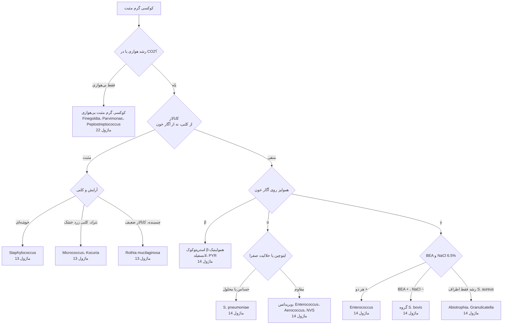

# الگوریتم اصلی: کوکسی‌های گرم مثبت

> **مسیریاب** است، نه شناسایی کامل: از رنگ گرم و چند تست اولیه به **ماژول خانوادهٔ درست** می‌رسد. جدول‌ها، دام‌ها و گزارش‌دهی در خود ماژول‌ها است.

## نقاط تصمیم کلیدی
| گام | چرا مهم است | ارجاع |
|---|---|---|
| **کاتالاز** | استاف/میکروکوک را از استرپ/انتروکوک جدا می‌کند؛ کاتالاز از آگار خون **مثبت کاذب** می‌دهد | [12/02 بخش ۲.۱](../../12_Identification_Tests/02_Spot_Rapid_Tests.md) |
| **هوازی‌تحملی** | کوکسی‌های بی‌هوازی در کشت هوازی رشد نمی‌کنند | [12/03 بخش ۳.۸](../../12_Identification_Tests/03_Disk_and_Growth_Tests.md) |
| **همولیز** | β ← استرپ‌های پیوژن؛ α ← پنوموکوک/ویریدانس؛ γ ← انتروکوک | [11/01](../../11_Culture_Media/01_Basic_Enriched.md) |
| **کوکوباسیل کاتالاز + در زنجیره** | ممکن است ***Listeria*** باشد، نه استرپ | [ماژول ۱۵](../../15_Aerobic_GPB/README.md) |

## ماژول‌های مقصد
- [13_GPC_Catalase_Positive](../../13_GPC_Catalase_Positive/README.md) · [14_GPC_Catalase_Negative](../../14_GPC_Catalase_Negative/README.md) · [22_Anaerobes](../../22_Anaerobes/README.md)
- آنتی‌بیوگرام: [AST/03_Other_Resistance](../../AST/03_Other_Resistance/README.md)
