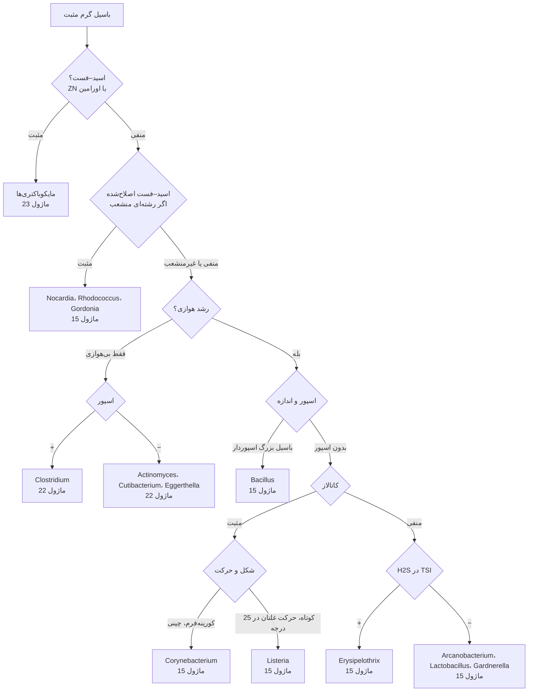

# الگوریتم اصلی: باسیل‌های گرم مثبت

> **مسیریاب** از رنگ گرم تا ماژول خانواده. ⚠️ در شک به ***Bacillus anthracis*** (کلنی بزرگ غیرهمولیتیک، بی‌حرکت، چسبنده) پیش از هر آزمون دیگر ← **توقف و BSC** ← [ماژول ۱۵](../../15_Aerobic_GPB/README.md).

## نقاط تصمیم کلیدی
| گام | نکته | ارجاع |
|---|---|---|
| **اسید–فست کامل در برابر اصلاح‌شده** | مایکوباکتری‌ها با ZN؛ *Nocardia* فقط با رنگ‌بر ضعیف (H₂SO₄ ۱٪) | [12/01 بخش ۱.۲](../../12_Identification_Tests/01_Microscopy_Stains.md) |
| **هوازی‌تحملی** | *C. tertium* در هوا رشد می‌کند (بدون اسپور، **کاتالاز −**)؛ *Actinomyces*، *Cutibacterium* اغلب در CO₂ | [12/03 بخش ۳.۸](../../12_Identification_Tests/03_Disk_and_Growth_Tests.md) |
| **گرم‌متغیر بودن** | *Clostridium ramosum* و برخی *Bacillus* گرم منفی دیده می‌شوند ← **دیسک ونکومایسین ۵ µg** ([12/03 بخش ۳.۴](../../12_Identification_Tests/03_Disk_and_Growth_Tests.md)) یا **KOH ۳٪** ([12/01 بخش ۱.۳](../../12_Identification_Tests/01_Microscopy_Stains.md)) | |
| **«دیفتروئید» در نمونهٔ استریل** | ممکن است *Listeria* (CSF، بارداری) یا *C. jeikeium* (کاتتر) باشد | [ماژول ۱۵](../../15_Aerobic_GPB/03_Pitfalls_and_Reporting.md) |

## ماژول‌های مقصد
- [15_Aerobic_GPB](../../15_Aerobic_GPB/README.md) · [22_Anaerobes](../../22_Anaerobes/README.md) · [23_Mycobacteria](../../23_Mycobacteria/README.md)
- آنتی‌بیوگرام: CLSI **M45** و **M24** ← [AST/05](../../AST/05_Fastidious_Anaerobes/README.md) · [AST/06](../../AST/06_Mycobacteria/01_Mycobacteria_AST.md)
