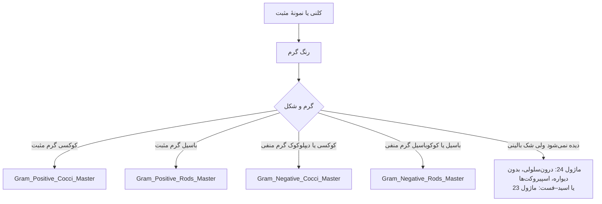

# الگوریتم‌های اصلی: از رنگ گرم تا ماژول خانواده

> نقطهٔ شروع برای **کلنی ناشناخته**. هر الگوریتم اصلی با چند تست ساده (اکسیداز، کاتالاز، TSI، رشد روی MacConkey، هوازی‌تحملی) به **ماژول خانوادهٔ مناسب (۱۳ تا ۲۴)** می‌رسد؛ شناسایی تا گونه، دام‌ها و گزارش‌دهی در همان ماژول است.

| رنگ گرم | الگوریتم | ماژول‌های مقصد |
|---|---|---|
| کوکسی گرم مثبت | [Gram_Positive_Cocci_Master](Gram_Positive_Cocci_Master.md) | ۱۳، ۱۴، ۲۲ |
| باسیل گرم مثبت | [Gram_Positive_Rods_Master](Gram_Positive_Rods_Master.md) | ۱۵، ۲۲، ۲۳ |
| کوکسی/دیپلوکوک گرم منفی | [Gram_Negative_Cocci_Master](Gram_Negative_Cocci_Master.md) | ۱۶، ۱۹، ۲۰، ۲۲ |
| باسیل/کوکوباسیل گرم منفی | [Gram_Negative_Rods_Master](Gram_Negative_Rods_Master.md) | ۱۷ تا ۲۲، ۲۴ |

## قواعد مشترک
- **رنگ گرم را با کشت تطبیق دهید:** ارگانیسم دیده‌شده در اسمیر که رشد نکرده ← بی‌هوازی، سخت‌رشد، یا غیرقابل‌کشت.
- **ارگانیسم‌های گرم‌متغیر:** *Acinetobacter*، *Gardnerella*، *Mobiluncus*، *C. ramosum*، برخی *Bacillus* ← KOH ۳٪ یا دیسک ونکومایسین ← [12/01](../../12_Identification_Tests/01_Microscopy_Stains.md)، [12/03](../../12_Identification_Tests/03_Disk_and_Growth_Tests.md).
- **ایمنی پیش از شناسایی:** هشدارهای *B. anthracis*، *Brucella*، *Francisella*، *Y. pestis*، *B. pseudomallei*، *N. meningitidis* و MTB در هر الگوریتم آمده‌اند ← کار در **BSC** و ارجاع (Sentinel).
- **MALDI-TOF** میان‌بر بیشتر شاخه‌هاست، به‌جز ارگانیسم‌های خطرناک بالا و محدودیت‌های شناخته‌شده ← [12/05](../../12_Identification_Tests/05_Identification_Systems.md).
